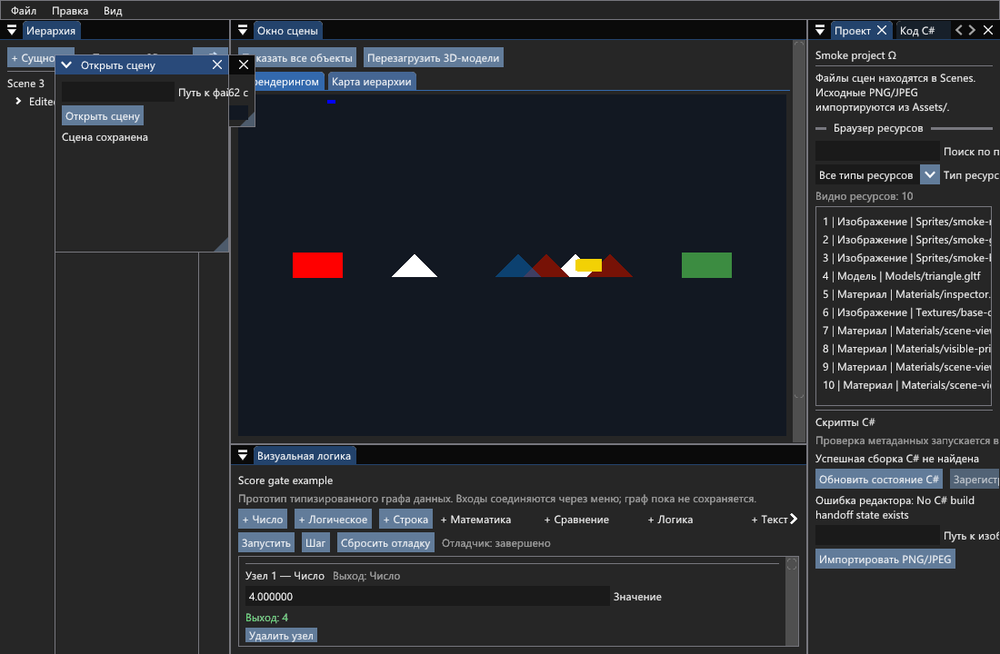

# AstroEngine

В подэтапе 09.3n Hierarchy получила групповое переподчинение: Ctrl+Click формирует выбор, перетаскивание переносит выбранные верхние корни одной транзакцией `entity.reparent_many`. Локальные Transform сохраняются, выбранные предок и потомок не переносятся дважды, Undo/Redo отменяет или повторяет всю группу. Smoke проверяет ввод, историю и сохранение/повторное открытие сцены; подробности — [отчёт 09.3n](docs/reports/09.3n-group-reparent.md).

Подэтап 09.3p добавил групповой Inspector для локального Transform: смешанные значения отмечаются явно, поля изменяются относительно родителя, а применение всей группы использует одну транзакцию с Undo/Redo и сохранением сцены. Редакторы остальных компонентов относятся только к основному выбранному объекту. См. [отчёт 09.3p](docs/reports/09.3p-multi-transform-inspector.md).

Подэтап 09.2 добавляет локальный read-only Codex adapter: он отдаёт снимок активной загруженной сцены и каталог зарегистрированных команд, а также проверяет ссылки команд в описательном плане. Адаптер не подключён к сетевому/JSON-транспорту, не читает дерево файлов и не исполняет план. Подробности и ограничения — в [AI integration](docs/AI_INTEGRATION.md) и [отчёте 09.2](docs/reports/09.2.md).

Срезы 09.3b–09.3g расширяют панель **AI Change Review**: она показывает diff переименования сущности или видимости уже назначенного SpriteRenderer, а также позволяет проверить и подтвердить создание встроенного 3D-примитива, Camera3D и изменения её объектива/активного выбора. До подтверждения Scene не меняется; после применяется существующая транзакционная команда с Undo/Redo и сохранением сцены. В 09.3i добавлена typed-транзакция `entity.set_transform`, а 09.3j подключает к ней AI review: пользователь редактирует локальные позицию, вращение и масштаб, просматривает diff и подтверждает применение. Для сущности с Camera3D UI отдельно показывает вычисленную мировую позицию, цель и up-вектор. Перед подтверждением сверяется ID Transform и вся цепочка родителей; устаревший preview отклоняется. См. [Command API](docs/COMMAND_API.md), [интеграцию AI](docs/AI_INTEGRATION.md) и [отчёт 09.3j](docs/reports/09.3j-transform-review.md).

В 09.3k AI Change Review также умеет предложить нового родителя сущности и показать число затрагиваемых потомков. После подтверждения команда `entity.reparent` сохраняет локальный Transform и связи внутри поддерева; мировая поза вычисляется по новой иерархии. Preview перед применением повторно сверяет исходную/целевую цепочки и снимок всего поддерева, поэтому устаревшее предложение отклоняется. Для сущностей с Camera3D показываются мировые позы до/после. Это операция текущего Scene и локальный UX внутри Editor, не граница безопасности. См. [Command API](docs/COMMAND_API.md), [AI Integration](docs/AI_INTEGRATION.md) и [отчёт 09.3k](docs/reports/09.3k-entity-reparent-review.md).

07.2cd assessed Scene/Game transparency and presentation. Current BGFX 3D BLEND shaders encode RGB before blending into ordinary BGRA8, so the overlap is not linear-light correct; the opaque viewport is then passed through ImGui unchanged. BGFX in the local cache exposes a capability-gated sRGB attachment path, but it is not yet tested on this adapter. 2D sprite textures/tints must join any color-managed target change to avoid double encoding. No runtime behavior changed. Baseline focused Release CTest: **14/14 passed**. See [07.2cd assessment](docs/reports/07.2cd-alpha-blend-target-assessment.md).

07.2cc corrected the optional BGFX color transfer path: CPU-prepared base-color textures stay linear BGRA8, shader decode is no longer repeated, material factors are applied once, and shaders encode RGB for ordinary BGRA8 output. A Windows x64/D3D11 GPU screenshot smoke verifies four production shader paths exactly: unlit texture 93, lit texture 66, unlit vertex-color 128, lit vertex-color 66. Full Release CTest: **110 passed, 0 failed, 1 skipped of 111** (mixed-DPI display pair unavailable). BGFX alpha blending into ordinary BGRA8 remains a known color-management limitation; this is not PBR or cross-backend validation. See [07.2cc report](docs/reports/07.2cc-bgfx-color-transfer.md).

В 07.2bu Runtime BGFX Game View поддерживает ограниченный MASK-путь для base-color материалов: alpha cutoff применяется в текстурированном и vertex-color shader, а texture mip chain строится с сохранением alpha coverage. Детерминированный Play smoke с прозрачным checker подтвердил 2 BGFX texture submissions, отсутствие fallback и видимые cutout texels. Windows x64/D3D11 полный CTest: **108 passed, 1 skipped из 109**. BLEND и прочие неподдержанные PBR/UV пути остаются на Editor renderer. [Отчёт 07.2bu](docs/reports/07.2bu-runtime-bgfx-mask.md).

В 07.2bt Runtime BGFX Game View проверяет все четыре glTF mip min-filter mode на сильно уменьшенной checker-текстуре: `NEAREST_MIPMAP_NEAREST` (9984), `LINEAR_MIPMAP_NEAREST` (9985), `NEAREST_MIPMAP_LINEAR` (9986), `LINEAR_MIPMAP_LINEAR` (9987). Фильтры реально передаются в sampler, тест также сверяет диапазон видимых пикселей текстуры. Windows x64/D3D11 Release: четыре новых smoke прошли; финальный полный повтор — **107 passed, 1 skipped из 108**. Предыдущий единичный сбой `editor.asset_model_preview.smoke` не воспроизвёлся в 10 повторах и повторном полном CTest; код не менялся. Mixed-DPI пропущен без подходящих дисплеев. [Отчёт 07.2bt](docs/reports/07.2bt-runtime-bgfx-mipmap-comparison.md).



Для встроенных 3D-примитивов Inspector позволяет назначить зарегистрированный проектный материал. Назначение сохраняется, поддерживает Undo/Redo и используется в Scene/Game View. См. [3D rendering](docs/3D_RENDERING.md) и [формат сцен](docs/FILE_FORMATS.md).

Подготовка 3D объектов из Scene выделена в backend-neutral CPU render packet. При включённом `ASTRO_BUILD_RUNTIME_BGFX_3D` Game View во время Play передаёт поддерживаемые opaque сцены BGFX adapter. Для project и local external glTF base-color textures поддерживаются UV0 и четыре min-фильтра mip-chain в ограниченном opaque subset; alpha/PBR/UV-transform пути остаются на Editor renderer. WIC читает внешние пути после canonical containment check внутри `Assets`. Runtime Game View smoke проверяет фактическую mip-текстуру и цветной результат; подробности — [07.2bs](docs/reports/07.2bs-runtime-bgfx-mipmap.md), [07.2bq](docs/reports/07.2bq-runtime-bgfx-gltf-source-texture.md) и [07.2bp](docs/reports/07.2bp-runtime-bgfx-textured-game-view.md).

В Hierarchy можно добавить встроенные 3D-фигуры через меню «+ Примитив 3D»: куб, плоскость, сферу или цилиндр. Выбранную форму и видимость можно менять в Inspector; размер и положение задаются через Transform. Создание, изменение и удаление поддерживают Undo/Redo. Геометрия создаётся в памяти, файлы в `Assets` не создаются. Подробности: [3D rendering](docs/3D_RENDERING.md), [отчёт 07.2bf](docs/reports/07.2bf-primitive-inspector-authoring.md).

В «Открыть проект» кнопка «Обзор…» выбирает файл `project.astro`. В «Новый проект» она выбирает существующий родительский каталог; редактор создаёт в нём новую папку с указанным именем проекта. Если папка с таким именем уже есть, она не перезаписывается. Проверка: [07.2bc](docs/reports/07.2bc-project-path-browse.md).

В 07.2bb правый orbit и средний pan основной Scene View продолжаются после выхода курсора за viewport, если drag начат внутри; отпускание завершает capture, внешние нажатия игнорируются. SDL smoke подтверждает `sceneViewRightDrag=1`, `sceneViewMiddleDrag=1`, `sceneViewOutsidePressIgnored=1`, `sceneViewDragReleased=1`. Windows x64 Release/BGFX D3D11: focused CTest **5/5 за 6,24 с**, полный **96/96 за 129,49 с**. Ввод синтетический, через SDL/ImGui очередь; физическая мышь и другие backends не проверялись. [Отчёт 07.2bb](docs/reports/07.2bb-scene-view-drag-capture.md).

В 07.2ba правый orbit и средний pan выбранной модели в Project продолжаются при выходе курсора за изображение, если drag начался внутри preview. Нажатие снаружи не начинает вращение/сдвиг; отпускание и смена asset сбрасывают захват. SDL smoke подтвердил все четыре условия (`sdlRightDrag=1`, `sdlMiddleDrag=1`, `outsidePressIgnored=1`, `dragReleased=1`), 2 234 пикселя модели. Release CTest: focused **5/5 за 9,39 с**, полный **96/96 за 129,06 с**. Синтетический SDL input, не физическая мышь. [Отчёт 07.2ba](docs/reports/07.2ba-project-preview-drag-capture.md).

В 07.2az расширен model preview smoke: изолированный 864×608 Editor принимает через SDL/ImGui раздельные synthetic right-drag и middle-drag события; тест подтвердил изменение yaw и focus камеры (`sdlRightDrag=1`, `sdlMiddleDrag=1`). Модель осталась видимой — screenshot crop 2 313 пикселей. Release сборка успешна, focused CTest **5/5 за 9,22 с**, полный **96/96 за 128,57 с**. Это автоматизированный SDL event-path тест, не физический mouse input. [Отчёт 07.2az](docs/reports/07.2az-project-preview-mouse-input.md).

В 07.2ay исправлена прокрутка Project dock после resize: при изменении размера панели прокрутка снова позиционирует выбранный model viewport. Release smoke теперь заканчивает при 864×608 и сверяет полный прямоугольник изображения с активной ImGui clip area; подтверждено `viewportFullyVisible=1`, 2 202 видимых пикселя модели при UI scale 1,25. Сборка прошла, focused CTest **5/5 за 9,44 с**, полный **96/96 за 129,11 с**. Лог проверки: [07.2ay](docs/reports/07.2ay-project-preview-resize.md).

В 07.2ax вручную открыт изолированный Project glTF preview с двумя разнесёнными primitives и source material; реальное колесо мыши меняло масштаб. Preview в узкой панели сохраняет aspect 4:3. Подтвердить orbit/pan правой/средней кнопкой средствами текущей UI automation нельзя; поддерживается только левый drag. Пользовательские OBJ/FBX проверены только на наличие, не изменялись и текущим importer-ом не поддерживаются. Полный Release CTest после проверки **96/96 за 122,80 с**; подробности и ограничения — [отчёт 07.2ax](docs/reports/07.2ax-manual-model-preview-review.md).

В 07.2aw smoke проекта теперь проверяет модель с двумя glTF primitives, два BGFX draw submissions, Frame All и фактическое изменение orbit/pan/zoom камеры в изолированном Project viewport. Сцена создаётся во временном каталоге теста. Windows Release focused CTest **5/5 за 16,76 с**, полный CTest **96/96 за 123,28 с**; сборка прошла. Отчёт: [07.2aw](docs/reports/07.2aw-model-preview-controls.md).

В 07.2av выбранная glTF-модель получила отдельный BGFX 3D viewport в Project: камера автоматически кадрирует модель; правая кнопка вращает, средняя сдвигает, колесо приближает/отдаляет. Preview использует отдельные view/framebuffer и GPU cache, не меняет редактируемую сцену и исходники. Windows Release CTest: focused **5/5**, полный **96/96 за 123,80 с**; model screenshot smoke измерил **2 178 видимых пикселей**. Подробности — [отчёт 07.2av](docs/reports/07.2av-project-model-viewport.md).

В 07.2au Project показывает миниатюру выбранного зарегистрированного изображения и статистику геометрии выбранной модели (meshes, primitives, vertices, indices). Для моделей это информационный обзор, не отдельный 3D viewport. Изображение читается из проверенного cache, glTF — через текущий importer; исходные Assets не изменяются. Windows Release CTest: focused **5/5**, полный **96/96 за 131,11 с**; логи и ограничения — [отчёт 07.2au](docs/reports/07.2au-asset-previews.md).

В 07.2at окно Project получило первый read-only Asset Browser: он показывает зарегистрированные images, models, materials и scripts, ищет по UTF-8 подстроке пути или десятичному AssetId и фильтрует по типу. Каталог строится из AssetRegistry, сортируется по ID и использует clipping списка. Он не сканирует диск, не открывает и не изменяет ресурсы. Детали — [отчёт 07.2at](docs/reports/07.2at-read-only-asset-browser.md).

В 07.2as диагностика Game View может выбрать зарегистрированную модель или материал в Project: отображаются тип, AssetId и registry-relative source path. Ссылка показывается только после повторной проверки активного корня проекта и AssetRegistry; отсутствующие ресурсы остаются без ссылки. Файлы не открываются и не изменяются. Windows Release CTest прошёл **93/93**; подробности и ограничения — [отчёт 07.2as](docs/reports/07.2as-game-view-registered-asset-navigation.md).

В 07.2ao Game View выводит 3D MeshRenderer из активной Camera3D: world-поза камеры иерархически компонуется из Transform, а view/projection строятся по размеру framebuffer. Scene View сохраняет отдельную orbit-камеру; 2D-спрайты Game View остаются ортографическим overlay. Release CTest прошёл **89/89 за 116,02 с**. Ограничения BGFX-пути и отсутствие Game View material rendering записаны в [отчёте 07.2ao](docs/reports/07.2ao-active-camera-game-view.md).

В 07.2ap Game View показывает локализованную диагностику 3D поверх кадра. Release smoke проверяет отсутствие активной камеры и вырожденный Transform камеры, а unit-тест — русский текст диагностик. Результаты и ограничения записаны в [отчёте 07.2ap](docs/reports/07.2ap-game-view-diagnostics.md).

В 07.2aq диагностики 3D Game View также появляются в общем окне Diagnostics. Для ошибки активной камеры Console может выбрать её сущность и перевести Hierarchy к ней; если активной камеры нет, показывает и позволяет выбрать Camera3D-кандидатов. Полный отчёт: [07.2aq](docs/reports/07.2aq-game-view-diagnostics-console-navigation.md).

В 07.2ar ошибки подготовки конкретного 3D mesh/material в Game View показывают связанную сущность и позволяют перейти к ней в Hierarchy. Сообщения без достоверного EntityId остаются без ссылки; рендеринг остальных объектов продолжается. [Отчёт 07.2ar](docs/reports/07.2ar-game-view-mesh-diagnostic-navigation.md).

В 07.2an Inspector позволяет добавлять/удалять Camera3D, редактировать lens-поля через typed transactional commands с Undo/Redo и назначать единственную активную камеру; формат Scene v9 мигрирует v8 Camera3D v1 как неактивную. Smoke и integration-тесты проверяют UI, выбор, сериализацию и транзакции. [Отчёт 07.2an](docs/reports/07.2an-active-camera-inspector.md).

В 07.2am добавлена сохраняемая основа 3D камеры на уровне сцены: Camera3D хранит поле зрения и near/far clipping planes, а поза остаётся у существующего Transform сущности. Scene-файл обновлён до v8; файлы v1–v7 читаются без добавления камеры и переписываются только при явном сохранении. Обнаружено и исправлено отсутствие Ninja header dependencies при русской локали MSVC: для неё задаётся `ASTRO_MSVC_SHOWINCLUDES_PREFIX`. Полная чистая Release сборка и CTest прошли **88/88**. [Отчёт 07.2am](docs/reports/07.2am-scene-camera-component.md).

В 07.2al добавлен автоматический mixed-DPI smoke реального SDL окна: тест находит подключённые дисплеи с разными content scale, переносит Editor между ними и подтверждает фактический scale ImGui в обоих направлениях. На текущей машине переход `1@1.25 → 2@1.0 → 1@1.25` прошёл; вперёд SDL display/scale events не пришли, поэтому per-frame опрос масштаба остался необходимым fallback, а обратный переход сообщил оба события. После проверки настроек Release CTest повторно прошёл **88/88 за 113,63 с**. Scale, разрешение и ориентация активного дисплея в Settings недоступны; глобальный Custom scaling не менялся, полный прогон при 100% не подтверждён. [Отчёт 07.2al](docs/reports/07.2al-mixed-dpi-window-transition.md).

В 07.2ak исправлена проверка компактного Scene/Game smoke: при 125% оба alpha-ramp теста проходят, а общая 2D-проверка больше не требует видеть спрайты, перекрытые 3D-мешами в compact Scene View; обычный `editor.smoke` продолжает проверять красный, синий и blend маркеры. Геометрическое ограничение окна вынесено в unit policy и подтверждается SDL display-change smoke. Windows Release: полный CTest **87/87 за 108,06 с** на фактическом `displayScale=1.25`. Вернуть системный масштаб в Settings не удалось: список масштаба открывал страницу Custom scaling с пустым полем; это поле не применялось. Поэтому полный регресс при 100% после 07.2aj не подтверждён. [Отчёт 07.2ak](docs/reports/07.2ak-window-geometry-and-compact-smokes.md).

В 07.2ai Editor применяет `SDL_GetWindowDisplayScale()` к ImGui шрифту и размерам style. В 07.2aj стартовое окно ограничено рабочей областью дисплея, compact ширина выбирает отдельные dock-пропорции, Game View ограничивается окном. Первый полный прогон 07.2aj при 125% дал 84/86; оба compact alpha smoke затем разобраны и исправлены в 07.2ak. Полный текущий CTest — 87/87 при 125%; подтверждённого прогона после возврата к 100% пока нет. Подробности: [отчёт 07.2aj](docs/reports/07.2aj-responsive-editor-layout.md), [07.2ai](docs/reports/07.2ai-editor-dpi-scaling.md) и [07.2ak](docs/reports/07.2ak-window-geometry-and-compact-smokes.md).

AstroEngine is a universal modular 2D/3D game engine and editor in development. Its intended differentiator is AI-assisted game creation through the same typed project operations used by the GUI, with reviewable changes, validation and tests. Puzzle is the current vertical-slice example, not the product's genre limit. Unity/Godot/Unreal/CryEngine are long-term breadth references; current implementation status is recorded below and in [PRODUCT_REQUIREMENTS.md](docs/PRODUCT_REQUIREMENTS.md).

The optional 07.1 3D prototypes add bounded glTF static geometry import and Scene references, plus an Editor-only BGFX preview in Scene View. In 07.1g, right-drag orbits, middle-drag pans, the wheel zooms, and **Frame All** fits visible mesh bounds after hierarchy transforms. The 07.1h smoke checks two visible meshes, an unresolved asset diagnostic, their combined framing, and coarse mesh pixel coverage inside a cropped Scene View screenshot. The 07.1i `astro_editor.exe --benchmark-3d` profile measures mesh CPU preparation/submission and full Editor frame timings on deterministic scenes with 1/100/500/1000 meshes; on the current Windows D3D11 host, the 1000-mesh Scene View pass used 1.42–1.60 ms CPU p50 and the complete editor frame remained about 16.65–16.68 ms p50 with VSync. These are machine-specific observations, not performance budgets. 07.2b adds the versioned material value format and registry; 07.2c imports a supported glTF metallic-roughness subset, primitive material indices, and typed source image references. 07.2d adds a project material override on a Scene primitive, a typed Undo/Redo command, and Scene v7 migration; 07.2e exposes the source slot, registered material choices, and link diagnostics in Inspector. 07.2f adds a separate standalone BGFX flat-tint smoke, and 07.2g adds validated optional normals and UV0 to mesh import. 07.2h adds shared bounded WIC decoding and a BGFX base-color texture sampling smoke. 07.2i tests sRGB decoding, linear `baseColorFactor` multiplication, linear BGRA8 preparation and sRGB backbuffer output. In 07.2j–07.2k, Editor Scene View previews a project override or glTF source base-color material with vertex-color fallback and diagnostics. 07.2l makes the active preview source visible in Inspector. 07.2m assessed sampler support; 07.2n applies glTF source base-color wrap/filter and `KHR_texture_transform`; 07.2o adds v2 project material sampler/UV authoring with v1 read migration and explicit safe save. 07.2p adds bounded linear-space mip generation and a shared, reference-counted Scene View texture cache for all six minification filters. 07.2q assessed alpha modes and 07.2r implements bounded `OPAQUE`, `MASK` and `BLEND` rendering in the Windows Editor Scene View with stable far-to-near object ordering. 07.2s adds premultiplied-alpha BLEND mips and MASK cutoff-coverage preservation; 07.2t verifies actual D3D11 pixels below, at and above the MASK cutoff; 07.2u tests a split alpha texture at two scales; 07.2v adds checker and center-hole alpha patterns; 07.2w checks coverage precision on binary alpha inputs; 07.2x adds partial-alpha patterns and a cutoff sweep; 07.2y adds two D3D11 Scene View minification smokes using partial alpha; 07.2z tests cutoffs 0.25 and 0.75 at both minification scales. Game View, other texture roles, full PBR, lighting and shadows remain unsupported. See the [3D rendering guide](docs/3D_RENDERING.md), [07.2z report](docs/reports/07.2z-partial-alpha-mask-cutoff-smoke.md), and [07.2z tests](docs/TESTING.md#072z-partial-alpha-mask-cutoff-minification-sweep).

07.2aa проверяет mip-фильтрованный D3D11 MASK на 8-битных alpha-значениях по обе стороны cutoff 0,5: 127/255, 128/255 и 129/255 при UV-scale 2 и 4. 128/255 — первый представимый UNORM8 уровень выше 0,5; точного 0,5 байт не кодирует. [Отчёт](docs/reports/07.2aa-mask-cutoff-edge-smoke.md).

07.2ab проверяет одну mip-фильтруемую текстуру с вертикальными alpha-полосами 127/128/129/127 при cutoff 0,5 и UV-scale 2/4: в обоих запусках MASK-области сосуществуют с видимой подложкой через отброшенные полосы. Это smoke текущего Windows D3D11 пути, не golden image или проверка точного mip LOD. [Отчёт](docs/reports/07.2ab-mixed-mask-boundary-smoke.md).

07.2ac проверяет гладкую alpha-рампу 112–143 около cutoff 0,5 с mip-фильтрацией на UV-scale 2/4; оба smoke подтверждают MASK и проходящую подложку. Результат относится только к текущей Windows D3D11 Scene View. [Отчёт](docs/reports/07.2ac-mask-cutoff-transition-smoke.md).

07.2ad добавляет 64 пространственные колонки к ramp smoke и проверяет, что на стороне alpha ниже cutoff преобладает blend-through, а на стороне выше — MASK, с повторным чередованием после Repeat UV scale. Валидация остаётся count-based и ограничена текущим Windows D3D11. [Отчёт](docs/reports/07.2ad-mask-spatial-transition.md).

07.2ae прогоняет near/far spatial MASK ramp smoke на окнах 900×650, 1100×720 и 1440×900; последний запрашивает high-pixel-density SDL surface. Проверка перешла на относительную плотность пикселей в bins. Все 6 вариантов прошли, полный Release CTest — 84/84. Текущий экран сообщил density 1.0, поэтому проверка другого физического DPI ещё требуется. [Отчёт](docs/reports/07.2ae-window-density-spatial-smoke.md).

Начало разработки модульного 2D/3D-движка на C++20. Headless-приложение выводит информацию о запуске. В `astro_core` есть базовые сервисы, ModuleRegistry, typed EventBus, TimeService/fixed timestep, typed CommandRegistry и in-memory транзакции/Undo/Redo. Optional Windows editor показывает Hierarchy, Inspector с Name и SpriteRenderer, сохраняет Astro Scene v7 и показывает WIC image preview. Scene v7 хранит ScriptBehavior-ссылки; Asset index v4 объединяет IDs ресурсов и разрешает зарегистрированный Script AssetId в source/type/assembly/runtimeconfig. При включённом optional C# host Editor после односессионного согласия запускает lifecycle enabled ScriptBehavior в изолированном Play. Подэтап 04.15 добавил базовую C# Code workspace для файлов проекта: просмотр `Scripts/**/*.cs`, создание/открытие/сохранение UTF-8, подтверждение при переключении грязного документа и запуск существующей сборки с диагностикой/переходом к строке. Редактор не имеет подсветки синтаксиса, LSP или отладчика; C# build доступен только в конфигурации с локальным SDK/host support. Core API поддерживает nested prefabs, overrides и обновление экземпляров; UI управления префабами ещё нет. Scene/Game View отображают иерархические SpriteRenderer; Game View поддерживает изолированный Play и optional Puzzle sample с ручными SaveStore-слотами. Это не полноценные игровые шаблоны. WIC loader пока ограничен Windows.

Для editor integrations доступен начальный in-process C++ `AIEditorApi`: каталог реально зарегистрированных команд, typed validation и вызов через общий CommandRegistry. Это пока не Codex adapter, JSON/network API или security boundary; детали и ограничения в [COMMAND_API.md](docs/COMMAND_API.md) и [AI_INTEGRATION.md](docs/AI_INTEGRATION.md).

В продуктовое ТЗ внесено P15: отдельная встроенная Code workspace для ручного редактирования игровых скриптов на C#. В 04.5–04.6 проверен экспериментальный Windows x64 C++ host через .NET `hostfxr` и versioned ABI v1. В 04.7 Scene v5 сохраняет ScriptBehavior; 04.8–04.10 связывают его с project build; 04.12 добавил одноразовое Editor-согласие; 04.13 подключил lifecycle в RuntimeSession. Подэтап 04.15 добавил базовый текстовый workflow для C# файлов. Sandbox, hot reload, LSP/отладчик и cross-platform host пока отсутствуют. Host остаётся опциональным (`ASTRO_BUILD_CSHARP_RUNTIME=OFF` по умолчанию). Подробности: [C# scripting API](docs/CSHARP_SCRIPTING_API.md) и [отчёт 04.15](docs/reports/04.15-csharp-code-workspace.md).

Windows Editor позволяет переключать интерфейс English/Russian через **Edit → Settings… → Language → Русский → Apply**; выбор сохраняется в каталоге пользователя SDL. SDL Game UI demo предоставляет отдельный переключатель языка на экране Settings и сохраняет его там же, вне проекта и игровых данных. Границы перевода и поведение системных диагностик описаны в [руководстве по языку](docs/LOCALIZATION.md).

В 00.2 добавлены локальные проверки с JSON-отчётом, настройка форматирования и опциональный статический анализ. Фактические результаты и ограничения: [отчёт 00.2](docs/reports/00.2.md). Подэтапы ядра 01.1–01.5 покрыты в [отчётах](docs/reports/).

## Сборка на Windows 11

Нужны CMake 3.20+, Ninja и настроенный C++20-компилятор с Windows SDK. Для MSVC используйте Developer PowerShell/Command Prompt x64. Windows x64 Debug-сборка и CTest подтверждены в Visual Studio 2022 Build Tools; актуальные результаты этапов указаны в `docs/reports/`. Эти инструменты не устанавливаются проектом.

```powershell
Set-Location 'C:\Users\zheka\Desktop\gpt\AstroEngine'
cmake --preset windows-debug
cmake --build --preset windows-debug
ctest --preset windows-debug
& '.\build\windows-debug\engine\runtime\astro_headless.exe'
```

Каждую команду выполнять только после успешного завершения предыдущей. Подробности и чистая сборка: [BUILD_GUIDE](docs/BUILD_GUIDE.md).

Ожидаемый вывод headless приложения:

```text
[info] AstroEngine
[info] Mode: headless
[info] Language: C++20
[info] Startup complete
```

## Структура и ограничения

Для полного локального отчёта: `pwsh -NoProfile -File scripts/verify.ps1`. Нужен PowerShell 7+. Код 0 означает прохождение обязательных проверок, 1 — ошибку, 2 — неполную проверку из-за недоступных инструментов. Отчёты и отдельные логи находятся в новом каталоге `build/verification/<UTC-время>-<ID>/` каждого запуска. Скрипт не устанавливает инструменты и не отправляет данные.

Подэтап 06.50 сделал архивирование malformed campaign-transfer journal устойчивее: запись сначала завершается и проверяется во временном файле, затем публикуется атомарно без замены существующего архива. Исходный журнал остаётся для ручного разбора. При аварийном завершении временный остаток не удаляется автоматически; подробности и ограничения — в [SAVE_SYSTEM](docs/SAVE_SYSTEM.md#archive-a-readable-malformed-journal-0644-behavior-revised-in-0645) и [отчёте 06.50](docs/reports/06.50-staged-journal-archive.md).

Подэтап 06.51 проверяет остановку дочернего процесса в середине staging-записи, после проверки до публикации и сразу после публикации. Повторное архивирование сохраняет исходный журнал, slot-файл и прежние staging-остатки. Проверяется процессный сбой, а не потеря питания. См. [отчёт 06.51](docs/reports/06.51-archive-interruption-tests.md).

Оценка 06.52 установила, что чужой файл на итоговом пути архива нельзя распознать по fingerprint или совпадающему префиксу. В 06.53 Editor получил read-only диагностику: показывает ожидаемый путь, тип объекта, размер и сравнение ограниченного содержимого; ссылки не разыменовываются. Конфликт остаётся нетронутым, автоматического удаления/перемещения/замены нет. Подробности и ограничения: [отчёт 06.53](docs/reports/06.53-archive-conflict-diagnostics.md), [D116](docs/DECISIONS.md#d116--read-only-diagnostics-for-archive-conflicts-0653).

В 06.54 оценён будущий способ сохранить неизвестный обычный файл конфликта отдельной копией. Это пока только политика: продукт не создаёт такие копии. Предложение ограничено явным подтверждением, no-follow чтением обычных файлов не больше 4096 байт, новой соседней целью без замены, сохранением оригинала и ручной проверкой. Само копирование не доказывает происхождение файла и не разблокирует исходный путь. См. [отчёт 06.54](docs/reports/06.54-conflict-copy-assessment.md) и [D117](docs/DECISIONS.md#d117--bounded-explicit-copy-of-unknown-archive-occupants-0654-assessment).

В 06.55 реализована отдельная подтверждаемая копия ограниченного файла-конфликта: диалог показывает исходный и целевой путь, размер и предупреждает о неизвестном авторстве. API удерживает no-follow источник, проверяет точные байты и публикует соседнюю копию без замены; исходный конфликт, журнал и slot сохраняются. Копия остаётся непроверенной и не снимает конфликт. Проверены коллизии, устаревший источник, небезопасные типы и завершение процесса до/после публикации. См. [отчёт 06.55](docs/reports/06.55-conflict-copy.md), [D118](docs/DECISIONS.md#d118--explicit-bounded-copy-aside-for-archive-conflicts-0655).

В 06.56 проверен тот же copy-aside путь в Unicode-каталоге `Проверка копии Ω` на Windows и POSIX; байты копии, исходника, журнала и слота совпали с ожиданиями. Подтверждающий диалог вручную осмотрен в изолированном Editor smoke и отменён без копирования. Для повторного визуального просмотра есть тестовый запуск `astro_editor.exe --smoke-inspect-copy-dialog`; он сам использует временную фикстуру и ждёт ручной отмены. См. [отчёт 06.56](docs/reports/06.56-unicode-copy-and-dialog-review.md).

Приложение принимает `--help`; неизвестные или лишние аргументы дают код 2 и сообщение `[error]` в stderr. Обычный запуск возвращает 0; сбой вывода/исключение — 1. Текст stdout получил префикс `[info]`; внешним потребителям точного вывода нужно учитывать этот префикс. Это ранний CLI, не стабильный API движка.

- `engine/runtime/` — минимальная консольная точка входа, не готовый игровой runtime.
- `tests/smoke/` — проверка запуска процесса, кода возврата и вывода.
- `docs/` — требования, архитектура, дорожная карта и фактический статус.

Основная headless-сборка не требует внешних библиотек. Optional Windows editor, графический spike, Game UI demo и экспериментальный 3D BGFX packet adapter используют локальные зависимости из build-кэша. 2D runtime имеет только минимальную AABB физику; общий Play host пока не подключает 3D adapter. AI Editor API остаётся in-process прототипом, поддержка целевых платформ кроме Windows не проверена. Лицензия проекта не выбрана.

См. [архитектуру](docs/ARCHITECTURE.md), [план](docs/ROADMAP.md), [статус](docs/STATUS.md), [решения](docs/DECISIONS.md), [проверки](docs/TESTING.md) и [отчёт 00.1](docs/reports/00.1.md).

Редактор 02.1: [запуск и ограничения](docs/reports/02.1.md). EXE: build/stack-spike/editor/astro_editor.exe.
Редактор 02.2: [модель сцены, Hierarchy и Scene View](docs/reports/02.2.md). Панели позволяют создавать сцену, root/child сущности, выбирать и удалять поддеревья. Scene View показывает структуру, не пространственные объекты.

Подэтап 03.3: [SpriteRenderer и image preview](docs/reports/03.3.md). AssetId сохраняется в сцене, компонент редактируется транзакционной командой; это preview выбранного компонента, не пространственный/runtime renderer.

Подэтап 03.4: [Prefab API](docs/reports/03.4.md). Есть versioned файлы, вложенные ссылки, overrides и update; панели editor для authoring пока отсутствуют.
Редактор 02.3: [Inspector и schema properties](docs/reports/02.3.md). Сейчас схема включает обязательное имя сущности и read-only ID; команда изменения проверяет UTF-8 и ограничение 240 байт.

Подэтап 06.1: optional Editor содержит Visual Logic dataflow prototype с типизированными числами/логическими/текстовыми узлами и пошаговой трассой. Соединения выбираются из типизированного меню; графы пока не сохраняются и не меняют Scene. См. [документацию Visual Logic](docs/VISUAL_LOGIC.md).

Подэтап 06.2: панель `View → UI Editor` создаёт Text/Button/Panel элементы, редактирует тёмную/светлую тему и responsive anchors/offsets, показывает Desktop/Tablet/Phone preview и поддерживает привязки `Entity.Name` и `SpriteRenderer.Visible`. UI-документы пока живут только в памяти редактора и не отображаются в игровой сборке. См. [руководство UI Editor](docs/UI_EDITOR.md).

Подэтап 06.3: панели `View → Timeline` и `View → Camera Presets` редактируют/проигрывают один scalar animation track и вычисляют camera pose через существующие пресеты CameraRig. Это editor preview: animation не привязана к Scene properties, camera pose не рендерится, документы не сохраняются. См. [Timeline](docs/TIMELINE_EDITOR.md) и [Camera Rig](docs/CAMERA_RIG.md).

Подэтап 06.4: окно `View → Save System` позволяет создавать пустые профили, явно выбирать сохраняемые свойства, составлять группы сущностей, подключать правила группы к профилю, настраивать checkpoint и проверять активацию/respawn на копии сцены с временным хранилищем. Данные authoring пока in-memory; ограничения: [Save System Editor](docs/SAVE_SYSTEM_EDITOR.md), результаты: [отчёт 06.4](docs/reports/06.4.md).

Подготовительная основа для 06.5: optional `astro_runtime_render2d`, SDL3 адаптер и отдельный Play preview с fixed-step RuntimeSession, цветной геометрией и root `SpriteRenderer` из AssetRegistry. Детали и ограничения: [RENDERER_2D.md](docs/RENDERER_2D.md).

Для T01 Puzzle есть детерминированный `PuzzleSnapshot`, optional `astro_runtime_puzzle_save` адаптер и Game View preview с фиксированным шагом и ручными слотами только для выбранных свойств. Авторские уровни хранятся в `Puzzle/Levels/<ID>.astro-puzzle-level`; кампании — в `Puzzle/Campaigns/<ID>.astro-puzzle-campaign`. Окно **View → Puzzle Campaign Browser** показывает ссылки и позволяет редактировать порядок, START и переходы; подтверждённое сохранение проходит строгую проверку. Переименование уровня блокируется, если на него ссылается кампания или ссылки не удалось проверить: сначала обновите и сохраните кампанию. Editor Game View запускает кампанию по ID и явно продолжает после достижения цели; при `END` финальная доска остаётся видимой. Теперь в Game View можно вручную сохранять и загружать кампанийный прогресс в слотах 0–9; профиль проверяет ID кампании и уровня, END и Puzzle snapshot. Файлы лежат в SDL user data отдельно от проекта. При смене ID кампании выбирается отдельный namespace без переноса старых слотов. Перенос или копия проекта с `.astro/puzzle-save.settings` сохраняет ту же папку прогресса, поэтому копии делят слоты, пока не задан другой каталог в настройках. Автоматической миграции нет. Это не готовый T01 шаблон. См. [Puzzle Level Authoring](docs/PUZZLE_LEVELS.md), [Puzzle Campaign Format](docs/PUZZLE_CAMPAIGNS.md), [Save System](docs/SAVE_SYSTEM.md) и [отчёты 06.31–06.33](docs/reports/06.31-editor-campaign-progress.md).

### Сцены редактора (02.4)

В редакторе доступны сохранение/открытие сцены (Ctrl+S, Ctrl+O), Undo/Redo (Ctrl+Z, Ctrl+Y или Ctrl+Shift+Z) и панель Diagnostics. Astro Scene v5 сохраняет ID/имена сцены и сущностей, иерархию, Transform, SpriteRenderer AssetId, prefab instance metadata и ScriptBehavior binding records. Загрузчик читает v1–v4; старые файлы переписываются в v5 только при явном сохранении. Asset index v2 добавляет глобальные script AssetIds и разрешение существующей сборки, мигрируя v1 только при явной операции записи. При несохранённых правках переключение проекта/сцены блокируется. Форматы и миграции описаны в [FILE_FORMATS.md](docs/FILE_FORMATS.md).

Каждая новая сущность получает обязательный Transform с позицией, углами Эйлера в градусах и масштабом. Доступен C++ API `scene.transform(entityId)` и `scene.setTransform(entityId, value)`; значения должны быть конечными числами. Пространственный рендеринг и вычисление мировых матриц пока отсутствуют.

### Импорт изображений в проекте (03.2)

`astro_assets` предоставляет `AssetRegistry::open(projectRoot)`, `importImage(relativePath)` и `reimport(AssetId)`. Источники PNG/JPEG должны находиться внутри `Assets/`; их исходные байты не меняются. Индекс стабильных ID находится в `.astro/assets.index`, проверенные исходники зеркалируются по SHA-256 в генерируемый `Library/Assets` (эта папка добавлена в `.gitignore`). Пример и ограничения: [ASSET_PIPELINE.md](docs/ASSET_PIPELINE.md).

Подэтап 03.5: реализованы явный граф AssetId и target-tagged deterministic package из выбранных ресурсов и зависимостей. Формат сохраняет исходные PNG/JPEG bytes; см. [pipeline](docs/ASSET_PIPELINE.md) и [отчёт](docs/reports/03.5.md). Это не полноценный платформенный экспорт.

Подэтап 04.1: появился headless `RuntimeSession` с изолированной Scene-копией и Play/Pause/Resume/Step/Stop. Проверки и границы: [runtime API](docs/RUNTIME.md), [отчёт 04.1](docs/reports/04.1.md). Редакторские кнопки, рендеринг и игровые системы пока не подключены.

Подэтап 04.2: добавлены backend-neutral actions и optional SDL3 adapter для keyboard/mouse/gamepad событий. Тесты и ограничения: [Input Mapping API](docs/INPUT_MAPPING.md), [отчёт 04.2](docs/reports/04.2.md). Профили ввода, editor UI назначения клавиш и другие платформенные adapters не входят в эту реализацию.

Подэтап 04.2: backend-neutral Input Mapping и optional SDL3 adapter для клавиатуры, мыши и геймпада; [описание API](docs/INPUT_MAPPING.md), [отчёт](docs/reports/04.2.md).

Подэтап 04.3: добавлен headless `CameraRig` для camera pose, preset modes, следования за target Transform, smoothing, bounds и zoom. Он не визуализирует изображение и не добавляет camera component в формат Scene. См. [описание](docs/CAMERA_RIG.md) и [отчёт 04.3](docs/reports/04.3.md).

Подэтап 04.3: runtime CameraRig для pose/follow, пресетов, smoothing, границ и zoom. Рендеринг камеры и Scene camera component пока отсутствуют; [API](docs/CAMERA_RIG.md), [отчёт](docs/reports/04.3.md).

Подэтап 04.4: runtime InteractionSystem связывает entity с code-defined InteractableBehavior, проверяет дальность/активацию и публикует события Requested/Activated/Rejected через typed EventBus. Система может менять только переданную runtime Scene; это не сохранённый no-code component. [API и ограничения](docs/INTERACTION_SYSTEM.md), [отчёт](docs/reports/04.4.md).

Подэтап 05.1: `astro_runtime_physics2d` предоставляет fixed-step runtime API для динамических тел, axis-aligned box overlaps, простого solid resolution и collision Enter/Stay/Exit events. Данные пока не сериализуются и не настраиваются через GUI; ограничения и пример: [PHYSICS_2D](docs/PHYSICS_2D.md), [отчёт 05.1](docs/reports/05.1.md).

Подэтап 05.2: `GameUiModel` управляет меню, запуском/паузой `RuntimeSession`, HUD и настройками. 05.3 добавляет match-three rules, scalar animation sampling и optional SDL3 cues; 05.4 — selective save slots; 05.5 — runtime checkpoint triggers и respawn поверх явно выбранного SaveProfile. В 05.7 в Game UI demo появилась Puzzle-доска, 05.8 подключил авторские campaign-файлы, а 05.9 добавил ручное сохранение выбранного прогресса кампании в standalone runtime. См. [Save System и Checkpoints](docs/SAVE_SYSTEM.md), [Puzzle campaigns](docs/PUZZLE_CAMPAIGNS.md) и [отчёт 05.9](docs/reports/05.9-campaign-progress-save.md).

Подэтап 05.6 упаковывает Game UI runtime demo в Windows ZIP с README и лицензиями SDL3/ImGui. В 05.10 к архиву добавлены пример кампании в `game-data/puzzle-campaign` и launcher `launch_puzzle_campaign.cmd`, запускающий пример относительно расположения самого архива. Demo вручную сохраняет выбранный прогресс в пользовательском каталоге. ZIP не содержит редактора, build tools или произвольный проект; полноценный экспорт и завершённая 2D-игра остаются незавершёнными. Чистая распаковка проверяет меню и bundled campaign save/restore; launcher также проверен вручную из другого рабочего каталога. Инструкции: [Windows runtime packaging](docs/BUILD_GUIDE.md#упаковка-windows-runtime-этап-056), [отчёт 05.10](docs/reports/05.10-self-contained-campaign-package.md).

2D SpriteRenderer показывается в Editor **Scene View** и **Game View**; Scene View также сохраняет вкладку карты иерархии. Обычный Play/Pause/Step/Stop управляет изолированной Scene-копией. Дополнительно `Play Puzzle` запускает optional Puzzle runtime с кликабельной доской и fixed-step ходами. Это не изменяет редактируемую сцену. Подробности и ограничения: [2D renderer и редакторские preview](docs/RENDERER_2D.md), [результаты 06.15](docs/reports/06.15-puzzle-game-view.md).

Для сравнения Scene/Game View preview запустите `build/stack-spike/editor/astro_editor.exe --benchmark`. Editor рисует окна напрямую в bgfx framebuffer; результаты сравнения с предыдущим CPU preview приведены в [отчёте 06.10](docs/reports/06.10-bgfx-framebuffer-renderer.md), исходный baseline — [отчёт 06.9](docs/reports/06.9-renderer-performance.md).

## 04.12–04.13 — согласие и C# ScriptBehavior в Play

Перед Play Editor показывает проект/сцену, точный список включённых `ScriptBehavior`, source/type и fingerprint с SHA-256 выходов свежей сборки. Подтверждение действует на одну сессию и отзывается при Stop, новом Play, смене проекта/сцены или ошибке. В 04.13 RuntimeSession запускает lifecycle callbacks на изолированной копии сцены; ошибка загрузки/`OnCreate` отменяет Play и выполняет rollback, Stop вызывает `OnDestroy` в обратном порядке. Скрипты остаются доверенным in-process кодом без sandbox. Подробности: [C# scripting API](docs/CSHARP_SCRIPTING_API.md), [отчёт 04.12](docs/reports/04.12-csharp-editor-approval.md) и [отчёт 04.13](docs/reports/04.13-csharp-runtime-lifecycle.md).

## 04.14 — авторинг ScriptBehavior

Выберите сущность в Hierarchy, затем в Inspector выберите скрипт из зарегистрированных актуальных bindings и нажмите **Add disabled script**. Новый компонент сохраняется выключенным; включить его можно только при актуальной сборке. Команды добавления, включения и удаления поддерживают Undo/Redo, а сохранение сцены записывает компонент в Astro Scene v5. Для подготовки binding сначала обновите состояние сборки C# и зарегистрируйте её в панели Project. Это authoring существующих привязок, не встроенный редактор C# кода. Ограничения и тесты: [отчёт 04.14](docs/reports/04.14-scriptbehavior-editor-authoring.md).

## 04.15 — C# Code workspace

Откройте View → **C# Code**. Панель показывает `.cs` файлы проекта в `Scripts/`; поле пути указывает путь относительно этой папки. Создание, открытие и атомарное сохранение поддерживают UTF-8, а переключение изменённого документа спрашивает о сохранении/отмене. Кнопка сборки запускает существующий offline C# build pipeline; диагностика компилятора открывает файл и переводит каретку на указанную строку. Код остаётся доверенным in-process кодом: подтверждение Play не является sandbox. Workspace ограничивает файлы папкой `Scripts` и принимает исходники размером до 4 MiB. Подсветки, IntelliSense, автодополнения и отладчика нет. См. [отчёт 04.15](docs/reports/04.15-csharp-code-workspace.md).

В C# Code workspace можно открыть **Build settings** и настроить проектный `.astro/csharp-build.json`: SDK 10.0.x, имя сборки и bindings `Scripts/**/*.cs` → managed type. Framework пока фиксирован на `net10.0`; сохранение выполняется отдельно. См. [отчёт 04.16](docs/reports/04.16-csharp-build-manifest-editor.md).

В панели **Project → C# scripts** диагностика различает отсутствующий/несовпадающий binding, устаревший source hash и другую generation сборки. После успешной сборки используйте **Register current C# build** для явной синхронизации AssetRegistry; AssetId исходника сохраняется. Это проверка build/index metadata. CLR тип проверяется только при явном одобренном Play-запуске. Подробности: [C# scripting API](docs/CSHARP_SCRIPTING_API.md), [04.17](docs/reports/04.17-csharp-binding-diagnostics.md).

### C# metadata diagnostics after 04.20

In Project → C# scripts, **Inspect registered C# types** runs an explicit asynchronous metadata check for a current registered build. The worker is a separate AppContainer process; the Editor confines the selected DLL to canonical `Library/Scripts` and blocks concurrent C# builds while it runs. It inspects metadata and does not load or execute user script code. This is Windows-only and not a security certification for hostile PE files; the C# Play host remains trusted-code-only in-process. See [C# scripting API](docs/CSHARP_SCRIPTING_API.md), [D085](docs/DECISIONS.md#d085--project-panel-c-metadata-diagnostics-0420), and [04.20 report](docs/reports/04.20-csharp-project-metadata-diagnostics.md).

### C# metadata batch performance (04.21)

The validator checks up to 64 registered types in one isolated worker session; the Editor can split a project inspection of up to 256 types across sessions. The aggregated scrollable report is capped at 128 KiB and shows type/batch counts. In a local synthetic 256-type Release profile, a 64-type worker session took about 1.35 s median; four 16-type sessions previously took about 5.48 s for the same 64 types. Runtime staging still repeats for each batch. These figures measure this Windows host and ABI-shaped fixture, not a user's project. See [benchmark instructions](docs/TESTING.md#04.21--c-metadata-batch-profile) and [report 04.21](docs/reports/04.21-csharp-metadata-batch-performance.md).
# Campaign save migration status

## 06.57 — macOS/POSIX durability assessment

The copy-aside implementation uses Darwin-supported descriptor-relative file operations, but macOS has not been built or tested in this workspace. POSIX tests ran on WSL/Ubuntu only. Apple documents ordinary `fsync` as insufficient to guarantee physical persistence through a crash or power loss; exact guarantees depend on the filesystem and storage. See [06.57 assessment](docs/reports/06.57-posix-macos-portability-assessment.md), [D120](docs/DECISIONS.md#d120--macos-posix-copy-aside-portability-assessment-0657), and [save-system notes](docs/SAVE_SYSTEM.md#macosposix-durability-assessment-0657).

Campaign progress is namespaced by project settings and campaign ID. Renaming the campaign selects another namespace, and the current save adapter rejects payloads belonging to a different campaign ID. There is no automatic migration or file-copy tool. A future same-ID transfer needs a read-only preview and explicit approval before any user save files are written; see [06.34 assessment](docs/reports/06.34-campaign-save-transfer-assessment.md).

The Editor's Puzzle Save Settings supports same-ID campaign save copying after a read-only preview, with explicit confirmation and exclusive no-overwrite writes. A versioned journal reports transfers interrupted by process exit. The Editor can explicitly resume a valid interrupted transfer after rechecking the journal and source artifacts: complete targets are preserved and skipped, and only missing targets are created. Changed sources and partial, changed, or unsafe targets block resume; partial files remain untouched and require manual inspection. Invalid journals are categorized without inferring target files. On Windows, copy/resume/archive/acknowledgement coordinate through an exclusive `LockFileEx` journal lease; POSIX uses no-follow opens, advisory `flock`, directory-relative identity verification and `unlinkat` for acknowledgement. A readable malformed journal can be copied to an adjacent archive only after separate confirmation; archive creation holds the same source lease, verifies the exact copy, and retains the original for manual review. POSIX locks coordinate only cooperating processes. An interrupted archive write can leave a partial final-path file; retry refuses to replace it and preserves both it and the malformed source journal for manual review. No archive resume or automatic cleanup exists. Archive-name collisions are never replaced; unreadable, unsafe and oversized journals still require manual handling. Save slots are not changed by journal archival or acknowledgement. Copying is not migration and the multi-file write is not atomic across power failure. Tests use isolated temporary fixtures. See [06.36](docs/reports/06.36-campaign-save-transfer-editor-preview.md), [06.37](docs/reports/06.37-campaign-save-transfer-preflight.md), [06.38](docs/reports/06.38-campaign-save-copy-transaction.md), [06.39](docs/reports/06.39-campaign-save-transfer-editor-confirmation.md), [06.40](docs/reports/06.40-campaign-save-transfer-recovery-journal.md), [06.41](docs/reports/06.41-campaign-save-transfer-resume.md), [06.42](docs/reports/06.42-partial-campaign-save-transfer-policy.md), [06.43](docs/reports/06.43-invalid-campaign-transfer-journal-diagnostics.md), [06.44](docs/reports/06.44-malformed-campaign-journal-archive.md), [06.45](docs/reports/06.45-race-safe-malformed-journal-archive.md), [06.47](docs/reports/06.47-posix-journal-acknowledgement-readiness.md), [06.48](docs/reports/06.48-malformed-journal-archive-lock.md), and [06.49 assessment](docs/reports/06.49-partial-journal-archive-assessment.md).

## 07.2cn — Vulkan Game View target/window tap diagnostics

The opt-in Vulkan smoke now prints Game View target, BGFX backbuffer and final-window screenshot dimensions, viewport rectangle, UV orientation, 24 per-row match counts, and five fixed pixel pairs. It is diagnostic only and retains the 99.5% parity contract. On this Windows/AMD run, the target was 624×416, BGFX backbuffer 1100×720, screenshot 1280×800; matches were 563/768 (alternate Y 564/768). This does not establish parity or explain the discrepancy. Full Release CTest: 115 passed, 2 skipped, 0 failed of 117. See [report](docs/reports/07.2cn-game-view-target-window-taps.md).

## 07.2co — Vulkan capture coordinate scaling

The opt-in smoke now compares controlled 1100×720 and 1280×800 client sizes. On this AMD/Vulkan host, 1100×720 captures a 1280×800 TGA with a 726×462 viewport over a 624×416 target and remains at 563/768; 1280×800 captures 1280×800 with a viewport matching the 624×416 target and reaches 768/768. This points to a size/capture mapping discrepancy but does not prove the backend cause. No production rendering changed. See [07.2co report](docs/reports/07.2co-vulkan-capture-coordinate-scaling.md).

## 07.2cp — Vulkan resize extent diagnostics

At 1100×720, SDL drawable, `bgfx::reset`, BGFX stats, and a separate Vulkan surface-capabilities query all report 1100×720, but the BGFX screenshot TGA remains 1280×800. At 1280×800 these extents agree and the framebuffer comparison matches 768/768. This narrows the discrepancy to the BGFX screenshot target path after resize; it does not identify the selected internal framebuffer or establish a fix. See [07.2cp report](docs/reports/07.2cp-vulkan-swapchain-extent-after-resize.md).
# Directional light data (07.2bw)

Scene v13 stores optional DirectionalLight3D and PointLight3D settings. BGFX D3D11 Scene/Game views support bounded Lambert diffuse for up to four lights of each kind; point-light positions follow hierarchical Transforms and directional lights use the entity's local -Z axis through parent rotations. Their Inspector sections add/remove components and edit enabled state, linear color, and intensity through transactional commands with Undo/Redo. Current behavior, file migration, limits, and tests are documented in [3D_RENDERING](docs/3D_RENDERING.md), [FILE_FORMATS](docs/FILE_FORMATS.md), and [TESTING](docs/TESTING.md).

## 07.2cf — Scene/Game framebuffer verification

The Windows D3D11 directional-light smoke now copies the Scene and Game sRGB framebuffer attachments through BGFX's read-back texture path and compares interior samples with the final Editor window capture. Current results are 768/768 matching samples per view with maximum channel delta 0. The Asset Browser orbit/pan drag smoke feeds ImGui after SDL polling, removing dependence on OS delivery to an inactive test window; five consecutive Release runs passed. This is a test-harness verification for the current Windows backend, not a cross-platform image golden. See [the report](docs/reports/07.2cf-framebuffer-readback-and-smoke-input.md).

## 07.2cg — material and alpha framebuffer matrix

The Windows D3D11 smoke now checks the viewport relevant to each scenario: Scene View BLEND/MASK and Runtime Game View texture/MASK/mip filters. Opaque texture and mip-filter views matched 768/768 sampled points exactly; Game MASK matched 767/768. Scene BLEND and MASK use an empirical 98.5% acceptance threshold because some final-window samples differ from the attachment; they measured 762/768 and 758/768. This is backend/fixture-specific smoke evidence, not a portable visual golden. See [the report](docs/reports/07.2cg-framebuffer-material-alpha-matrix.md).

## 07.2ch — alternate BGFX backend availability assessment

The machine has a Vulkan 1.4 loader and AMD Radeon driver, but the Editor cannot currently select Vulkan: `bgfx::Init` explicitly requests D3D11 with fallback disabled, and the Editor shader build emits only Windows `s_5_0` binaries. System Vulkan availability is not evidence of AstroEngine Vulkan support. No alternate-backend smoke was run. See [the assessment](docs/reports/07.2ch-alternate-bgfx-backend-assessment.md).

## 07.2ci — opt-in BGFX Vulkan startup smoke

Windows Editor keeps D3D11 as its default. A test-only `--smoke-bgfx-vulkan` mode selects Vulkan explicitly and loads local SPIR-V variants for ImGui and Editor 3D shaders; `--smoke-bgfx-backend` verifies the unchanged default. On this PC both paths initialized and rendered 14 UI draw calls; full Release CTest passed 112 tests with one mixed-DPI skip. This confirms startup and shader-program creation on this AMD/Vulkan setup, not visual parity or a supported cross-platform Vulkan release. See [07.2ci report](docs/reports/07.2ci-bgfx-vulkan-startup-smoke.md).

### Vulkan Scene View smoke (07.2cj)

Optional Vulkan now renders the existing 3D primitive/material fixture in the Editor Scene View. The test compares localized screenshot material coverage to the D3D11 baseline (current host: 402 pixels on both); regular Editor startup stays on D3D11. Full Windows Release CTest: **113 passed, 0 failed, 1 skipped of 114**. Vulkan Game View and other GPUs/platforms remain unverified. Details: [07.2cj report](docs/reports/07.2cj-vulkan-scene-view-smoke.md).
### Vulkan Game View validation (07.2ck)

The opt-in Vulkan Play smoke reaches the Runtime BGFX adapter with an active 3D camera and two textured mesh submissions. The D3D11 control matches the final Game View screenshot at 768/768 samples. Vulkan currently matches only 563/768 at 8/255 RGB tolerance (vertical flip alternative 564/768); this does not meet the 99.5% threshold, so Vulkan Game View composition remains unverified and its CTest is explicitly skipped with the measured mismatch in output. See [07.2ck report](docs/reports/07.2ck-vulkan-game-view-readback.md).

### Vulkan Game View color-path investigation (07.2cl)

Explicit sRGB render-target sampling broke both D3D11 and Vulkan readbacks (0/768); BGFX ImGui sRGB output mode also produced 0/768 on Vulkan. Both experiments were reverted. Vulkan Game View remains unverified; see [07.2cl report](docs/reports/07.2cl-vulkan-imgui-color-transfer.md).

### Vulkan surface format and color chart (07.2cm)

The current AMD/Vulkan host selects BGRA8 UNORM with sRGB-nonlinear color space. A four-color mutable BGRA8 texture sampled through ImGui matches the final-window capture at 4/4 samples, maximum delta 3/255. This does not resolve Game View parity: Vulkan still measures 563/768 against the unchanged 99.5% threshold and remains explicitly unverified. See [07.2cm report](docs/reports/07.2cm-vulkan-surface-format-and-color-chart.md).

07.2cr added an opt-in frame-by-frame Vulkan resize trace to the 1100×720 Game View tap smoke. A baseline BGFX screenshot before resize measured 1100×720. After resizing to 1280×800, four consecutive captures measured 1280×800. After returning the window to 1100×720, BGFX stats switched to 1100×720 on the next frame, but four consecutive screenshot captures stayed at 1280×800. The persistent Game View parity mismatch measured 563/768 and remains skipped under the unchanged 99.5% rule. This reproduces the shrink-transition discrepancy but does not yet identify why the BGFX Vulkan screenshot extent is retained. Full Release CTest: **116 passed, 2 skipped, 0 failed of 118**. See [07.2cr report](docs/reports/07.2cr-bgfx-resize-frame-capture-trace.md).
07.2cs traced the Vulkan backend's resize behavior. On the current Windows AMD host, BGFX first created a 1100×720 swapchain; on the subsequent 1280×800 surface transition it recreated with a stored descriptor still at 1100×720, while Vulkan presentation scaling selected a 1280×800 image extent. On the way back to 1100×720, the descriptor matched its prior 1100×720 value and `needToRecreateSwapchain` was false, so BGFX did not recreate and screenshots stayed 1280×800. This identifies the backend condition; no vendor or production fix was retained. The existing Vulkan parity result remains 563/768 and skipped. Full restored Release CTest: **116 passed, 2 skipped, 0 failed of 118**. See [07.2cs report](docs/reports/07.2cs-bgfx-vulkan-shrink-recreate-root-cause.md).

### BGFX Vulkan shrink-resize fix (07.2ct)

The pinned local BGFX Vulkan backend checks a fixed surface extent against its selected swapchain image extent when evaluating recreation. The focused smoke verifies stable 1100×720, grow to 1280×800 and shrink back to 1100×720; all nine captured BGFX screenshots have the expected size. Vulkan Game View readback on this Windows AMD host matched **768/768** samples (max channel delta 0). Full Release CTest: **117 passed, 0 failed, 1 skipped** (mixed-DPI pair unavailable). Apply and rebuild the local dependency with `pwsh -NoProfile -File scripts/build_bgfx_07_2ct.ps1`; it accepts only BGFX revision `eebf5686a8c5f1c77e1af2dad17b5746ba17da8f` and refuses an unrelated dirty checkout. This is verified on one Windows Vulkan driver; D3D11 remains the default and other Vulkan drivers are unverified. See [the report](docs/reports/07.2ct-bgfx-vulkan-resize-fix.md).

### BGFX patch clean-copy build (07.2cu)

The 07.2ct patch was applied and built successfully from a fresh local copy of the pinned BGFX/BX/BIMG commits; a second invocation verified idempotence. The editor's Vulkan resize smoke remains **3/3 passed** on the existing Windows AMD host. A second Vulkan machine was unavailable, so this does not add cross-driver evidence. See [the report](docs/reports/07.2cu-bgfx-patch-clean-build.md).

### Vulkan resize repeatability on the available host (07.2cv)

The Vulkan texture, 1100×720 grow/shrink, and 1280×800 fixed-size smoke tests each passed five consecutive runs (**15/15 total**) on the sole physical Vulkan adapter detected here, an AMD Radeon Graphics GPU. The shrink capture returned to 1100×720 and readback matched 768/768 samples. No second Vulkan host was available; portability remains unverified. See [the report](docs/reports/07.2cv-vulkan-resize-repeatability.md).

### Vulkan multi-cycle resize smoke (07.2cw)

Added a bounded opt-in stress test that performs two 1100×720 → 1280×800 → 1100×720 cycles in one Editor process and verifies every captured extent. The test passed five consecutive launches; full Release CTest: **118 passed, 0 failed, 1 skipped of 119** (mixed-DPI pair unavailable). Readback was 768/768, maxDelta 0 on the same AMD Vulkan host. See [the report](docs/reports/07.2cw-vulkan-multi-cycle-resize-smoke.md).

### Light Inspector pointer smoke (07.2d0)

The point and directional light smoke tests now click each Inspector's Apply button through queued ImGui mouse events in a fixed, uniquely identified test window. They verify that the existing typed command changes the light, then undo the test edit so the smoke does not leave its fixture dirty. Focused Release tests passed **3/3**; full Release CTest passed **119 tests, 0 failed, 1 skipped of 120**. The mixed-DPI test was unavailable on this host. See [the report](docs/reports/07.2d0-light-inspector-pointer-smoke.md).

### Light Inspector control input smoke (07.2d1)

The same test windows now toggle each light's Enabled checkbox and drag its intensity slider from 25% to 75%, then Apply and Undo through the existing command path. Both applied and restored component values are checked. Focused Release tests passed **3/3**; full Release CTest passed **119 tests, 0 failed, 1 skipped of 120**. See [the report](docs/reports/07.2d1-light-inspector-control-input.md).

### Light Inspector RGB pointer input (07.2d2)

Point and directional light smokes now drag each RGB channel separately, apply the resulting color through the existing command and undo it. Focused Release tests passed **3/3**; full Release CTest passed **119 tests, 0 failed, 1 skipped of 120** (the mixed-DPI test requires a monitor pair unavailable on this host). This checks UI input and command transactions on one Windows x64/D3D11 machine, not cross-platform color parity. See [the report](docs/reports/07.2d2-light-inspector-rgb-pointer-input.md).

### Inspector accessibility assessment (07.2d3)

Keyboard navigation is enabled in ImGui but is not yet verified through Inspector controls. Editor gamepad navigation is not active: SDL Gamepad is not initialized and ImGui gamepad navigation is not enabled. Runtime gamepad mapping tests do not cover Editor UI. The assessment recommends a separate implementation with focused keyboard and virtual-gamepad smoke coverage; no functionality was changed here. See [the report](docs/reports/07.2d3-inspector-accessibility-assessment.md).

### Light Inspector keyboard test (07.2d5)

Focused Point/Directional Light smoke tests send Tab and Enter as SDL events through the Editor event loop and ImGui SDL backend. They confirm focus reaches Enabled/intensity, the Enabled draft changes, and the Scene component remains untouched until Apply. This is synthetic SDL evidence, not physical keyboard validation. Numeric slider editing, keyboard Apply/Undo and Editor gamepad navigation remain unverified. See [the report](docs/reports/07.2d5-light-inspector-sdl-keyboard.md) and [the previous ImGui-level check](docs/reports/07.2d4-light-inspector-keyboard-navigation.md).

### Light Inspector keyboard edit diagnosis (07.2d6)

The Point/Directional smoke and a normal interactive Editor check both reproduce the numeric-entry gap: focus reaches the slider, but Enter/Right/text input leave the draft unchanged. The interactive check used Windows UI keyboard injection; physical keyboard hardware remains unverified. A global navigation-cursor setting caused a pointer-smoke regression and was removed. Keyboard Apply/Undo remain unverified; no fix is claimed. Full Release CTest passed **119/120**, with the mixed-DPI display test skipped. See [the report](docs/reports/07.2d6-light-inspector-keyboard-edit.md).

### 09.3l — Hierarchy drag reparent

In Hierarchy, drag one entity row onto another entity to change its parent, or drop it on **Scene root (drop here to unparent)**. The existing `entity.reparent` transaction keeps local Transform and supports Undo/Redo; save through the normal Scene workflow. Cycles and invalid parents are rejected by the command. Multi-selection and preserving world pose are not part of this interaction. See [the 09.3l report](docs/reports/09.3l-hierarchy-drag-reparent.md).


### 09.3m — оценка группового переподчинения (assessment only)

Подэтап 09.3m оценил контракт, а 09.3n реализовал множественное выделение через Ctrl+Click и групповое переподчинение одной typed-транзакцией `entity.reparent_many` v1; одиночная `entity.reparent` v1 сохранена. Реализация, проверки и ограничения описаны в [отчёте 09.3n](docs/reports/09.3n-group-reparent.md).

В 09.3p общий выбор также доступен в Inspector для девяти полей локального Transform. Групповая команда `entity.set_transforms` v1 сохраняет 64-битные EntityId через отдельный структурированный typed payload и создаёт одну запись Undo. Сетевой/JSON-кодек для этого нового поля схемы не добавлен.

Подэтап 09.3q добавил автоматизированную проверку реального SDL/ImGui ввода Transform с клавиатуры, черновика до применения и блокировки устаревшего черновика после внешнего изменения сцены. Физическая клавиатура вручную не проверялась; подробности и результаты — в [отчёте 09.3q](docs/reports/09.3q-multi-transform-keyboard-stale-draft.md).

Подэтап 09.3r проверяет и вторую границу жизни черновика: изменение multi-selection сбрасывает неприменённое поле и показывает предупреждение. Smoke затем возвращает группу и проходит транзакцию, Undo/Redo и save/reload; детали в [отчёте 09.3r](docs/reports/09.3r-multi-transform-selection-draft-discard.md).
