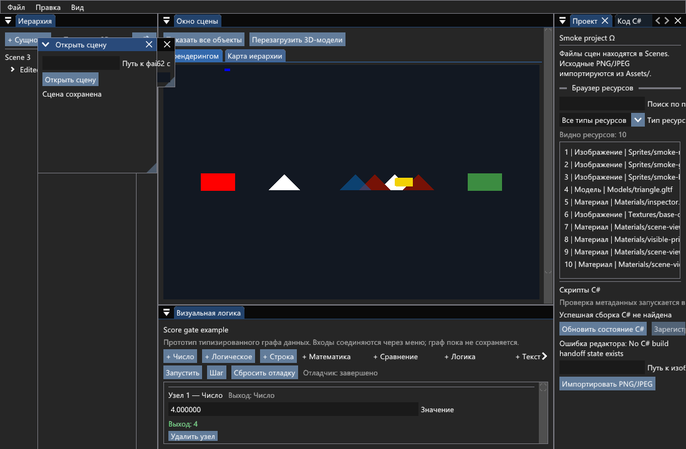

# 3D camera and mesh prototype (07.1a)

## Linear-light Scene/Game blending (07.2ce prototype)

On supported BGFX adapters, Scene/Game BGRA8 views 1/2 use mutable sRGB color attachments. Mesh and sprite producers output linear RGB and preserve linear alpha; attachment writes encode RGB to sRGB and fixed-function blend operates in linear light. 2D sprite tint bytes are interpreted as sRGB colors and decoded for the sRGB target; source sprite textures use sRGB sampling there. The editor backbuffer and project model-preview target are unchanged. The opaque attachment is sampled raw by ImGui for display. If BGRA8 sRGB texture/framebuffer capability is missing, targets retain the previous encode-to-ordinary-BGRA8 path and issue a diagnostic. Windows D3D11 GPU screenshot coverage measures 93/66/128/66 and alpha blend 92, but does not establish Scene/Game crop identity through the entire Editor UI, nor behavior on another backend. This remains limited Lambert diffuse, not PBR. See [07.2ce](reports/07.2ce-linear-light-srgb-attachments.md).

## Directional diffuse lighting in Scene View (07.2bz)

The Editor Scene View consumes enabled `DirectionalLight3D` components through its BGFX mesh path. The vertex layout includes imported/built-in normals; each drawable uses the CPU inverse-transpose normal matrix; up to four enabled lights are resolved from hierarchical world rotations and ordered by EntityId. Lit color and textured meshes use the project-owned Lambert shaders while preserving the Scene View material and alpha submission path. With no enabled light, the existing unlit programs are selected. Project model preview remains unlit. 07.2ca's Windows x64/D3D11 smoke compares exact raw Scene View crops for the old unlit and Lambert shader with zero lights, and verifies red pixels in a controlled front-facing plane region and none in its opposite-facing region.

Color transfer (07.2cc): `prepareLinearBaseColorMipChainBgra8` decodes source sRGB RGB, applies the linear base-color factor once and builds linear mips into ordinary BGRA8. Lit textured shader samples that linear value directly, then applies linear Lambert and output encoding; unlit texture and vertex-color paths encode RGB once, and lit vertex colors receive factor/diffuse before encoding. Runtime BGFX sets a white factor for texture draws because CPU preparation already baked it; vertex-color draws use the shader factor. Production fragment-shader screenshot smoke measured RGB 93/66/128/66 for unlit texture, lit texture, unlit vertex-color and lit vertex-color. Scene/Game BLEND still combines encoded RGB into ordinary BGRA8, so it is not linear-light correct. Their opaque viewport is pass-through sampled into ImGui; exact crop equivalence is not yet tested. This remains limited Lambert diffuse, not PBR or cross-backend color management. See [07.2cc report](reports/07.2cc-bgfx-color-transfer.md) and [07.2cd assessment](reports/07.2cd-alpha-blend-target-assessment.md).

## Runtime BGFX directional diffuse in Game View (07.2by)

The optional Runtime BGFX adapter consumes the Scene packet's directional-light list. It uploads normals in a project-owned vertex format and uses an inverse-transpose 3x3 world normal matrix. The transfer issue recorded by the earlier 07.2cb assessment was corrected and checked in 07.2cc (see the color-transfer summary above). Zero-light scenes take the previous unlit code path. Meshes without normals render unlit with a diagnostic; extra lights are omitted with a diagnostic. This remains limited diffuse support: no PBR, specular, ambient/environment term, shadows or cross-backend validation. See [07.2by](reports/07.2by-bgfx-directional-diffuse.md) and [07.2cb assessment](reports/07.2cb-material-color-space-contract.md).

## Scene render packet, optional BGFX consumer and Editor Play Game View (07.2bk–07.2bu)

07.2bv was the pre-lighting assessment: imported meshes can carry validated NORMAL and built-in primitives define normals, while the Scene format had no Light component and the render packet had no light data. Those gaps were addressed by 07.2bw–07.2bz. See [assessment 07.2bv](reports/07.2bv-lighting-vertical-slice-assessment.md).

07.2bu allows Runtime BGFX to consume supported base-color `MASK` items alongside `OPAQUE`. The existing shader discards samples below the material cutoff while retaining depth writes; no blend state is enabled. Project/source base-color mip generation uses mask coverage preservation, and texture cache keys distinguish alpha mode/cutoff. A Game View smoke checks a transparent checker source texture is submitted through BGFX and remains partially visible. `BLEND`, additional PBR textures and unsupported UV settings still trigger the complete Editor renderer fallback. This does not add lighting or shadows. See the [07.2bu report](reports/07.2bu-runtime-bgfx-mask.md).

07.2bt adds four separate adapter Game View smoke cases for glTF mip min-filter enums 9984–9987. Each scene uses a reduced checker-textured glTF triangle; checks assert the selected sampler enum and bounded visible color-pixel counts, in addition to cache/submission evidence. Current Windows D3D11 observations are 256 pixels for 9984/9986 and 512 for 9985/9987. Counts depend on rasterizer/driver and are not portable goldens. Full details and the full-suite smoke failure are recorded in the [07.2bt report](reports/07.2bt-runtime-bgfx-mipmap-comparison.md).

`astro_scene_render3d` prepares visible `MeshRenderer` and `PrimitiveRenderer` data without any GPU API. It resolves the active Camera3D through hierarchical transforms, generates in-memory primitive geometry, accepts imported mesh geometry through a callback, and validates project material overrides via AssetRegistry. The returned packet is a CPU snapshot for a later backend; it does not upload buffers, decode images or execute Play. The callback lets the optional importer remain outside this target.

`astro_runtime_bgfx_scene3d` is an opt-in Windows x64 adapter that consumes this packet. Enable it with `-DASTRO_BUILD_RUNTIME_BGFX_3D=ON` and the existing local `ASTRO_BUILD_STACK_SPIKE=ON` BGFX dependencies. It sets the view from the packet Camera3D, submits each item with its hierarchical world transform, caches GPU geometry by content hash plus opaque `baseColorFactor`, and exposes `clearCache()` for resource lifecycle. Since 07.2bm the sample smoke exercises a disposable Play Scene; since 07.2bn the Editor Game View also submits its active runtime Scene through the adapter when the complete packet fits its supported path. It reuses Editor's BGFX context/program and Game View framebuffer. When packet construction or adapter rendering rejects unsupported texture/alpha/material data, the existing Editor 3D renderer draws the scene instead. This does not create a standalone runtime host.

Since 07.2bo, separate Editor Play smokes cover both outcomes: supported opaque content must submit through the adapter; a registered textured material can fall back to the existing textured Editor renderer. At 07.2bo the fallback smoke checked submission counters; 07.2bp adds the first bounded texture-capable subset and checks actual Game View pixels.

07.2bp adds a bounded Runtime BGFX path for project-material base-color textures. 07.2bq also accepts a local external glTF source image when the Scene has no project material override. Both use opaque-only, UV0, identity transform, non-mip nearest/linear minification, nearest/linear magnification and repeat/mirror/clamp. The host resolves project paths and decodes through WIC; the external path must canonicalize under project `Assets`. The adapter creates a linear BGRA8 texture with base-color factor and enforces a shared 256 MiB cache limit. Game View's BGFX color clear runs before its 3D pass. The Play smoke requires two submissions/cache entries for project and source textures plus visible Game View color pixels; render-packet integration checks source path/hash/sampler propagation. Embedded/data URI images, UV1/transforms, mipmaps, other PBR maps, alpha mask/blend and other backends remain unsupported; the complete pass falls back to the Editor renderer. See the [07.2bq report](reports/07.2bq-runtime-bgfx-gltf-source-texture.md) and [07.2bp report](reports/07.2bp-runtime-bgfx-textured-game-view.md).

07.2bs reuses the existing bounded linear-space CPU mip generator for opaque project and source-glTF base-color textures. The adapter allocates a BGFX texture with mip levels, submits all generated levels, accounts the entire chain against the 256 MiB texture cache, and applies the selected mip/texel sampler flags. Game View smoke uses a source glTF texture with `LINEAR_MIPMAP_LINEAR` and requires an entry in the adapter's mip-texture cache plus visible source/project colors. The smoke proves path upload and one sampler mode, not visual differentiation among all four mip filters. BGFX `updateTexture2D` provides no per-level result, so asynchronous backend upload failure cannot be reported. Alpha, other PBR roles, UV extensions and other backends remain unsupported. See the [07.2bs report](reports/07.2bs-runtime-bgfx-mipmap.md).

Current material scope is vertex color plus opaque base-color factor. Texture maps, alpha blend/mask, normals/lighting/PBR, shader/material batching and other platforms are not supported by this adapter yet. Geometry limits follow MeshData bounds; backends without 32-bit index support reject wider meshes. Cache is capped at 4096 mesh/material variants and should be cleared at scene unload.

## Встроенные примитивы сцены (07.2bd–07.2bf)

В Hierarchy меню «+ Примитив 3D» создаёт Cube, Plane, Sphere или Cylinder как сущность с `Transform` и сохраняемым `PrimitiveRenderer`. Начальная геометрия центрирована относительно локального начала координат; размеры задаются общим Transform. Геометрия генерируется из ограниченного набора вершин/индексов в памяти и отправляется через тот же BGFX Scene/Game View draw path. Проектные файлы ресурсов не создаются и не меняются. Scene v11 хранит optional material override; v10 и ранние версии читаются, а миграция записывается только при явном сохранении.

В 07.2be создание маршрутизировано через typed `entity.create_primitive`; удаление выбранной сущности через `entity.delete_subtree`. Undo/Redo создания сохраняет EntityId и ComponentId; Undo удаления восстанавливает поддерево, порядок сущностей и prefab-instance метаданные из снимка сцены. Снимочные транзакции потребляют память пропорционально размеру сцены. Тогда Editor smoke отдельно отправлял Cube, Plane, Sphere и Cylinder через BGFX Scene View target. Это проверяло рендер-путь, не пиксельную идентичность форм. Опциональный самостоятельный runtime draw prototype появился позднее в 07.2bl; golden images всех форм, UV-инспектор, примитивная физика и экспорт ещё не заявлены. Подробности: [07.2bd](reports/07.2bd-scene-primitives.md), [07.2be](reports/07.2be-primitive-transactions-render-smoke.md).

В 07.2bf Inspector позволяет выбрать форму и переключить Visible. В 07.2bg он также позволяет назначить или сбросить зарегистрированный проектный материал через `entity.set_primitive_material_override` с Undo/Redo. Preview использует общий BGFX material path (base-color factor и UV0 texture); ограничения рендерера материалов остаются такими же, как у MeshRenderer. Smoke подтверждает тестовую сцену и рендер-путь, но не синтетический клик по Combo и не pixel golden. См. [отчёт 07.2bf](reports/07.2bf-primitive-inspector-authoring.md).

В 07.2bh добавлен Editor pixel smoke, а в 07.2bi он усилен уникальным жёлтым base color: цветовой порог отдельно от цветных 2D маркеров подтверждает видимость материала на Cube в Scene View. Smoke дополнительно требует textured submission этого `PrimitiveRenderer` в Scene View и в Game View через активную Camera3D. Снимок кадра Editor: . Проверена одна Windows x64/D3D11 конфигурация; это пороговая маска, а не платформенно-независимый visual golden.

## Drag capture в Scene View (07.2bb)

Правый orbit и средний pan Rendered Scene View начинаются в пределах отображаемого viewport и продолжаются при выходе курсора за его прямоугольник, пока кнопка удерживается. Отпускание сбрасывает capture, а down снаружи viewport не запускает жест. Wheel zoom остаётся hover-only. Smoke использует SDL events штатного окна и ImGui backend, подтверждает yaw/focus changes и оба внешних отказа. Это синтетический тест Windows BGFX D3D11, не проверка физического устройства или других платформ/backends. [Отчёт 07.2bb](reports/07.2bb-scene-view-drag-capture.md).

## Drag capture in Project model preview (07.2ba)

Right orbit and middle pan start on a press inside the selected model image and continue as the cursor moves outside it while the corresponding button stays down. Releasing clears the capture; a press that starts outside does not activate it. The smoke drives these boundary cases through SDL/ImGui in the compact window and confirms camera yaw/focus changes and release state. Scope is the Project preview only; Scene View input still uses hover-scoped handlers. The input is synthetic, not physical hardware. [07.2ba report](reports/07.2ba-project-preview-drag-capture.md).

## Project preview mouse event-path smoke (07.2az)

Модельный preview smoke теперь доставляет SDL3 motion/down/up events с SDL button state для правого и среднего drag. События проходят обычную очередь окна и `ImGui_ImplSDL3_ProcessEvent`; GUI handlers должны изменить yaw и camera focus соответственно. Проверка прошла на Windows Release BGFX D3D11 в окне 864×608 (`sdlRightDrag=1`, `sdlMiddleDrag=1`). Это не физический ввод через OS и не подтверждает пользовательскую мышь, другие ОС или graphics backends. [Отчёт 07.2az](reports/07.2az-project-preview-mouse-input.md).

## Compact Project viewport after resize (07.2ay)

При изменении размера Project panel модельный viewport повторно прокручивается в видимую область. Компактный Editor smoke меняет размер окна и оставляет его 864×608; тест требует, чтобы весь ImGui image viewport был внутри окна clip rect, и проверяет пиксели модели в screenshot crop. Windows Release D3D11 result: `viewportFullyVisible=1`, 2 202 foreground pixels, display scale 1,25. Это visibility smoke, не golden image; реальное правое/среднее перетаскивание всё ещё не автоматизировано. [Отчёт 07.2ay](reports/07.2ay-project-preview-resize.md).

## Manual Project viewport review (07.2ax)

On the Windows Editor, a temporary registered glTF with two separated triangles and a source base-color material was selected in Project. The two shapes rendered and real wheel input changed their apparent scale in both directions. The preview is constrained to 4:3; the narrow dock uses the 160×120 logical minimum, and the restored 864×608 Editor window clipped the lower preview area while a maximized portrait window showed it. The image appeared blue/cyan, but no color golden was available. Actual orbit/pan input was not verified: the available automation can left-drag only, while the UI requires right/middle drag. User OBJ/FBX files were not modified and are outside the current importer.

## Project model viewport control smoke (07.2aw)

The Windows D3D11 model-preview smoke expands its temporary glTF to two primitives and requires two target draw submissions. After Frame All, the harness calls the same `SceneViewTarget` orbit, pan and zoom methods used by right/middle mouse drag and wheel; it asserts yaw, focus and distance change. The final screenshot crop must still contain at least 32 foreground pixels (observed 2,202). This validates target/controller wiring and multi-primitive submission, not physical mouse events or a pixel golden. The checked-in source asset and project fixture are not modified by this smoke run.

## Project model preview viewport (07.2av)

The selected registered glTF model is expanded into a transient preview Scene with one `MeshRenderer` per imported primitive and sent through an independent `SceneViewTarget` on BGFX views 5/7. Its color/depth framebuffer and GPU cache are separate from Scene View (1/3) and Game View (2/4); ImGui remains view 0. The target uses the existing mesh resolver, source-material path, alpha policy, mesh cache and `SceneViewCamera3D`. On selection, **Frame All** fits combined mesh bounds. Right-drag orbits, middle-drag pans, and wheel zooms this preview camera only. The Project selection scrolls the panel to bring the preview into view.

The preview Scene is memory-only and never changes the project Scene or model source. It accepts at most 128 primitives and 64 MiB combined vertex/index buffers, in addition to existing per-mesh and texture-cache limits. Unsupported/import-failed resources display diagnostics. Windows Release smoke verifies mesh submission, `Frame All`, zero mesh diagnostics, and more than 32 non-background pixels in the screenshot viewport crop. The model-specific test does not exercise physical camera input or other graphics backends. See [07.2av report](reports/07.2av-project-model-viewport.md) and [D182](DECISIONS.md#d182--изолированный-3d-preview-модели-072av).

## Console navigation for Game View camera diagnostics (07.2aq)

### Registered asset selection from renderer diagnostics (07.2as)

When a per-entry Game View diagnostic has a trusted registered model/material `AssetId`, Diagnostics offers a Project selection action alongside any Entity action. The Editor re-resolves the ID through the active AssetRegistry and checks that the Project snapshot root still matches; Project then shows asset kind, ID and registry-relative source path. Missing or stale IDs have no asset action. This does not parse diagnostic text, open or write files, or provide the full Asset Browser/search workflow. The Windows smoke covers a registered material action and confirms an unresolved model remains entity-only. See [architecture](ARCHITECTURE.md#выбор-зарегистрированного-ресурса-из-game-view-diagnostics-072as), [testing](TESTING.md#072as-переход-к-зарегистрированному-ресурсу), and [D179](DECISIONS.md#d179--безопасная-asset-навигация-из-game-view-диагностик-072as).

The shared Editor Diagnostics window now shows the current 3D renderer diagnostic snapshot from Game View. An invalid active Camera3D includes a **Select entity in Hierarchy** action; selecting it uses the common scene selection, expands its parent chain and scrolls the Hierarchy row into view. When there is no active camera, each Scene Camera3D component is offered as a candidate. Selecting a candidate does not change its active flag. Asset/mesh diagnostics are shown as individual current-frame entries. If an entry was produced while processing one Scene entity, it carries that EntityId and offers the same Hierarchy selection action; entries without a reliable entity stay plain text. The snapshot is replaced by the next render result rather than appended once per frame.

The Windows D3D11 Editor smoke exercises the link action and resulting Hierarchy selection for invalid-camera, missing-camera and nested unresolved-mesh cases, alongside normal camera-driven rendering. It simulates the button action through the smoke harness, not physical mouse input. No Scene format/API or runtime behavior changes. See [testing](TESTING.md#072ar-переход-от-game-view-diagnostics-к-meshrenderer), [D178](DECISIONS.md#d178--entity-links-for-game-view-renderer-diagnostics-072ar), and [report](reports/07.2ar-game-view-mesh-diagnostic-navigation.md).

## Game View renderer diagnostics (07.2ap)

Когда 3D pass Game View записывает camera/render diagnostic, Editor рисует ограниченную полупрозрачную текстовую карточку поверх изображения. Известные сообщения об отсутствии активной камеры и невалидном Transform камеры имеют русские переводы. При ошибке камеры target пропускает 3D submissions, но сохраняет ортографический 2D output; предупреждение остаётся видимым. Overlay — UI редактора, не объект сцены; исходная текстура framebuffer и project assets не изменяются.

Случаи no-active и zero-scale камеры проверяются двумя Windows D3D11 Editor smoke на одноразовом проекте; обычный camera-driven smoke проверяет успешный путь. Это не подтверждает другие backend, standalone runtime, отображение длинных диагностик за пределами clip карточки или идентичное размещение на других DPI/драйверах. См. [testing](TESTING.md#072ap-диагностики-активной-camera3d-в-game-view), [D176](DECISIONS.md#d176--локализованная-диагностика-game-view-и-smoke-сценарии-072ap) и [report](reports/07.2ap-game-view-diagnostics.md).

## Active camera in Editor Game View (07.2ao)

When the optional glTF Scene renderer is configured, Game View renders visible Scene `MeshRenderer` primitives through the explicitly active `Camera3DComponent`. The camera entity's composed hierarchy Transform provides position and orientation; lens values provide perspective FOV and clip planes. Projection aspect follows the BGFX target's pixel dimensions, and the target has a depth attachment. Scene View retains its orbit camera. Existing 2D sprites use their own orthographic framing and draw after Game View 3D, so they currently overlay 3D irrespective of scene depth. If there is no active camera or its hierarchy cannot yield a valid view, Game View skips 3D and reports a diagnostic while its 2D path remains available.

This is an Editor preview path validated on Windows x64/D3D11. It does not connect the camera to standalone Runtime or Play Mode, render the Game View material/alpha pipeline, or implement lights/shadows, picking, composited 2D/3D depth, or other renderer backends. See [architecture](ARCHITECTURE.md#активная-scene-camera3d-в-game-view-072ao), [tests](TESTING.md#072ao-активная-camera3d-в-game-view), [D175](DECISIONS.md#d175--активная-camera3d-в-game-view-072ao), and [report](reports/07.2ao-active-camera-game-view.md).

## Persisted Scene Camera3D foundation (07.2am)

Scene v8 can store an optional `Camera3DComponent` on an Entity. It contains finite vertical FOV degrees and near/far planes; the existing Entity Transform is the reserved camera pose. The Scene model validates the lens range and scene serialization preserves the component ID. No active-camera selection, Transform-to-view conversion, Inspector, Play camera behavior, or Game View rendering is implemented in this substage. See [architecture](ARCHITECTURE.md#scene-camera3d-component-foundation-072am), [format](FILE_FORMATS.md#astro-scene-v8), [tests](TESTING.md#072am-scene-camera3d-и-scene-v8), and [report](reports/07.2am-scene-camera-component.md).

## Windows DPI metrics (07.2ag)

On Windows at 125% scaling, the Editor HWND reported PerMonitorV2 and DPI120. SDL reported `displayScale=1.25` and `pixelDensity=1.0`; these are different metrics. Display scale represents Windows content/UI scale, while pixel density is the ratio between SDL pixel dimensions and window size. The BGFX swapchain is initialized/resized using `SDL_GetWindowSizeInPixels`. The diagnostic log records both values; no renderer behavior changed in 07.2ag. See [TESTING](TESTING.md#072ag-диагностика-windows-dpi-metrics-sdl), [D166](DECISIONS.md#d166--разделять-sdl-display-scale-и-pixel-density-072ag), and [report](reports/07.2ag-sdl-windows-dpi-metrics.md).

## Real Windows DPI validation status (07.2af)

With explicit user authorization, both active Windows displays were temporarily set to 125%; Windows logical bounds changed from 1080×1920/2560×1440 to 864×1536/2048×1152. All six MASK ramp smokes passed. A later diagnostic showed the HWND was PerMonitorV2/DPI120 and SDL returned `displayScale=1.25`, `pixelDensity=1.0`; see [07.2ag](reports/07.2ag-sdl-windows-dpi-metrics.md). Both display scales were restored to 100%. See [TESTING](TESTING.md#072af-проверка-на-реальном-windows-dpi), [D165](DECISIONS.md#d165--временное-изменение-масштаба-только-для-проверки-072af), and the [assessment](reports/07.2af-active-windows-dpi-assessment.md).

## Spatial MASK smoke across window sizes (07.2ae)

The alpha-ramp Scene View smoke now runs near/far sampling at logical window sizes 900×650, 1100×720, and 1440×900. The last profile requests SDL high-pixel-density mode. Spatial MASK/blend classification uses per-bin pixel coverage rather than absolute counts, making its threshold less dependent on framebuffer dimensions; it requires repeated regions of each class and does not require a specific first class. On the current Windows host all profiles reported pixel density 1.0, so different physical DPI scaling was not exercised. The check remains count-based and D3D11-specific. See [TESTING](TESTING.md#072ae-пространственные-mask-smoke-при-разных-размерах-окна), [D163](DECISIONS.md#d163--пространственные-mask-smoke-при-разных-размерах-окна-072ae), and the [report](reports/07.2ae-window-density-spatial-smoke.md).

## Пространственная проверка MASK alpha-рампы (07.2ad)

Для ramp smoke 07.2ac добавлены per-column проверки: при test-only zoom +5 Scene View crop делится на 64 vertical bins; пиксели классифицируются как magenta MASK или cyan blend-through. Проверяется, что низкий U начинается blend-rich, а далее присутствуют mask-rich и blend-rich зоны минимум с тремя сменами доминирования. Пороговые counts допускают mixed bins. Это помогает обнаружить потерю/перестановку частей перехода, но всё ещё не доказывает цвет каждого ожидаемого texel, точный LOD или переносимость вне текущего Windows D3D11 adapter. См. [TESTING](TESTING.md#072ad-пространственная-проверка-mask-alpha-рампы), [D162](DECISIONS.md#d162--пространственные-проверки-mask-alpha-рампы-072ad) и [отчёт](reports/07.2ad-mask-spatial-transition.md).

## Локальная alpha-рампа вокруг MASK cutoff (07.2ac)

`editor.scene_view_mask_mips.cutoff_transition.near/far.smoke` использует одноразовую 64×64 RGBA текстуру, в которой alpha линейно растёт от byte 112 до 143. На Scene View пути MASK/cutoff 0,5 с Repeat и trilinear mip sampling обе UV-scale проверки показывают и mask, и blend-through участки. Пиксельные диапазоны не являются визуальным golden и не связаны с известным выбранным hardware LOD; проверена только текущая Windows D3D11 конфигурация. См. [TESTING](TESTING.md#072ac-локальная-alpha-рампа-вокруг-mask-cutoff), [D161](DECISIONS.md#d161--локальная-alpha-рампа-вокруг-mask-cutoff-072ac) и [отчёт](reports/07.2ac-mask-cutoff-transition-smoke.md).

## Смешанные alpha-полосы MASK cutoff (07.2ab)

Editor smoke `editor.scene_view_mask_mips.mixed_boundary.near/far.smoke` проверяет одну временную 64×64 текстуру, разбитую на вертикальные полосы alpha 127/128/129/127. При cutoff 0,5 mip-фильтрованная D3D11 Scene View одновременно показывает surviving MASK области и blend-through подложки под отброшенной alpha 127 областью при UV-scale 2 и 4. Это подтверждает лишь грубое сосуществование обоих исходов в пределах изображения. Pixel counts не привязаны к конкретным полосам; точный mip LOD не читается. Не является визуальным эталоном и не устанавливает переносимость на другие драйверы или графические backend. Подробности в [TESTING](TESTING.md#072ab-смешанные-alpha-полосы-mask-cutoff), [D160](DECISIONS.md#d160--смешанные-alpha-полосы-masked-mip-072ab) и [отчёте](reports/07.2ab-mixed-mask-boundary-smoke.md).

This prototype establishes a small backend-neutral data contract and one optional graphics smoke. It is a foundation experiment, not a scene-rendering feature.

## Current API

Include `astro/render3d/Camera3D.hpp` for `Camera3D`, `Vec3`, `Mat4`, and `ClipDepthRange`. The camera uses a right-handed view: +Y is up and the default camera looks from +Z toward the origin along -Z. `viewMatrix()` validates finite, non-degenerate pose vectors. `projectionMatrix(aspect, depthRange)` validates FOV and near/far planes; the default clip-depth range is [0, 1], while `NegativeOneToOne` provides the OpenGL-style range. `Mat4::values` is column-major.

Include `astro/render3d/MeshData.hpp` for `MeshData::create(vertices, triangleIndices)`. The validator rejects empty/oversized buffers, incomplete triangles, non-finite positions and out-of-range indices. Vertex colors are four 8-bit channels. `MeshData::makeColoredCube()` is a deterministic 8-vertex/12-triangle sample.

Example:

```cpp
astro::render3d::Camera3D camera;
auto view = camera.viewMatrix();
auto projection = camera.projectionMatrix(16.0f / 9.0f);
auto cube = astro::render3d::MeshData::makeColoredCube();
if (!view || !projection) return; // surface the Result error in production code
```

The matrices are used by the optional bgfx sample; production renderer adapters should verify their backend clip-space convention before using another graphics API.

## Build and smoke

`astro_runtime_render3d` is independent of SDL/bgfx. With testing enabled it builds the portable camera/mesh unit test. The graphics sample currently requires the existing Windows x64/MSVC SDL3/bgfx cache and D3D11 shaders; it does not download dependencies:

With `BUILD_TESTING=OFF` and the 3D options left disabled, the ordinary headless build does not add `astro_runtime_render3d` or require bgfx. This separation was checked using a fresh WSL Ubuntu build directory.

```powershell
# From a VS 2022 x64 Developer Command Prompt
cmake -S . -B build/06.53-editor-release `
  -DASTRO_BUILD_RENDER3D=ON `
  -DASTRO_BUILD_RENDER3D_BGFX_SMOKE=ON
cmake --build build/06.53-editor-release --parallel 8
ctest --test-dir build/06.53-editor-release `
  -R "runtime.render3d.(camera_mesh.unit|bgfx.smoke)" --output-on-failure
```

The window target reads the bgfx example's `vs_cubes.bin` and `fs_cubes.bin` from `build/spike-deps` and copies them into its build directory. Its `--smoke` mode requests a bgfx backbuffer readback, checks a minimum foreground-pixel count, color diversity and an in-bounds cube region, and reports CPU frame-interval p50/p95. Three Windows D3D11 runs each found 85,155 foreground pixels, 169 color buckets and bounds 280,135–658,498; median p50 was 16.735 ms (range 16.701–16.764 ms) and median p95 was 32.824 ms (range 32.055–34.120 ms) with VSync. It does not save an image or compare exact pixels against a golden screenshot. These intervals are a single-cube smoke baseline, not full frame time or a performance budget.

## Limits

- No mesh/camera Scene components, Scene format changes, asset registry integration or Editor Scene/Game View integration.
- No normals, UVs, materials, lighting, depth picking, 3D Scene transforms or 3D physics. The bounded static glTF/GLB prototype below imports positions and triangle topology only.
- The bgfx smoke is Windows D3D11 only; no macOS/Android/iOS graphics path was built.
- The smoke checks coarse visible-pixel presence, not exact image output, graphics quality or approved performance budgets.
- The timing workload is one rotating colored cube with VSync; it is a baseline, not a representative engine frame or target budget.

## Bounded glTF/GLB geometry import (07.1b)

`astro_gltf` is a separate opt-in CMake target. Its public header is `astro/render3d/GltfImporter.hpp`:

```cpp
auto imported = astro::render3d::GltfImporter::importFile(
    projectRoot, std::filesystem::path("Assets/Models/crate.glb"));
if (!imported) {
    report(imported.error().message);
    return;
}
for (const auto& mesh : imported.value().meshes) {
    for (const auto& primitive : mesh.primitives) {
        // primitive is validated backend-neutral MeshData (positions + triangle indices)
    }
}
```

The source path must be project-relative under `Assets/` and end in `.gltf` or `.glb`. External buffer URIs must be plain relative local paths that resolve to regular files under `Assets/`; data URIs are supported by the parser for embedded buffers. Import reads but never rewrites source files. Validated outputs are cached under `Library/Derived/gltf`; cache entries use a content-derived name and checksummed schema, and are rebuilt if malformed. Limits currently include 8 MiB source JSON/container, 64 MiB per external buffer, 128 MiB total external buffers, 128 meshes, 256 primitives, 1,000,000 vertices, 3,000,000 indices, and a 64 MiB cache artifact.

Enable it explicitly after staging the pinned dependencies in the ignored `build/07.1b-deps` directory:

```powershell
cmake -S . -B build/07.1b-release -G Ninja -DCMAKE_BUILD_TYPE=Release `
  -DBUILD_TESTING=ON -DASTRO_BUILD_GLTF_IMPORTER=ON `
  -DASTRO_GLTF_DEPS_ROOT="$((Get-Location).Path)/build/07.1b-deps"
cmake --build build/07.1b-release --parallel 8
ctest --test-dir build/07.1b-release -R "runtime.render3d.gltf.import.integration" --output-on-failure
```

The implementation supports static triangle primitives with a float `POSITION` VEC3 accessor and optional unsigned triangle indices. Non-indexed triangles are converted to indexed `MeshData`. It rejects sparse accessors, unsupported vertex attributes, morph targets, Draco, unsupported required extensions, invalid indices and out-of-budget data. Names and mesh grouping are retained. Normals, UVs, tangents, colors, materials, textures/images, node transforms/hierarchy, animation, skinning, morphs, physics and Scene/AssetRegistry/Editor integration are not provided. This is a prototype, not general glTF compatibility.

The filesystem checks reject traversal and links/reparse points, but use path inspection followed by ordinary file opens; they do not prevent TOCTOU attacks from a hostile process concurrently replacing path components. The parser is not claimed vulnerability-free. Fuzzing/sanitizers and macOS/mobile builds have not been run. See [07.1b verification report](reports/07.1b-bounded-gltf-importer.md).

## First BGFX material draw path (07.2f)

The optional standalone `astro_render3d_bgfx_smoke --material-smoke --project-root <project>` mode resolves the selected `MeshRenderer` project material override via AssetRegistry and applies its `baseColorFactor` by multiplying the factor into existing vertex-color bytes before the current BGFX vertex buffer upload. The dedicated `runtime.render3d.material.bgfx.smoke` copies a checked-in Scene/glTF/material fixture into an isolated build-local project, performs a D3D11 draw, requests screenshot readback, and requires visible red-dominant pixel coverage plus the existing broad geometry bounds check. The Scene smoke also uses the material fixture and continues checking selected-primitive rendering.

This is a flat tint diagnostic in the standalone sample. It does not render material values in Editor Scene/Game View or runtime and is not a PBR or color-managed presentation contract. Only `baseColorFactor` is consumed. Metallic, roughness, emissive, alpha modes, texture roles, normals/UV, texture decoding/sampling, lights and shadows are ignored by this draw path. The glTF importer still accepts only POSITION and indices and explicitly rejects other vertex attributes. Validation is Windows x64/MSVC BGFX D3D11 only; the screenshot check is a threshold, not a committed golden image. See [D138](DECISIONS.md#d138--first-bgfx-material-draw-prototype-scope-072f) and [TESTING.md](TESTING.md#072f-first-bgfx-material-draw-path).

## Normal and UV0 import channels (07.2g)

`MeshVertex` now includes backend-neutral normal and TEXCOORD_0 values; `MeshData::hasNormals()` and `hasTexCoords()` explicitly state whether those arrays are authored/imported. Existing two-argument `MeshData::create(vertices, indices)` remains valid and reports both optional channels absent. The importer accepts `NORMAL` as matching non-sparse FLOAT VEC3 with finite, non-zero vectors. It accepts `TEXCOORD_0` as matching FLOAT VEC2 or normalized unsigned-byte/unsigned-short VEC2, converting normalized integers to floats. Accessor count and buffer bounds are checked, and unsupported channel names/formats remain errors. Derived mesh cache advances to ASTROMSH v2 in a separate filename; older v1 files are left in place and ignored.

This stage only exposes validated source data. Before 07.2h, no renderer consumed these channels. Windows x64 Release was validated; macOS/mobile and fuzz/sanitizer validation were not run. See [D139](DECISIONS.md#d139--optional-mesh-channels-and-bounded-gltf-import-072g), [file format](FILE_FORMATS.md#gltf-material-import-metadata-072c), and [testing](TESTING.md#072g-normals-and-uv0-mesh-import).

## Base-color texture decode and BGFX smoke (07.2h)

`decodeWicImage(path)` is the shared Windows decoder used by `SDLImageTextureCache` and the optional BGFX sample. It opens the resolved registry cache path, converts through WIC to tightly packed BGRA8 and rejects invalid images, zero/oversized dimensions, more than 16 Mi pixels, and buffer sizes outside the WIC copy limit. The integration test imports a 4×4 fixture into a temporary project cache, decodes it, checks exact dimensions and representative BGRA texels, and rejects corrupt/missing files.

The separate `runtime.render3d.base_color_texture.bgfx.smoke` resolves a registered material override, verifies its `BASE_COLOR` binding points to the imported PNG and UV channel 0, requires the selected glTF primitive to contain UV0, uploads the decoded bytes to BGFX, and checks that D3D11 screenshot readback contains multiple expected broad color families. The fixture and temporary copy are test-owned. This is a texture sampling path only: it does not multiply baseColorFactor, configure sRGB decoding, honor glTF samplers/texture transforms, support other roles, or modify Editor Scene/Game View. Windows x64/MSVC/D3D11 only; there is no exact image golden. See [D140](DECISIONS.md#d140--single-base-color-texture-prototype-072h), [testing](TESTING.md#072h-base-color-texture-smoke), and the [prototype guide](../samples/3d_prototype/README.md).

## Base-color color space and factor (07.2i)

`prepareLinearBaseColorBgra8` defines the tested order for this prototype: decode source sRGB RGB, multiply by the linear factor, then quantize to linear BGRA8; alpha is linear and multiplied directly. Input cache/source bytes are immutable. The optional D3D11 sample enables `BGFX_RESET_SRGB_BACKBUFFER`; the GPU samples the prepared linear texture and converts output for sRGB display. This avoids a GPU sRGB texture view/custom fragment shader in this smoke, but performs per-image CPU work and loses precision to an 8-bit linear intermediate. The transfer unit tests values and bounds; `runtime.render3d.base_color_factor.bgfx.smoke` checks four expected encoded color families. See [D141](DECISIONS.md#d141--linear-base-color-factor-over-srgb-source-072i), [testing](TESTING.md#072i-base-color-color-space-and-factor), and [report](reports/07.2i-base-color-color-space.md).

## Editor Scene View base-color material preview (07.2j)

When the optional glTF importer is enabled in the Windows Editor, a `MeshRenderer` with a registered material override can render that material's `baseColorTexture` and linear `baseColorFactor` in Scene View. The Editor reads the immutable image from `AssetRegistry::cachedPath`, decodes it through the bounded WIC path, prepares a temporary linear BGRA8 copy, and uploads that copy to BGFX. A factor-only override is represented by a one-pixel white base-color texture. UV0 is the only supported coordinate set. The BGFX material texture is cached with the entity's preview mesh and released with it. No source image or derived asset cache is modified by rendering.

If the material cannot resolve, its texture uses UVs other than 0, UV0 is absent, WIC decode/factor validation fails, or GPU upload fails, the mesh remains visible through the existing vertex-color shader and the Scene View shows a diagnostic. Material files are resolved once per cached preview mesh; after changing a material file, register it again and use **Reload 3D meshes** to refresh that cache. The Editor smoke renders one textured override and one deliberate UV1 fallback, checks their draw/fallback counters, checks the diagnostic and samples colored pixels from the Scene View screenshot. This is a single-role preview, not full material support: glTF source materials are not selected automatically, metallic/roughness/normal/occlusion/emissive roles, samplers/texture transforms, alpha modes, mipmaps, lighting, shadows and Game View are not implemented. It is Windows x64 D3D11 only; the screenshot check is a coarse color-presence guard, not a cross-driver golden. See [D142](DECISIONS.md#d142--editor-scene-view-base-color-material-preview-072j), [testing](TESTING.md#072j-editor-scene-view-base-color-preview), and the [07.2j report](reports/07.2j-editor-scene-view-base-color.md).

## Scene View source material and project override policy (07.2k)

For a selected glTF primitive, Scene View uses an explicit registered project material override when present; otherwise it previews that primitive's glTF source material. If neither exists, the mesh keeps its imported vertex colors. The source material index/factor/image reference and project override remain separate in the resolver result and Inspector. An unresolved explicit override is reported and the geometry stays visible with the vertex-color shader; Scene View does not silently switch to the source material in that error case.

The source preview consumes only glTF `baseColorFactor` and `baseColorTexture` with `texCoord=0`. It decodes an available local external image under project `Assets` through the existing bounded Windows WIC decoder and builds a temporary linear BGRA8 GPU texture. It does not register/import the image as a side effect, rewrite its bytes, or fetch remote references. Embedded/data-URI images, missing/unsupported images, UV sets other than UV0, malformed factors, decode failures and GPU upload failures produce diagnostics and leave the mesh on vertex-color fallback. Existing project material override behavior remains in place. The Editor smoke renders separate source-material and project-override meshes and also checks UV and invalid-override fallbacks; it checks draw counters and broad screenshot color coverage, not exact pixels. This remains Windows x64 D3D11 and a single base-color role; samplers/texture transforms, alpha, other PBR roles, Game View and non-Windows renderers are unsupported. See [D143](DECISIONS.md#d143--editor-scene-view-source-material-override-priority-072k), [testing](TESTING.md#072k-editor-scene-view-source-material-policy), and the [07.2k report](reports/07.2k-scene-view-source-material-policy.md).

## glTF base-color sampler and UV transform assessment (07.2m)

This stage evaluates support only; no runtime behavior changed. The importer already validates and retains a texture's optional `samplerIndex`, but drops sampler wrap/filter values. The Editor Scene View currently creates one-mip BGRA8 textures and binds them with fixed BGFX Clamp + Point flags. Its textured shader consumes UV0 as imported and does not apply `KHR_texture_transform`. Nonzero `texCoord` remains a diagnosed fallback because only UV0 is present in `MeshData`.

The glTF 2.0 sampler contract defaults wrap S/T to REPEAT; omitted filters are implementation-selected, while explicit `minFilter` values include non-mip and mipmap modes. `KHR_texture_transform` belongs to each texture-info binding and may override that binding's `texCoord`, so the same texture may have distinct transforms in different material roles. Applying the transform in the shader (or a transient vertex stage) avoids changing source/cached geometry. Mipmap filter modes require an explicit mip generation/upload policy; silently mapping them to the current one-level texture would not preserve the requested filtering. A required but unsupported extension must not be treated as an ignorable optional feature.

Recommended next slice: implement only the Scene View base-color path, starting with UV0. Preserve the established material selection and vertex-color fallback. Parse/validate sampler defaults and enumerants, support all three wrap modes and nearest/linear magnification and non-mip minification first; either implement a tested mip chain for the four mip modes or retain fallback diagnostics until that exists. Carry offset/rotation/scale and optional UV-set override per texture binding; reject or diagnose nonzero UV sets until mesh import supplies them. Keep project material override sampling semantics explicit, with a format migration if per-binding sampler/transform authoring is added. Tests should cover metadata defaults/invalid values, transform math and texCoord precedence, regression for the current fail-closed `extensionsRequired` behavior, repeated source references, and a D3D11 Scene View pattern fixture for wrap/filter/transform plus visible fallback. This does not promise Game View, other PBR roles, non-Windows backends or full PBR. Full findings and test matrix: [07.2m report](reports/07.2m-gltf-sampler-and-uv-transform-assessment.md), [D145](DECISIONS.md#d145--gltf-base-color-sampler-and-uv-transform-assessment-072m), and [TESTING.md](TESTING.md#072m-gltf-sampler-and-uv-transform-assessment).

## Inspector preview source and feature limits (07.2l)

The `MeshRenderer` Inspector states whether Scene View currently uses the project override, glTF source material, or imported vertex colors. When a valid project override is active and a glTF source slot exists, it tells the user that clearing the override returns to the source material. An unresolved override is explicitly labeled as a vertex-color fallback. Since 07.2n it also describes the source sampler/UV transform support, mip-filter fallback, and the project override's fixed sampling policy; alpha and other PBR properties are still not rendered.

Override assignment and clearing continue through `entity.set_mesh_material_override`, so they retain the existing validation, audit and Undo/Redo behavior. The Editor smoke executes assignment and clearing on a test-owned source-material entity through this typed command, checks both intermediate/final component values, and confirms the material-source and limitations labels are present. This does not automate mouse selection in ImGui or promise that the listed unsupported properties affect the renderer. See [D144](DECISIONS.md#d144--inspector-preview-source-and-material-feature-limits-072l), [testing](TESTING.md#072l-editor-inspector-material-preview-authoring), and the [07.2l report](reports/07.2l-inspector-material-preview-authoring.md).

## Source glTF base-color sampler and UV transform (07.2n)

The bounded importer preserves core sampler `wrapS`/`wrapT`, optional min/mag filters and `KHR_texture_transform` offset/rotation/scale per texture-info binding. The extension `texCoord` value overrides the base binding's texCoord; the Scene View currently supports UV0 only, and nonzero sets retain the diagnosed vertex-color fallback. Files declaring any `extensionsRequired` are still rejected by the importer's existing fail-closed policy.

For a valid **source glTF base-color** material, Scene View maps REPEAT, MIRRORED_REPEAT and CLAMP_TO_EDGE independently to BGFX U/V sampler flags. Omitted filters use BGFX's documented linear default; explicit nearest and linear min/mag filters are applied per draw. The four mipmap minification modes fall back to vertex colors with a diagnostic because this texture path uploads one mip level. Project `.astro-material` overrides keep the preexisting Clamp + Point settings and have no sampling/transform fields; their format did not change in this step.

Offset, rotation and scale use the Khronos order (scale, counter-clockwise rotation, then offset). The transform is applied to a separate CPU copy that is uploaded as the Editor's GPU vertex buffer; imported mesh values, derived cache and source files are unchanged. This is only Windows x64 D3D11 Scene View and base color. Alpha, other texture roles, UV1+, Game View and cross-platform behavior remain unsupported. The Editor smoke checks a generated source glTF's sampler flags and transformed draw alongside existing screenshot/fallback assertions; unit/integration tests cover transform math, sampler defaults and metadata. It is not an exact screenshot golden. See [D146](DECISIONS.md#d146--source-gltf-base-color-sampler-and-uv-transform-072n), [testing](TESTING.md#072n-source-gltf-base-color-sampler-and-uv-transform), and the [07.2n report](reports/07.2n-source-gltf-sampler-uv-transform.md).

## Scene model asset reference (07.1c)

`astro::scene::MeshRendererComponent` stores a stable model `AssetId`, mesh index, primitive index and visibility. `entity.set_mesh_renderer` is a typed transactional Scene command with candidate validation and stable component identity across undo/redo. Scene v6 serializes the component; the loader still accepts v1–v5, where the component is absent. `GltfImporter::importAndRegister` first runs the bounded importer and only then registers the source in Asset index v3. The registry verifies the main model source size/hash and retains the import content digest. External glTF buffers are revalidated when this importer method runs; they are not independently represented in the registry dependency graph.

This slice does not draw MeshRenderer in Editor/Game View, add geometry to prefab serialization (prefab capture rejects the component), or import node transforms, normals, UVs, materials, textures or animation. Clean Windows x64 Release build completed 158/158 actions; focused integration passed 5/5, full CTest passed 42/42 in 7.94 s, and the default importer-off headless Release build completed 32/32 actions. See [07.1c report](reports/07.1c-scene-model-asset-reference.md).

## Scene MeshRenderer resolution (07.1d)

`astro/render3d/SceneMeshResolver.hpp` provides `resolveMeshRenderer(const AssetRegistry&, const MeshRendererComponent&)`. It validates component schema/AssetId, resolves the registered top-level source through AssetRegistry, asks the bounded importer for current geometry, compares the current importer content digest with the registered digest, and checks both `meshIndex` and `primitiveIndex`. On success it returns the selected `MeshData`, mesh name, stable model ID, selectors and visibility as a backend-neutral value. Invalid IDs/selectors fail with a diagnostic; changed source or external-buffer content fails as stale until explicit import and registration. Geometry is moved out of the import result to avoid an additional vertex/index buffer copy.

This resolves data for a future renderer but does not submit draw calls or connect to Editor/Game View. It revalidates import inputs on each call and adds no independent per-buffer dependency graph. Release verification is in [TESTING.md](TESTING.md#071d-scene-meshrenderer-resolution) and the [07.1d report](reports/07.1d-scene-mesh-resolution.md).

## Standalone Scene Mesh BGFX preview (07.1e)

The optional Windows x64 `astro_render3d_bgfx_smoke` sample has a `--scene-smoke --project-root <path>` mode when both `ASTRO_BUILD_RENDER3D_BGFX_SMOKE` and `ASTRO_BUILD_GLTF_IMPORTER` are enabled. It opens a test-owned project with a serialized Scene v6 `MeshRenderer`, explicitly imports/registers the `.gltf`, resolves the component through `resolveMeshRenderer`, uploads the selected primitive to a BGFX vertex/index buffer and submits a D3D11 draw. The CTest wrapper copies checked-in fixtures into a unique temporary directory, verifies the reported selected AssetId/indices and pixel readback, then removes only that temporary directory. The ordinary procedural cube smoke remains available with importer OFF.

This preview is a narrow graphics integration test, not an Editor/Game View or runtime renderer. It draws one visible primitive at the origin and does not apply the Scene Transform. The smoke adapter caps preview geometry at 65,536 vertices and 196,608 triangle indices to use 16-bit BGFX indices. The fixture has constant vertex color, so its pixel check expects visible foreground coverage and bounds rather than multiple color buckets or an exact golden image. See [sample instructions](../samples/3d_prototype/README.md), [CTest instructions](TESTING.md#071e-standalone-scene-mesh-bgfx-smoke), and the [07.1e report](reports/07.1e-scene-bgfx-preview.md).

## Editor Scene View Mesh preview (07.1f)

When `astro_gltf` is built, Editor's Scene View adds a BGFX 3D pass after its existing 2D Scene pass. Visible `MeshRenderer` components resolve through the project AssetRegistry/importer and draw their selected primitive into the same color target, with a depth attachment. Game View has no 3D integration in this step. Transform composition traverses parent links from root to entity and applies local position, Euler rotation and scale; invalid or cyclic/missing hierarchy data skips that mesh and displays a Scene View diagnostic. BGFX vertex/index buffers are retained per entity while its model/mesh/primitive selection stays stable; removed/invisible entities release their buffers. `Reload 3D meshes` releases the cache so the importer is run again.

The preview uses an editor orbit camera with a 60-degree vertical field of view. Right-drag orbits, middle-drag pans, the wheel zooms, and **Frame All** fits the world bounds of visible mesh geometry; mouse input is read only while over the rendered viewport. Bounds are built from transformed local-AABB corners, including hierarchy transforms. Camera input is finite-checked and bounded. Geometry still uses position and vertex-color attributes only, no back-face culling, and a 65,536 vertex/196,608 index cap for 16-bit indices. Normals, UVs, textures/materials, lighting, 3D gizmos, picking, automatic file watching, and Game View/runtime integration are unsupported. Reimport/register modified glTF inputs in the project and use Reload to refresh cached geometry. Unit and Editor smoke tests validate camera operations, rejected bounds, draw submission, hierarchy origin and Frame All application; there is no viewport pixel-golden test. Windows x64 D3D11 only; see [TESTING.md](TESTING.md#071g-scene-view-camera-and-framing), the [07.1g report](reports/07.1g-editor-scene-camera.md), and the [07.1f integration report](reports/07.1f-editor-scene-mesh-preview.md).

The 07.1h Editor smoke uses two valid mesh instances and one unresolved AssetId. It verifies two draws on the final frame, preserves rendering while reporting the missing reference, and measures the normalized Scene View crop from a BGFX swapchain screenshot. The test requires at least 32 near-white pixels for the white test mesh; it observed 11,900 on the current Windows D3D11 driver. This is a coarse blank-render detector, not an exact image baseline or cross-driver quality check. See [TESTING.md](TESTING.md#071h-scene-view-visual-smoke-and-mesh-diagnostics), [07.1h report](reports/07.1h-editor-scene-visual-smoke.md), and [D131](DECISIONS.md#d131--scene-view-visual-smoke-and-mesh-diagnostics-071h).

## Editor 3D frame profile (07.1i)

Run `astro_editor.exe --benchmark-3d` from a Release build with the optional glTF importer. The command makes a temporary project based on the existing triangle glTF fixture and constructs four fixed visible-mesh grids (1, 100, 500, 1000 entities), grouped under hierarchy roots. Each scenario discards 24 warm-up frames and measures 48 frames. The report separates CPU mesh preparation and draw submission from complete Editor frame wall time; it also includes the time spent before and inside `bgfx::frame`, BGFX full-frame GPU timer, derived frame rate, fixture import/scene construction, process working/private memory, executable bytes and draw counts. The Editor is VSync-limited on the validated Windows D3D11 configuration; `bgfx_full_frame_gpu_timer` covers the entire window frame and must not be read as an isolated 3D pass cost. This is a repeatable local diagnostic and CTest smoke, not a portable benchmark or a performance budget. On the current host, three runs reported 1000-mesh Scene 3D CPU p50 of 1.4192–1.6042 ms and complete Editor wall-frame p50 of 16.6509–16.6791 ms. Full logs and commands are in [TESTING.md](TESTING.md#071i-editor-3d-frame-profile) and [the 07.1i report](reports/07.1i-editor-3d-frame-profile.md).

## Material/PBR authoring assessment and data asset (07.2a–07.2b)

The current mesh preview is position plus vertex color and has no material assignment. The 07.2 model keeps separate (1) reusable material assets, (2) glTF-authored per-primitive source slots and (3) explicit project/entity overrides. 07.2b implements the first data layer only: `ASTRO_MATERIAL 1` and material records in Asset index v4, with stable AssetIds, validated linear factors and optional texture role references. Persist semantic values/AssetIds, never bgfx handles. Texture roles cover base color, metallic-roughness, normal, occlusion and emissive. Base color/emissive texture channels are sRGB; metallic/roughness, normal and occlusion are linear data; metallic-roughness uses G roughness/B metallic; occlusion uses R. These definitions are recorded in [FILE_FORMATS.md](FILE_FORMATS.md#material-asset-v1-072b). There is still no Inspector, material Scene slot, command/Undo authoring, glTF material extraction, PBR renderer, texture upload, light or shadow implementation. See [07.2a assessment](reports/07.2a-material-authoring-contract.md), [07.2b report](reports/07.2b-material-asset-and-registry.md), [D133](DECISIONS.md#d133--material-authoring-contract-before-implementation-072a), and [D134](DECISIONS.md#d134--versioned-material-asset-and-registry-072b).

## Bounded glTF material metadata (07.2c)

When the optional importer target is enabled, `GltfImportResult` additionally contains a bounded metallic-roughness material table, source texture/image references, per-image availability/hash metadata, and one optional source material index for every imported primitive. The table preserves base color, metallic/roughness, emissive, alpha mode/cutoff, double-sided, normal scale, occlusion strength, and texture roles with source texture index and `texCoord`. The texture table preserves its core source image/sampler indices. External local image files are resolved beneath `Assets/`, checked against reparse/traversal paths, read with 64 MiB per-image/128 MiB aggregate bounds, and included in import freshness hashing. Their source bytes are not decoded or modified. Missing local image files retain a mapping plus diagnostic; remote URIs are retained but never fetched. Embedded array and buffer-view sources remain opaque and are not promoted to image AssetIds. Unsupported material fields, alternative image extensions, and unapplied extensions such as `KHR_texture_transform` produce diagnostics.

The mesh cache remains geometry-only; metadata and primitive assignments are reconstructed from source at import time. Its content hash namespace was advanced so prior import digests do not claim the new material/image inputs. 07.2d adds a Scene v7 project material override for the primitive selected by each MeshRenderer, preserving the glTF source material index separately. 07.2e exposes that binding in Inspector with a registered-material choice and stale/missing reference diagnostics. The resolver validates the referenced project material, but no texture upload, PBR draw path, normals/UV vertex data, lighting, or shadows are implemented. See [metadata format/API notes](FILE_FORMATS.md#gltf-material-import-metadata-072c), [Scene v7](FILE_FORMATS.md#astro-scene-v7), [07.2c verification](TESTING.md#072c-gltf-material-metadata-import), [07.2e report](reports/07.2e-meshrenderer-material-inspector.md), and [D135](DECISIONS.md#d135--bounded-gltf-material-metadata-import-072c).

## Project material sampler and UV transform authoring (07.2o)

The MeshRenderer Inspector exposes U/V wrap modes, minification/magnification filters, UV offset, counter-clockwise rotation in degrees, and UV scale for a valid project material override. Edits remain a local draft until **Save material settings**. New `.astro-material` files serialize these values in v2; v1 files retain the historical Clamp + Nearest, identity-transform preview until explicitly edited and saved. The AssetRegistry save checks the source hash to avoid clobbering outside edits, atomically replaces the material file, refreshes the index hash/version, and preserves its AssetId. See the [07.2p mip-chain preview](#bounded-base-color-mip-chain-preview-072p) for filtering behavior. Other texture roles, Game View, cross-platform rendering, and pixel-golden validation remain outside this prototype. See [material v1/v2 format](FILE_FORMATS.md#material-asset-v1-and-v2-072b-072o), [tests](TESTING.md#072o-project-material-sampler-and-uv-authoring), [D147](DECISIONS.md#d147--project-material-sampler-and-uv-authoring-072o), and [report](reports/07.2o-project-material-sampler-authoring.md).

## Bounded base-color mip-chain preview (07.2p)

Scene View maps all six project/glTF minification modes to BGFX sampler flags and uploads generated mip levels when requested. Decoded sRGB BGRA8 pixels are converted and multiplied by the linear material factor before area filtering, so source image bytes are unchanged. The cache shares equal decoded inputs, dimensions, factors and mip policies across mesh previews; reference-counted handles are released after the last mesh. Bounds are 16 Mi source pixels, 96 MiB per upload chain and 256 MiB for live cached Scene View textures. Invalid/oversized chains, upload failure or a full cache keep the geometry visible and use vertex-color fallback diagnostics. glTF omitting `minFilter` uses its LINEAR default without mip levels. This does not implement alpha blending, other texture roles, Game View, other graphics backends or cross-driver image goldens. See [D148](DECISIONS.md#d148--bounded-base-color-mips-and-shared-texture-cache-072p), [tests](TESTING.md#072p-bounded-base-color-mip-chains-and-shared-cache), and [report](reports/07.2p-bounded-mip-chains.md).

## Scene View alpha mode and depth-order assessment (07.2q)

The material asset schema and glTF importer already preserve `alphaMode` (`OPAQUE`, `MASK`, `BLEND`), `alphaCutoff` and `doubleSided`; the Editor Scene View ignores them. The current upstream BGFX texture fragment shader returns sampled RGBA as-is. Scene View draw state writes color, alpha and depth, tests depth, and does not enable blending or discard. Its BGFX view is `Sequential`, and draws follow the Scene entity iteration order. Thus alpha values are not currently an opacity feature in this 3D preview.

Recommended first implementation policy: render OPAQUE and MASK geometry first with depth writes enabled; for MASK, discard fragments with final base-color alpha below cutoff. Then render BLEND geometry with the depth test enabled, depth writes disabled, straight-alpha over compositing, and stable far-to-near object-center sorting. Keep the sequential view and sort CPU draw items explicitly so opaque items cannot interleave after transparent ones. Use a stable Asset/Entity ID tie-break. Separate RGB and alpha blend factors preserve Porter-Duff output alpha when sampling the Scene View target. This object-level approximation cannot correctly order intersecting/self-overlapping transparent triangles. Defer order-independent transparency, per-triangle sorting and alpha-to-coverage.

Before implementation, decide if the mip filter needs alpha-aware preparation: current mips area-average RGB and alpha independently. That may produce color fringes for transparent texels and alter MASK coverage at smaller levels. Also explicitly select back-face culling from `doubleSided`; current Scene View state does not request culling. The first implementation requires authored/owned shader source or reproducible shader compilation rather than extending an unexplained binary only. No rendering behavior or schema changed in 07.2q. Exact follow-up test matrix and findings: [07.2q assessment report](reports/07.2q-alpha-blending-depth-assessment.md), [D149](DECISIONS.md#d149--scene-view-alpha-mode-and-depth-order-assessment-072q), and [testing](TESTING.md#072q-alpha-mode-and-depth-order-assessment).

## Scene View alpha pass (07.2r)

The Windows Editor Scene View now reads the existing material alpha fields without changing their schema. Project-owned `scene_color.sc` and `scene_textured.sc` sources are compiled to D3D11 shader binaries by the cached BGFX `shaderc` during the Editor target build. OPAQUE ignores source alpha (outputs 1), MASK discards when sampled base-color alpha is below `alphaCutoff` and writes depth for survivors, and BLEND uses straight-alpha `SRC_ALPHA / INV_SRC_ALPHA` over with separate alpha factors. All meshes depth-test; only OPAQUE/MASK write depth. BGFX culling is set explicitly: clockwise faces are culled unless the selected material is double-sided.

The Scene View keeps its sequential BGFX view and sorts complete draw items as OPAQUE, MASK, then BLEND. Blend items sort far-to-near by camera-space object-center Z and stable `EntityId` ties, including deterministic handling for non-finite Z. This is object-level sorting; self-overlapping and intersecting transparent triangles can still appear incorrectly ordered. OIT, per-triangle sorting and alpha-to-coverage remain deferred. 07.2t adds a D3D11 screenshot smoke for the cutoff boundary; arbitrary imported texture patterns and cross-driver parity remain untested.

MASK and BLEND textures now retain generated mip levels. BLEND filtering premultiplies RGB by alpha during area filtering and returns straight-alpha samples for the existing blend state. MASK filtering uses the same fringe-safe color filter and scales each mip's alpha toward the mip-0 fraction at or above the authored cutoff. A finite scan of 8-bit alpha-bin thresholds chooses the nearest attainable coverage using the same quantization path for scoring and output; tiny mip levels cannot represent every source fraction. OPAQUE filtering is unchanged. Alpha mode and cutoff are included in the prepared texture cache key. Source image bytes, material files and imported geometry remain read-only. Unit tests cover transparent-color fringe, MASK coverage across multiple alpha patterns/resolutions, and alpha below/equal/above cutoff. The Windows D3D11 Editor smoke still checks the three queues and a half-alpha overlap visible beneath a below-cutoff mask mesh; it is not a pixel golden for cutoff equality. Scene View only: Game View, other backends, remaining PBR roles, lights and shadows are outside this pass. See [D151](DECISIONS.md#d151--alpha-aware-base-color-mips-072s), [D155](DECISIONS.md#d155--mask-mip-coverage-candidate-selection-072w), [testing](TESTING.md#072s-alpha-aware-base-color-mips), and the [07.2s report](reports/07.2s-alpha-aware-base-color-mips.md).

## Alpha-aware base-color mips (07.2s)

BLEND mip RGB is averaged in premultiplied-alpha form and unpremultiplied for the current straight-alpha compositor. MASK mip alpha is rescaled per level to approximate the source coverage measured using that material's cutoff. Different cutoffs therefore build/cache distinct chains. OPAQUE keeps the established linear-area filter. Preparation operates on decoded copies; project/source texture bytes and material schemas are unchanged. The current 8-bit format and small mip dimensions impose coverage quantization. Validation scope and exact commands are recorded in [TESTING](TESTING.md#072s-alpha-aware-base-color-mips).

## MASK cutoff pixel smoke (07.2t)

The Editor smoke can run three Windows D3D11 cases with mask alpha 0.49, 0.50 and 0.51 at cutoff 0.50. It checks that a diagnostic magenta material disappears below cutoff and remains visible on equality/above, using a cropped Scene View screenshot. The existing below-cutoff translucent-overlap assertion remains active. This does not establish parity across drivers, OSes or sampled texture distributions. See [TESTING](TESTING.md#072t-mask-cutoff-pixel-smoke), [D152](DECISIONS.md#d152--rendered-mask-cutoff-boundary-validation-072t), and the [report](reports/07.2t-mask-cutoff-pixel-smoke.md).

## Nonuniform MASK alpha mip smoke (07.2u)

The Editor smoke creates a disposable 64×64 magenta RGBA image with a vertical 50% opaque/transparent alpha split. A project MASK material samples it using cutoff 0.5, Repeat wrapping and `LinearMipmapLinear`; two runs set U scale to 2 and 4 to change texture minification. The smoke confirms a MASK draw uploaded a mipmapped texture and checks a broad partial magenta coverage range plus the visible blend layer beneath discarded texels. Observed Scene View crops had 297/270 mask pixels and 296/343 blend pixels for the two scales. It does not query actual selected LOD, validate arbitrary alpha images, or imply other-backend parity. See [TESTING](TESTING.md#072u-mask-alpha-mip-smoke), [D153](DECISIONS.md#d153--nonuniform-mask-alpha-mip-smoke-072u), and the [report](reports/07.2u-mask-mip-coverage-smoke.md).

## Additional MASK alpha patterns (07.2v)

Additional disposable alpha fixtures cover a 16×16-block checker at UV scale 2 and a 32×32 transparent center surrounded by opaque texels at UV scale 4. The tests retain split-pattern UV scale 2/4 cases. Pixel assertions require the expected partially visible MASK color plus the underlying blend and confirm the MASK material has mip levels. A too-fine checker at stronger minification averaged to uniform alpha and produced no representable partial coverage; it was replaced by a coarser checker. Results and current-driver limits are in [TESTING](TESTING.md#072v-mask-alpha-pattern-smoke).

## MASK mip coverage accuracy (07.2w)

The CPU selector was checked across every mip for split/checker/center-hole fixtures at even 64×64 and odd 31×17 dimensions. An odd checker case exposed an avoidable quantization-boundary miss; finite alpha-bin threshold candidates now select the nearest achievable coverage with shared score/output quantization. The separate texture smoke still checks selected D3D11 visual samples, but does not inspect every GPU-selected mip or generalize to other drivers. Tiny levels remain unable to match arbitrary coverage ratios. See [D155](DECISIONS.md#d155--mask-mip-coverage-candidate-selection-072w), [tests](TESTING.md#072w-mask-mip-coverage-accuracy), and the [report](reports/07.2w-mask-mip-coverage-precision.md).

## Fractional-alpha MASK coverage sweep (07.2x)

Additional CPU fixtures use stepped and ramped 8-bit alpha values and cutoff values 0.25, 0.50 and 0.75 at even and odd source resolutions. The nearest-achievable oracle passes each level, so the 07.2w selector remains unchanged. The results validate mip preparation choices, not GPU-selected LOD or visual output for every cutoff. See [D156](DECISIONS.md#d156--fractional-alpha-mask-coverage-sweep-072x), [tests](TESTING.md#072x-fractional-mask-alpha-and-cutoffs), and the [report](reports/07.2x-fractional-mask-alpha.md).

## Partial-alpha MASK minification smoke (07.2y)

The Windows Scene View smoke uses a temporary 64×64 alpha ramp rather than only binary transparent/opaque texels. At UV scales 2 and 4 it confirms mipmapped MASK submission, visible diagnostic-magenta fragments and translucent geometry beneath discarded ramp texels. The source PNG is generated in a disposable smoke project. This samples two D3D11 minification cases only; it does not inspect the hardware's exact selected mip or compare other drivers. See [D157](DECISIONS.md#d157--partial-alpha-mask-minification-smoke-072y), [tests](TESTING.md#072y-partial-alpha-mask-minification-smoke), and the [report](reports/07.2y-partial-alpha-mask-smoke.md).

## Partial-alpha MASK cutoff minification sweep (07.2z)

The same disposable ramp is now rendered at cutoffs 0.25 and 0.75 with UV scales 2 and 4; the cutoff 0.5 near/far cases stay enabled. The tests confirm broad visible mask coverage and a blend-through region while a mipmapped MASK texture is submitted. Results sample this Windows D3D11 renderer and do not validate exact mip selection or other graphics backends. See [D158](DECISIONS.md#d158--partial-alpha-mask-cutoff-minification-sweep-072z), [testing](TESTING.md#072z-partial-alpha-mask-cutoff-minification-sweep), and the [report](reports/07.2z-partial-alpha-mask-cutoff-smoke.md).

## MASK cutoff-edge UNORM8 mip smoke (07.2aa)

The Windows Scene View tests constant alpha bytes 127, 128 and 129 against cutoff 0.5 at UV scales 2 and 4 with mipmapping. The first discards; the latter two render. UNORM8 cannot encode exactly 0.5, so 128/255 is the first representable sample above it. The checks are specific to the current D3D11 path and do not establish parity across drivers/backends. See [D159](DECISIONS.md#d159--mask-cutoff-edge-unorm8-mip-smoke-072aa), [testing](TESTING.md#072aa-mask-cutoff-edge-unorm8-mip-smoke), and [report](reports/07.2aa-mask-cutoff-edge-smoke.md).

## Runtime/Play boundary (07.2bj–07.2bl)

The BGFX sample now includes an optional backend adapter that consumes a Scene packet, uses Camera3D and hierarchy matrices, and renders a two-object smoke. The sample is still not the standalone game runtime: it does not own an SDL window/session, start Play mode, or connect the adapter to the Editor Game View. The adapter is Windows x64 BGFX D3D11 only and supports opaque baseColorFactor without texture or PBR passes. See the [runtime readiness assessment](reports/07.2bj-runtime-3d-assessment.md) and [07.2bl report](reports/07.2bl-runtime-bgfx-packet.md) before treating it as game-ready.
# Directional light data packet (07.2bw)

An optional `DirectionalLight3D` Scene component contributes an entry to `SceneRenderPacket::directionalLights` only when enabled. Each entry includes stable entity/component IDs, linear RGB, bounded unitless intensity, and normalized direction. Local `-Z` is the direction of propagation; parent/child rotations compose, while translation and scale are ignored. Scene and Runtime BGFX D3D11 views consume up to four sorted lights with Lambert diffuse. No-light scenes retain the previous unlit output. The localized Editor Inspector can add/remove the component and edit enabled state, linear RGB, and intensity with the existing transactional commands; it displays the derived world direction for reference. Direction changes are made through Transform. See [07.2cz report](reports/07.2cz-directional-light-inspector.md).

## BGFX lighting status (07.2bx assessment)

The 07.2bx assessment is historical and was implemented by 07.2by/07.2bz. Directional Lambert lighting is active in the bounded opaque/masked subset; point Lambert was added in 07.2cx. PBR BRDFs, specular/environment lighting, shadows, and other GPU backends are not implied.

## Bounded point diffuse lighting (07.2cx)

`PointLight3D` stores enabled state, linear RGB, intensity `[0,64]`, and range `[0.1,10000]` scene units. Its Transform origin resolves through the full parent hierarchy, including translation, rotation, and scale. Scene v13 persists it; v1–v12 remain readable without inferred lights or implicit writes. Typed `light3d.add_point`, `light3d.set_point`, and `light3d.remove_point` commands support transaction Undo/Redo. The Inspector for both light types keeps a local identity-keyed draft and applies changes through those typed commands; Scene/commands remain the validation boundary.

Scene/Game BGFX shaders support up to four enabled point lights in stable EntityId order. Each fragment evaluates Lambert diffuse toward the light and multiplies it by bounded inverse-square attenuation with quadratic range fade: `max(1 - distance/range, 0)^2 / max(distance^2, 0.01)`. Directional and point diffuse contributions are summed and clamped to `[0,1]` before multiplying base color. Overflow is omitted with a packet diagnostic. The localized Inspector can add/remove the component and edit enabled state, linear RGB, intensity and range through transactional typed commands; Apply, add and remove participate in Undo/Redo. The Windows D3D11 smoke verifies visible controls and command round-trips alongside blue-lit pixels in both Scene and Runtime Game View; it is not a colorimetric golden. Point-light shadows, specular/PBR response, spotlights, and cross-driver visual behavior are not implemented/verified. See [07.2cx report](reports/07.2cx-point-light-scene-game-view.md) and [07.2cy report](reports/07.2cy-point-light-inspector.md).

## Framebuffer readback verification (07.2cf)

The directional-light Windows smoke now verifies Scene/Game BGRA8 sRGB attachment output against the final Editor window crop with BGFX blit/readback. Both no-light shader variants produced 768/768 matching interior samples at max channel delta 0. The test uses a bounded CPU readback texture only during smoke. It does not establish cross-driver, Vulkan, Metal or mobile parity. See [testing](TESTING.md#072cf--bgfx-framebuffer-readback-and-editor-smoke-stability) and [report](reports/07.2cf-framebuffer-readback-and-smoke-input.md).

## Material and alpha readback matrix (07.2cg)

The smoke now checks Scene View BLEND/MASK and Runtime Game View texture/MASK/mip fixtures. Opaque texture/mip output matches the final-window sample grid exactly; MASK/BLEND contain a small count of samples outside 8/255, so those fixtures use a documented empirical threshold and expose match count/max delta. This is not a portable visual golden; alternate BGFX renderers and operating systems remain untested. See [testing](TESTING.md#072cg--material-and-alpha-framebuffer-matrix) and [report](reports/07.2cg-framebuffer-material-alpha-matrix.md).

## Alternate BGFX backend readiness (07.2ch assessment)

The workstation exposes Vulkan 1.4 through an AMD Radeon driver, but the Editor is fixed to D3D11 and only builds D3D11 shader binaries for Scene View. The presence of the Vulkan loader and a BGFX compile-time default do not establish a working Editor Vulkan path. No alternate backend was run. See [assessment](reports/07.2ch-alternate-bgfx-backend-assessment.md).

## Opt-in Vulkan startup and shader-program smoke (07.2ci)

The regular Editor remains D3D11. On Windows, local BGFX `shaderc` produces an additional `shaders/vulkan` SPIR-V set for the ImGui program, Scene View material/light programs, and model-preview vertex stages. `--smoke-bgfx-vulkan` selects Vulkan explicitly with fallback disabled; `--smoke-bgfx-backend` verifies the D3D11 default. On the current AMD/Vulkan host, both smoke tests passed and reported 14 UI draw calls. Program creation succeeded, but the short smoke does not render Scene View geometry, compare framebuffer pixels, measure performance, or establish Vulkan support beyond this machine. See [07.2ci report](reports/07.2ci-bgfx-vulkan-startup-smoke.md).

## Vulkan Scene View material smoke (07.2cj)

Scene and Game framebuffer creation queries BGFX render-target capabilities and chooses the first supported depth attachment in the order D24S8, D32F, D24, D16. On this Vulkan device only D32F and D16 are supported; D3D11 continues to prefer D24S8 when available. The Editor's normal backend remains D3D11. A Vulkan-only smoke renders the shared test scene in Scene View and compares screenshot-derived diagnostic-material coverage to the D3D11 baseline. This does not establish Vulkan Game View support, full-frame parity, or portability to other GPUs/drivers. See [07.2cj report](reports/07.2cj-vulkan-scene-view-smoke.md).
## Vulkan Runtime Game View readback status (07.2ck)

The opt-in Vulkan Game View test uses the same runtime-camera texture fixture as D3D11. The Runtime BGFX adapter submits two textured meshes, but framebuffer-to-window readback records 563/768 samples within 8/255 RGB tolerance (best alternate vertical orientation: 564/768); D3D11 matches 768/768 exactly. This isolates a Vulkan presentation/composition discrepancy after successful submissions, but the precise color transform cause has not been proven. Do not treat Vulkan Game View as visually validated. See [07.2ck report](reports/07.2ck-vulkan-game-view-readback.md).

### 07.2cl color-path assessment

Explicit sRGB render-target sampling and BGFX ImGui sRGB output mode were tested separately and reverted: the former produced 0/768 matches on both backends; the latter produced 0/768 on Vulkan. The original path is restored (D3D11 768/768; Vulkan 563/768). No color/presentation fix is accepted. The actual swapchain format and transfer stage still need direct evidence. See [07.2cl report](reports/07.2cl-vulkan-imgui-color-transfer.md).

### Vulkan surface and color chart (07.2cm)

The current AMD/Vulkan host selects `VK_FORMAT_B8G8R8A8_UNORM` with `VK_COLOR_SPACE_SRGB_NONLINEAR_KHR` for BGFX's BGRA8 non-sRGB request. A four-value `BGRA8_SRGB_MUTABLE` texture sampled through ImGui reaches the final screenshot at 4/4 chart samples with maximum RGB channel delta 3/255. This confirms the simple texture-sampling/window route for this device, but the runtime Game View attachment still matches only 563/768 screenshot samples and remains unverified. Do not treat this as Vulkan Game View parity or general driver validation. See [07.2cm report](reports/07.2cm-vulkan-surface-format-and-color-chart.md).

### Vulkan Game View target/window taps (07.2cn)

The opt-in diagnostic reports the Game View target and BGFX backbuffer sizes separately from the final-window capture, samples the 32×24 comparison grid row by row, and prints five fixed target/window BGRA pairs plus BGFX's UV-origin flag. Current host values are target 624×416, backbuffer 1100×720, screenshot 1280×800, match 563/768 (alternate Y 564/768). The disparity is not yet explained and does not validate Game View presentation; the 99.5% threshold remains. See [D226](DECISIONS.md#d226--vulkan-game-view-targetwindow-tap-diagnostics-072cn) and [report](reports/07.2cn-game-view-target-window-taps.md).

### Controlled Game View capture sizes (07.2co)

The Vulkan tap fixture compares 1100×720 and 1280×800. On this host, the TGA screenshot remains 1280×800 in both cases. The 1100×720 run maps a 726×462 viewport to the 624×416 target and remains at 563/768 matches; the 1280×800 run maps a 624×416 viewport to that target and reaches 768/768, maxDelta 0. This is a capture-size correlation only; actual Vulkan surface extent after resize remains unverified. Keep Vulkan Game View opt-in and do not relax the 99.5% threshold. See [D227](DECISIONS.md#d227--controlled-vulkan-game-view-screenshot-sizing-072co) and [report](reports/07.2co-vulkan-capture-coordinate-scaling.md).

### Vulkan swapchain/screenshot extent after resize (07.2cp)

The diagnostic compares the SDL drawable, BGFX reset/statistics, Vulkan `currentExtent` for the Editor HWND, and TGA dimensions from BGFX screenshot capture. At 1100×720 on this host, the first three agree but the TGA remains 1280×800; at 1280×800 all agree. This localizes the measurement discrepancy to BGFX screenshot target selection or subsequent capture, but does not reveal which internal swapchain/framebuffer was selected. Vulkan Game View parity remains unverified at 1100×720. Keep D3D11 default and the 99.5% contract. See [D228](DECISIONS.md#d228--vulkan-surface-and-bgfx-screenshot-extent-after-resize-072cp) and [report](reports/07.2cp-vulkan-swapchain-extent-after-resize.md).

## Vulkan Game View screenshot resize diagnostics (07.2cr)

The opt-in Windows Vulkan tap smoke records a baseline and four BGFX backbuffer screenshots after each controlled resize. At 1100×720, the baseline screenshot is 1100×720. Four captures after growing to 1280×800 are 1280×800. After shrinking back to 1100×720, BGFX stats return to 1100×720 one frame after reset, while the screenshot images remain 1280×800 for four frames. Game View parity remains 563/768 and is skipped below the existing 99.5% threshold. This is test evidence on the current AMD driver, not a supported cross-platform guarantee or a production resize fix. See [the 07.2cr report](reports/07.2cr-bgfx-resize-frame-capture-trace.md).
## Vulkan swapchain shrink diagnosis (07.2cs)

On the current Windows x64 AMD Vulkan test, a 1280×800 surface transition recreated BGFX's swapchain while its stored descriptor remained 1100×720; presentation scaling chose a 1280×800 image extent. Returning to 1100×720 did not satisfy BGFX's descriptor-change/recreate condition, so the screenshot image extent stayed large while the requested stats changed. The diagnosis is backend- and host-specific. No production workaround or vendor patch was retained; Game View parity stays below 99.5% and is skipped. See [07.2cs report](reports/07.2cs-bgfx-vulkan-shrink-recreate-root-cause.md).
### BGFX Vulkan fixed-surface resize (07.2ct)

The local BGFX Vulkan swapchain path detects a fixed Vulkan surface extent that no longer matches its selected swapchain image extent and recreates the swapchain. On the tested Windows AMD host, stable 1100×720, grow to 1280×800, and shrink to 1100×720 produced the expected extents across all nine BGFX captures; the Game View readback matched 768/768 points. The pinned patch is applied using `scripts/build_bgfx_07_2ct.ps1`. Vulkan remains opt-in, D3D11 remains the default, and behavior is not yet verified on other drivers or BGFX revisions. See [D232](DECISIONS.md#d232--bgfx-vulkan-fixed-surface-extent-recreation-072ct) and [report](reports/07.2ct-bgfx-vulkan-resize-fix.md).

The same fixed-size and resize smoke tests passed five consecutive runs apiece on one AMD Radeon Vulkan device (15/15 total). This is evidence of local repeatability, not support across GPUs or drivers. See [D234](DECISIONS.md#d234--vulkan-resize-repeatability-on-one-host-072cv) and [report](reports/07.2cv-vulkan-resize-repeatability.md).

The Vulkan tap smoke can additionally run two resize-up/down cycles before its readback point; it checks all nine screenshots in expected order and passed five consecutive stress runs on the current AMD host. This exercises consecutive swapchain updates in one process but is not cross-driver evidence. See [D235](DECISIONS.md#d235--vulkan-two-cycle-resize-regression-smoke-072cw) and [report](reports/07.2cw-vulkan-multi-cycle-resize-smoke.md).
