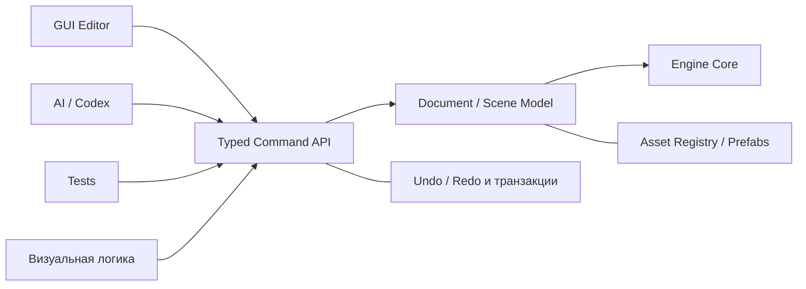

# Слои архитектуры и контракты

## Фактическая структура 00.1

Дополнение 00.2: main.cpp содержит минимальную диагностику уровней `[info]`/`[error]`, разбор --help и обработку ошибочных аргументов/сбоев вывода. Это не Logger/Result из этапа 01. Локальные scripts/verify.ps1 и ProcessRunner.psm1 выполняют проверку с логами, тайм-аутами и JSON-отчётом; .clang-format/.clang-tidy задают правила будущих инструментальных проверок. Запуск процессов и структура отчёта проверены PowerShell-тестами; C++ ещё не собран.

Корневой CMake подключает `engine/runtime` и, при BUILD_TESTING, `tests`. Цель `astro_headless` содержит только main.cpp с информацией о запуске. CTest запускает процесс и проверяет завершение и вывод. Внешних библиотек нет; окно не создаётся. Компиляция и выполнение пока не подтверждены из-за отсутствия toolchain. Это минимальная основа сборки, а не реализация перечисленных ниже контрактов ядра. См. [BUILD_GUIDE.md](BUILD_GUIDE.md).

Статус: архитектурные требования раздела 04. Перечисленные контракты и подсистемы ещё не реализованы. Конкретные C++ API, форматы и алгоритмы уточняются в явно назначенных подэтапах. [Предварительный стек](TECH_STACK.md) остаётся предметом проверки в прототипе 00.3.

## Направление зависимостей

GUI, визуальная логика и AI используют единый механизм команд для одинаковых действий, согласно P01. AI не изменяет внутреннее состояние сцен в обход команд. Optional Runtime Modules — Rendering, Physics, Audio, UI — подключаются при необходимости через границы подсистем. Core не зависит от GUI и необязательных реализаций. Конкретные интерфейсы связи модели, ресурсов и runtime подлежат дальнейшему проектированию.

## Core

Состав: EngineContext, IEngineModule, ModuleRegistry, EventBus, TimeService, Logger, ConfigurationService, Error/Result и диагностика. Ядро работает без окна.

Жизненный цикл: register → resolve dependencies → init → tick → shutdown. Требуются обнаружение циклических зависимостей, упорядоченное завершение и явное владение памятью.

## Typed Command API

Контракт команды включает идентификатор, версию, типизированный payload, проверку предусловий, dry-run где применимо, execute, result/errors, inverse/undo либо снимок транзакции и аудит.

Примеры будущих команд:

- scene.create, scene.save;
- entity.create, entity.delete, entity.set_property;
- component.add, component.remove;
- asset.replace, prefab.instantiate;
- checkpoint.create;
- save.configure, save.trigger, save.restore.

save.trigger и save.restore имеют runtime-контекст и ограничения. Не все runtime-действия обратимы: ограничения и возможность Undo должны документироваться отдельно для соответствующих команд. Перечень выше не означает готовность команд или утверждение их payload.

## Scene / ECS

Модель включает Scene ID, Entity ID, Component type/version, Property schema, hierarchy/parenting, transform, lifetime, validation и serialization.

Начальный перечень компонентов: Transform, Camera, SpriteRenderer, MeshRenderer, Light, Collider, RigidBody, AudioSource, ScriptBehavior, Health, UIBinding. Реализовывать их по мере потребности; не добавлять фиктивные «готовые» компоненты.

## Assets

Состав: AssetRegistry, AssetImporter, AssetReference, DependencyGraph, AssetProcessor; исходные файлы, метаданные и производный кэш. Требуются контроль хэшей, переимпорт, обработка отсутствующих ресурсов и упаковка только используемого.

Исходные ресурсы неизменны; оптимизированные копии и другие производные данные помещаются в пересоздаваемый кэш. Изменение модели сохраняет ID объекта и ссылки; несовместимые привязки диагностируются. Предусмотреть темы интерфейса и пользовательские UI-шаблоны.

## Prefab

Требуются вложенные префабы, варианты, overrides, обнаружение циклов и применение обновлений с сохранением локальных переопределений.

## Serialization

Требуются версии схем, миграции, резервные копии и понятные ошибки. Неизвестные данные не удаляются молча; неизвестные компоненты диагностируются. Данные редактора и игры разделяются.

## Runtime и Export

Runtime предусматривает фиксированный шаг симуляции, интерполяцию отображения, паузу и отдельное состояние Play Mode, не повреждающее редактируемую сцену.

Export создаёт самостоятельный runtime с минимальным набором используемых ресурсов. Готовая игра не включает редактор.

## Границы текущего решения

Save System & Checkpoint Editor — обязательный модуль продукта с явным выбором сохраняемых объектов, компонентов и свойств. Требования к SaveProfile, checkpoint, respawn, хранению и проверкам описаны в [SAVE_SYSTEM.md](SAVE_SYSTEM.md). Автоматическое сохранение всего мира без выбора профиля/правил запрещено. Настройки проекта и прогресс игрока хранятся отдельно. Реализация модуля отсутствует.

Адаптеры рендеринга, физики, звука и импорта должны позволять заменять библиотеки без переписывания ядра. Бинарный ABI, схемы payload, правила владения конкретными объектами и детали миграций пока не определены. Их нельзя считать готовыми контрактами реализации.
