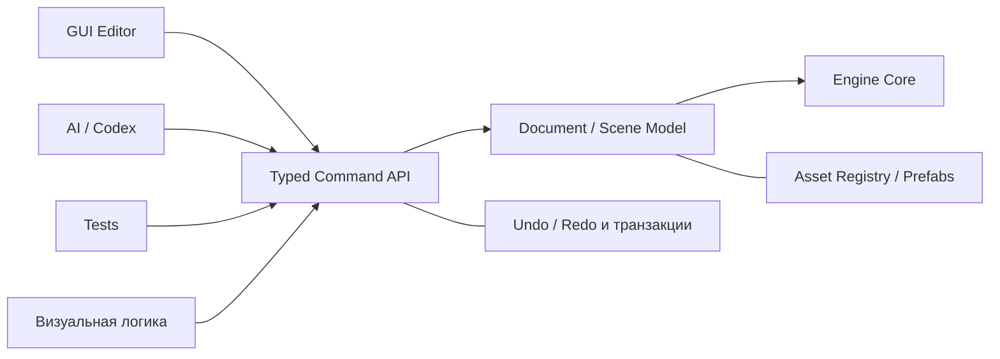

# Слои архитектуры и контракты

## Фактическая структура 00.1

Дополнение 00.2: main.cpp содержит минимальную диагностику уровней `[info]`/`[error]`, разбор --help и обработку ошибочных аргументов/сбоев вывода. Это не Logger/Result из этапа 01. Локальные scripts/verify.ps1 и ProcessRunner.psm1 выполняют проверку с логами, тайм-аутами и JSON-отчётом; .clang-format/.clang-tidy задают правила будущих инструментальных проверок. Запуск процессов и структура отчёта проверены PowerShell-тестами; C++ ещё не собран.

Корневой CMake подключает `engine/runtime` и, при BUILD_TESTING, `tests`. Цель `astro_headless` содержит только main.cpp с информацией о запуске. CTest запускает процесс и проверяет завершение и вывод. Внешних библиотек нет; окно не создаётся. Компиляция и выполнение пока не подтверждены из-за отсутствия toolchain. Это минимальная основа сборки, а не реализация перечисленных ниже контрактов ядра. См. [BUILD_GUIDE.md](BUILD_GUIDE.md).

Статус: документ фиксирует требования раздела 04. Фактическая реализация ядра отмечена в разделе Core; остальные контракты ниже являются планом, пока не подтверждены соответствующими отчётами подэтапов. [Предварительный стек](TECH_STACK.md) проверен только в пределах прототипа 00.3.

## Направление зависимостей

GUI, визуальная логика и AI используют единый механизм команд для одинаковых действий, согласно P01. AI не изменяет внутреннее состояние сцен в обход команд. Optional Runtime Modules — Rendering, Physics, Audio, UI — подключаются при необходимости через границы подсистем. Core не зависит от GUI и необязательных реализаций. Конкретные интерфейсы связи модели, ресурсов и runtime подлежат дальнейшему проектированию.

## Core

Реализованы подэтапы 01.1 и 01.2 в `engine/core`: `EngineContext` владеет `Logger` и `ConfigurationService`; `Result<T>`/`Result<void>` переносят типизированный `Error`. Logger поддерживает severity threshold и внедряемый sink, по умолчанию пишет в `clog`/`cerr`. ConfigurationService загружает и сохраняет простой UTF-8 `key=value` файл с комментариями `#`/`;`, BOM и CRLF; при ошибке разбора прежнее состояние не меняет. Это внутренний ранний формат, не финальный формат проекта/сцен; JSON и миграции здесь не реализованы.

`IEngineModule` задаёт имя, список зависимостей и методы `initialize`/`shutdown`, принимающие общий `EngineContext`. `ModuleRegistry` владеет зарегистрированными модулями через `unique_ptr`, до запуска проверяет имена и граф зависимостей, детерминированно инициализирует зависимости раньше потребителей и завершает в обратном порядке. Пропущенные/дублирующиеся зависимости, самозависимость и цикл возвращают диагностику до запуска. При ошибке инициализации ранее успешно запущенные модули откатываются; при ошибках shutdown обход продолжается, ошибки агрегируются. Модуль обязан сам очистить частичные ресурсы, если его `initialize` завершился ошибкой. После успешного запуска реестр одноразовый; повторный запуск и изменение его состава отклоняются. Планирование `tick` относится к 01.3 и пока не реализовано.

Состав: EngineContext, IEngineModule, ModuleRegistry, EventBus, TimeService, Logger, ConfigurationService, Error/Result и диагностика. Ядро работает без окна.

Подэтап 01.3 добавляет typed EventBus: события различаются типом C++, публикация синхронная, подписки получают монотонные ID; изменение подписок при dispatch безопасно через snapshot, снятая подписка пропускается, добавленная начинает получать события со следующего publish. Исключения callback переводятся в `Result` после вызова остальных подписчиков. EventBus не потокобезопасен.

`TimeService::advance(realDelta)` ограничивает frame delta, считает фиксированные шаги, максимум catch-up шагов и alpha интерполяции; избыточные целые шаги отбрасываются и учитываются в diagnostics. Pause останавливает simulation time и очищает неполный остаток accumulator при включении паузы. Пример игрового цикла: вызвать `advance(frameDelta)`, затем `ModuleRegistry::tick(fixedDeltaSeconds)` ровно `fixedStepCount` раз; renderer может использовать `interpolationAlpha`. `tick` выполняет модули в порядке инициализации, передавая фиксированный delta; ошибка возвращается вызывающему коду, который отвечает за реакцию и shutdown.

Реализованный lifecycle: register → resolve dependencies → init → fixed tick → shutdown. Конфигурация времени и система событий независимы; optional runtime modules могут не использовать EventBus.

## Typed Command API

Подэтап 01.4 реализует `CommandRegistry` в `engine/core`. `CommandSchema` задаёт ID и положительную версию; template-типы задают точный C++ payload и output; обязательный validator проверяет payload/предусловия, executor получает `EngineContext` и возвращает `Result<Output>`. `validate` выполняет validation-only/dry-run без вызова executor, `execute` повторяет validation непосредственно перед выполнением. Результат, типизированные ошибки и локальные audit entries доступны вызывающему коду. Подробный контракт и пример: [COMMAND_API.md](COMMAND_API.md).

Подэтап 01.5 добавляет `registerTransactionalCommand`: callback собирает apply/undo шаги, а registry применяет их атомарной транзакцией и включает в Undo/Redo history. Обычный `registerCommand` остаётся совместимым для необратимых операций, но после успешной валидации очищает прежнюю историю как undo-barrier до вызова executor. При ошибке применения транзакция откатывает выполненный префикс; ошибка rollback сообщается, а история очищается, чтобы не продолжать с потенциально неверным состоянием. Каждый отдельный apply/undo callback обязан быть атомарным или самокомпенсирующимся. API пока не является сериализуемой/удалённой схемой, не формирует preview diff и не реализует разрешения AI.

Подэтап 02.3 подключает `Scene::entityPropertySchema()` и `registerSceneCommands()`. Реализована команда `entity.set_property` v1 с типизированным payload `(entity ID, property ID, PropertyValue)`; validation проверяет ID сущности, существование/тип свойства, editable flag, requiredness, UTF-8 и ограничения длины/диапазона. Inspector вызывает тот же `CommandRegistry::execute`, что доступен другим потребителям. Сейчас схема сущности включает только редактируемое обязательное `Name` и read-only `ID`. Команда пока non-transactional и является undo barrier; Undo/Redo интеграция относится к 02.4.

Примеры будущих команд:

- scene.create, scene.save;
- entity.create, entity.delete, entity.set_property;
- component.add, component.remove;
- asset.replace, prefab.instantiate;
- checkpoint.create;
- save.configure, save.trigger, save.restore.

save.trigger и save.restore имеют runtime-контекст и ограничения. Не все runtime-действия обратимы: ограничения и возможность Undo должны документироваться отдельно для соответствующих команд. Перечень выше не означает готовность команд или утверждение их payload.

## Scene / ECS

`engine/scene` содержит Scene/Entity с именами и стабильными сериализуемыми ID, parent, обязательный Transform и необязательный SpriteRenderer (AssetId/visible). Transform и SpriteRenderer пишутся в Astro Scene v4 вместе с prefab instance map/overrides; загрузчик поддерживает v1–v3 миграции, операции проверяют циклы и ссылочную целостность.

В редакторе Hierarchy показывает дерево и позволяет создавать root/child entities и удалять выбранное поддерево. Выбранный SpriteRenderer показывает WIC/BGFX image preview в Inspector; полноценное пространственное отображение компонентов и runtime rendering ещё отсутствуют.

Дальнейшая модель должна включать Scene ID, Entity ID, Component type/version, Property schema, hierarchy/parenting, transform, lifetime, validation и serialization.

Начальный перечень компонентов: Transform, Camera, SpriteRenderer, MeshRenderer, Light, Collider, RigidBody, AudioSource, ScriptBehavior, Health, UIBinding. Реализовывать их по мере потребности; не добавлять фиктивные «готовые» компоненты.

## Assets

Состав: AssetRegistry, AssetImporter, AssetReference, DependencyGraph, AssetProcessor; исходные файлы, метаданные и производный кэш. Требуются контроль хэшей, переимпорт, обработка отсутствующих ресурсов и упаковка только используемого.

Исходные ресурсы неизменны; производные данные помещаются в пересоздаваемый кэш. Изменение модели сохраняет ID объекта и ссылки; несовместимые привязки диагностируются. Предусмотреть темы интерфейса и пользовательские UI-шаблоны.

В 03.2 добавлен `astro_assets::AssetRegistry`: project-root `Assets/` — source root, `.astro/assets.index` хранит AssetId, относительный UTF-8 путь и metadata, `Library/Assets` — игнорируемый кэш по SHA-256. Удалённый/изменённый источник не переписывается автоматически. Панель редактора показывает missing source; Windows WIC декодирует изображения для preview. PNG/JPEG importer checks остаются структурными и не гарантируют успешного WIC decode. Публичный API и лимиты: [ASSET_PIPELINE.md](ASSET_PIPELINE.md).

## Prefab

В 03.4 добавлен `astro_prefabs`: project-local `Prefabs/<id>.astro-prefab` хранит дерево с локальными стабильными ID, Transform, SpriteRenderer и вложенными prefab ссылками. `capturePrefab` копирует выбранное поддерево Scene. `instantiatePrefab` проверяет граф и создаёт развернутое дерево; source keys связывают asset nodes с EntityId экземпляра. Overrides Name/Transform/SpriteRenderer записываются в Scene v4, а `updatePrefabInstance` применяет новые базовые значения, сохраняя EntityId и локальные overrides. Устаревший source key с override отклоняет обновление, не теряя данные. `prefab.instantiate`, `prefab.set_override`, `prefab.update_instance` зарегистрированы как транзакционные команды с Undo/Redo по полному снимку Scene. Пока нет редакторского UI, variant prefabs, granular conflict merge и истории изменений между пользователями.

## Serialization

Требуются версии схем, миграции, резервные копии и понятные ошибки. Неизвестные данные не удаляются молча; неизвестные компоненты диагностируются. Данные редактора и игры разделяются.

## Runtime и Export

Runtime предусматривает фиксированный шаг симуляции, интерполяцию отображения, паузу и отдельное состояние Play Mode, не повреждающее редактируемую сцену.

Export создаёт самостоятельный runtime с минимальным набором используемых ресурсов. Готовая игра не включает редактор.

## Границы текущего решения

Save System & Checkpoint Editor — обязательный модуль продукта с явным выбором сохраняемых объектов, компонентов и свойств. Требования к SaveProfile, checkpoint, respawn, хранению и проверкам описаны в [SAVE_SYSTEM.md](SAVE_SYSTEM.md). Автоматическое сохранение всего мира без выбора профиля/правил запрещено. Настройки проекта и прогресс игрока хранятся отдельно. Реализация модуля отсутствует.

Адаптеры рендеринга, физики, звука и импорта должны позволять заменять библиотеки без переписывания ядра. Бинарный ABI, схемы payload, правила владения конкретными объектами и детали миграций пока не определены. Их нельзя считать готовыми контрактами реализации.

## Подэтап 02.1
Добавлен optional astro_editor: окно, docking, меню и project.astro. Подэтап 02.2 добавил минимальную in-memory Scene Model и панели Hierarchy/Scene View; точные границы перечислены выше и в [отчёте](reports/02.2.md).

## Файловая сцена и история (02.4)

В 02.4 `astro::scene::saveSceneFile`/`loadSceneFile` впервые сериализовали Scene/Entity в Astro Scene v1. Текущая версия формата — v3: v2 добавил Transform, v3 — SpriteRenderer/AssetId. Загрузчик читает v1 и v2, полная валидация выполняется до публикации модели; формат описан в [FILE_FORMATS.md](FILE_FORMATS.md). `entity.set_property` и `entity.set_sprite_renderer` транзакционны и используют историю CommandRegistry. Создание/удаление сущностей пока выполняются напрямую моделью и не отменяются; редактор очищает историю при смене/создании сцены.

## Компоненты и Transform (03.1)

Каждая `Entity` содержит обязательный `TransformComponent` версии 1 и может содержать один `SpriteRendererComponent` версии 1 с AssetId и видимостью. `ComponentId` уникален в пределах сцены и сохраняется вместе с сущностью; удалённые ID не переиспользуются в течение жизни сцены. Transform хранит локальные position, Euler rotation и scale; матрицы и пространственная композиция пока не реализованы. Неизвестные типы файла дают ошибку диагностики.

Astro Scene v4 сериализует ID, Transform, SpriteRenderer и prefab instance metadata. Загрузчик читает v1–v3, а сохранение явно мигрированной сцены создаёт v4. Формат и миграционное правило: [FILE_FORMATS.md](FILE_FORMATS.md).

## Derived resources и dependency graph (03.5)

`astro_assets` теперь включает явный `AssetDependencyGraph` и детерминированный сбор reachable AssetId в content-addressed `Library/Derived` package. Это слой между registry и будущим export; он не анализирует Scene/Prefab зависимости автоматически, не перекодирует картинки и не считается кроссплатформенным runtime/export.

## Подэтап 04.1 — Runtime Session

Добавлен `astro_runtime_session` и `astro::runtime::RuntimeSession`: Play копирует авторскую Scene, фиксированные callback-шаги изменяют только runtime-копию, Pause останавливает шаги, Step исполняет один шаг и остаётся на паузе, Stop освобождает сессию. Callback error переводит состояние в Faulted. Это headless API, не редакторский Play UI и не готовые игровые системы. Пример и ограничения: [RUNTIME.md](RUNTIME.md).

## Input Mapping (04.2)

`astro_runtime_input` предоставляет action map, independent от оконного backend; bindings принимают keyboard key/scancode, mouse buttons/delta/wheel, gamepad buttons/axes и ведут state/edge flags. `astro_runtime_sdl_input` — optional SDL3 adapter для editor-enabled сборки. Пример, frame ordering и ограничения: [INPUT_MAPPING.md](INPUT_MAPPING.md).

## Camera Rig (04.3)

`astro_runtime_camera` рассчитывает runtime camera pose по target Transform: есть программные presets, follow offset, exponential smoothing, AABB bounds и ограниченный zoom. Он не подключён к renderer и не сериализуется в Scene. API, пример и ограничения: [CAMERA_RIG.md](CAMERA_RIG.md).

## Runtime events and interaction (04.4)

`astro_runtime_interaction` registers programmatic runtime behavior for target entities and publishes sequenced `InteractionEvent` values through the existing typed `core::EventBus`. Request validation covers enabled state, entities, Transform and distance; callback executes against the supplied runtime Scene and reports Activated/Rejected events. Details and example: [INTERACTION_SYSTEM.md](INTERACTION_SYSTEM.md).

## Runtime 2D physics and collision events (05.1)

`astro_runtime_physics2d` binds runtime-only static/dynamic bodies and axis-aligned box colliders to one SceneId. Its caller supplies fixed steps and the runtime Scene; collision enter/stay/exit events use the core EventBus. Solid response is limited to axis positional correction; triggers report overlap without correction. It does not change the serialized Scene component model. Details: [PHYSICS_2D.md](PHYSICS_2D.md).
