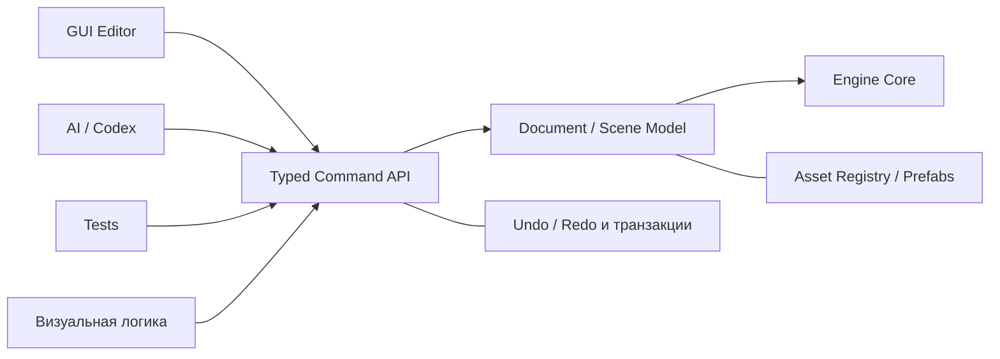

# Слои архитектуры и контракты

## Локальный Codex adapter (09.2)

Опциональный `astro_ai_editor` зависит от `astro_scene` и использует `AIEditorApi` для read-only снимка активной загруженной сцены и каталога зарегистрированных команд. План содержит только описательные намерения, ID команд и версии схем; adapter проверяет их по текущему каталогу, но не исполняет и не сканирует файловую систему. Он не является границей безопасности. См. [AI_INTEGRATION.md](AI_INTEGRATION.md) и [D248](DECISIONS.md#d248--in-process-codex-project-context-and-plan-validation-092).

## Scene change preview и подтверждённое применение (09.3a–09.3g)

Для зарегистрированных transactional-команд `entity.set_property`, `entity.set_sprite_renderer`, `camera3d.set_lens` и `camera3d.set_active` adapter/review model создают typed diff для имени сущности, видимости существующего SpriteRenderer, параметров объектива или активного выбора Camera3D. Editor хранит предложение и идентичность активных project/scene; прямое подтверждение заново проверяет актуальное состояние, затем вызывает исходную команду через `AIEditorApi`. Поэтому применение использует обычные валидацию и Undo/Redo `CommandRegistry`. Camera lens snapshot включает Component ID и active-флаг; выбор камеры сохраняет ID предыдущего и целевого компонентов и отвергает устаревший выбор. Очистка активной камеры явно отличается от переключения и не меняет runtime-копию сцены Play Mode. Срезы 09.3d/e/f/g также используют существующие транзакции для создания встроенного примитива, добавления неактивной камеры и переключения/очистки активной камеры. Review model — UX-механизм внутри доверенного процесса, не security boundary, permissions, sandbox или общий rollback/checkpoint API. UI не добавляет SpriteRenderer и не меняет его AssetId.

### Transform и Camera3D: локальные данные и мировая поза (09.3h–09.3j)

`TransformComponent::value` хранит позицию, вращение и масштаб относительно родителя. Рендер и `resolveSceneCameraPose` композируют цепочку родителей для получения мировой матрицы/позы камеры. Это два разных представления: любое будущее AI review должно явно маркировать редактируемый Transform как local и показывать рассчитанное world-space следствие отдельно, только для чтения. Подэтап 09.3h установил отсутствие команды; в 09.3i зарегистрирована транзакционная `entity.set_transform` v1. Команда принимает полный локальный Transform, проверяет payload через текущий `Scene::setTransform`, сохраняет Transform Component ID и обеспечивает Undo/Redo. `entity.set_property` по-прежнему отвечает только за `name`.

Валидация сохраняет прежний Scene контракт: все 9 чисел должны быть конечными; новые диапазоны не вводились, в том числе нулевой scale не запрещён. AI Change Review в 09.3j создаёт read-only diff локального Transform и применяет его только через `entity.set_transform`. Preview хранит ID компонента и снимок локального значения/родителя для сущности и каждой вершины цепочки вверх. Перед подтверждением весь снимок пересчитывается; изменение любой сущности или родителя отклоняет устаревшее предложение. Для Camera3D Editor отдельно вычисляет и показывает мировые position, target и up до/после на копии Scene; это производные значения, они не являются командным payload. При сингулярной иерархии world pose может быть недоступна, но локальная команда сохраняет прежний конечный числовой контракт. UI остаётся доверенным in-process UX, а не границей безопасности. См. [09.3h assessment](reports/09.3h-transform-contract-assessment.md), [09.3i report](reports/09.3i-transform-command.md), [09.3j report](reports/09.3j-transform-review.md), D256–D258.

В 09.3k `entity.reparent` v1 задаёт нового родителя или корень сцены (`parent = 0`) и сохраняет локальный Transform перемещаемой сущности и относительную иерархию потомков; мировые матрицы/позы остаются производными и могут измениться. Команда проверяется на копии Scene и транзакционно проверяет родителя до apply/undo, сохраняя Transform ComponentId. AI preview фиксирует Scene/Entity/Transform IDs, исходного родителя, обе цепочки родителей и полный затронутый subtree. Перед подтверждением они сверяются повторно; любое изменение, включая потомка, приводит к отказу и запросу свежего preview. Для Camera3D Editor показывает вычисленную мировую позу до/после, не превращая её в payload. «Сохранить мировую позу» не поддерживается: это потребует отдельного математического контракта для вращения и неравномерного масштаба. Подробности: [09.3k report](reports/09.3k-entity-reparent-review.md), D259.

## Scene/Game sRGB attachment boundary (07.2ce prototype)

The optional BGFX Scene/Game targets use mutable-sRGB BGRA8 attachments when the active backend advertises the required texture and framebuffer capabilities. Every producer into these targets emits linear RGB and linear alpha coverage; the attachment handles encoding and blend-space conversion. The Editor swapchain remains a distinct presentation target; ImGui samples encoded attachment values without sRGB decode. Capability absence retains the legacy ordinary-BGRA8 output contract with a diagnostic. This boundary is currently verified only with Windows D3D11; it is not a general cross-backend rendering contract. See [D217](DECISIONS.md#d217--capability-gated-srgb-scene-targets-072ce) and [07.2ce report](reports/07.2ce-linear-light-srgb-attachments.md).

## Scene/Game alpha blend boundary (07.2cd assessment)

The current BGFX Scene/Game color attachment is ordinary BGRA8. Linear 3D shader RGB is sRGB-encoded before straight-alpha blending, so blended overlaps are not linear-light correct. The displayed Scene/Game target is opaque and sampled through the pass-through ImGui path; that composition preserves the already-rendered image and does not correct its internal blending. A candidate is a capability-gated mutable-sRGB BGRA8 attachment, with every Scene/Game producer (including 2D sprite texture/tint) emitting linear RGB. Keep the Editor swap chain and ImGui output contract unchanged. See [07.2cd assessment](reports/07.2cd-alpha-blend-target-assessment.md).

## BGFX color conversion boundary (07.2cc)

Material semantics remain role-based: numeric color factors and imported vertex RGB are linear-light; base-color/emissive image RGB is sRGB encoded, image alpha is linear, and normal/metallic-roughness channels are data. No general serialized color-space field was added.

BGFX CPU preparation decodes image sRGB, applies the linear material factor once and generates linear mips into BGRA8 uploaded with `BGFX_TEXTURE_NONE`. Lit textured shaders now consume that linear sample without another decode; Runtime BGFX sets a white shader factor for textured draws because the factor is already baked. Unlit texture and vertex-color paths encode RGB once; lit paths encode after Lambert multiplication. Ordinary BGRA8 targets and backbuffer remain unchanged. The D3D11 GPU screenshot smoke passed the expected bytes for 128 sRGB gray × 0.5 factor: unlit texture 93, lit texture 66 at 0.5 diffuse, unlit vertex color 128 from linear byte 55, and lit vertex color 66. See [07.2cc](reports/07.2cc-bgfx-color-transfer.md).

Limitation: fixed-function alpha blending still operates on the ordinary BGRA8 target after shader RGB encoding, so transparent blending is not guaranteed to be linear-light correct. Smoke tests verify visible overlap/alpha coverage, not colorimetric blend accuracy. A color-managed blend target/composition design and validation on additional backends remain separate work.

## Scene 3D rendering data and optional Runtime BGFX adapter (07.2bk–07.2bu)

### Directional diffuse lighting in Scene View (07.2bz)

Scene View resolves enabled `DirectionalLight3D` directions from hierarchical transforms, orders them by stable EntityId, and submits up to four lights to the project-owned Lambert shaders. Its mesh vertex layout includes authored normals, transformed per draw by the inverse-transpose world matrix; the Scene View target receives the same lit programs and light uniforms as the optional BGFX path. The existing Scene View render path remains responsible for its material, MASK, BLEND and fallback behavior. With no enabled light, it submits the original unlit shader programs. Project model preview remains unlit. A controlled Windows x64/D3D11 smoke compares a raw Scene View crop for the legacy and zero-light Lambert programs and tests separate front/back pixel regions. The selected-entity Inspector now authors the same component through typed commands; its displayed world direction is derived from local -Z and the Transform hierarchy. This is not PBR or a cross-backend policy. See [07.2ca](reports/07.2ca-scene-view-lighting-equivalence.md) and [07.2cz](reports/07.2cz-directional-light-inspector.md).

### Directional diffuse lighting in Runtime BGFX Game View (07.2by)

The typed Scene directional-light component and deterministically EntityId-sorted render packet feed a Windows BGFX Runtime/Game View path capped at four lights. The adapter uploads authored mesh normals and applies a CPU-computed inverse-transpose 3x3 matrix for world rotation and non-uniform hierarchy scale. Project-owned vertex/fragment shaders perform bounded Lambert diffuse. Texture RGB samples are decoded from sRGB; mesh vertex colors and `baseColorFactor` are treated as linear; lit RGB is encoded to sRGB. With no light, the shader leaves the existing color unchanged. Meshes without normals stay visible through an unlit fallback and produce an Editor diagnostic; lights beyond four are omitted with a diagnostic. Scene View uses the same directional-light data contract through its own Scene renderer path as of 07.2bz; Project model preview remains unlit. The focused pixel smoke verifies red-lit Game View and Scene View images, and the prior no-light, texture, MASK, mip and fallback smoke set remains green. Exact image equivalence, opposite-face samples, PBR, shadows and non-Windows backends are not validated. See [07.2by](reports/07.2by-bgfx-directional-diffuse.md) and [07.2bz](reports/07.2bz-scene-view-directional-diffuse.md).

### Lighting vertical slice assessment (07.2bv, historical)

The 07.2bv assessment described the pre-lighting state and recommended adding a typed directional light and packet before GPU work. It is superseded by 07.2bw (light data), 07.2bx (visual-path assessment), and the limited implementation in 07.2by. See the [07.2bv assessment](reports/07.2bv-lighting-vertical-slice-assessment.md).

### Runtime BGFX MASK base-color pass (07.2bu)

Для OPAQUE и MASK adapter передаёт alpha mode/cutoff в существующий textured/color shader. MASK остаётся depth-writing alpha test без blending; texture mip preparation использует coverage-aware alpha mode, cache identity включает alpha mode и cutoff. BLEND/неподдержанные PBR bindings отклоняют весь adapter pass и сохраняют Editor renderer fallback. Stage smoke подтверждает textured source glTF MASK в Play на Windows D3D11; это не lighting/PBR path и не другая платформа. См. [07.2bu](reports/07.2bu-runtime-bgfx-mask.md).

### Runtime BGFX mip min-filter comparison (07.2bt)

Четыре glTF mip min-filter enum проверяются отдельными Game View smoke на фиксированной уменьшенной checker-текстуре. Renderer передаёт sampler policy в BGFX, а smoke проверяет enum и диапазон видимых source pixels. На Windows x64 / D3D11 все четыре случая проходят; это не платформенно-независимый visual golden и не подтверждение совпадения фильтрации на иных GPU/backend. Подробности: [07.2bt](reports/07.2bt-runtime-bgfx-mipmap-comparison.md).

`astro_scene_render3d` отделяет Scene traversal от BGFX/SDL: на входе `Scene`, optional `AssetRegistry` и optional `SceneMeshResolver`; на выходе camera pose, world-transform matrix, immutable shared geometry, component/entity identity, material values/reference и diagnostics. Renderer/import backend реализует mesh callback; встроенные формы строятся через `MeshData::makePrimitive`. Активная Camera3D обязательна, bad object transform/material/geometry диагностируется и опускает только этот объект. Material override из Scene имеет приоритет над callback source material. Editor camera pose теперь использует тот же общий transform resolver.

Опциональный Windows x64 `astro_runtime_bgfx_scene3d` потребляет packet и подаёт каждый item в BGFX view с packet camera и world matrix. Геометрия кэшируется по content hash и base-color factor; хозяин BGFX очищает cache/renderer до shutdown BGFX. С 07.2bn Editor может передать runtime-копию из Play session в adapter для Game View, переиспользуя BGFX context, shader и framebuffer Editor. Функция существует только при `ASTRO_BUILD_RUNTIME_BGFX_3D=ON`; сцены с texture/alpha-путями adapter отклоняет и рендерит прежний Editor renderer. Поддерживаются vertex color и opaque baseColorFactor; полноценные PBR, texture maps, alpha passes и другие backends остаются вне adapter.

07.2bo закрепляет это поведение двумя независимыми Editor Play smoke: поддерживаемая opaque сцена даёт adapter submission, а текстурированная сцена даёт ноль adapter submissions и остаётся на textured Editor renderer. Проверяются route/submission counters, а не точные pixels; ни одна ветка не допускает смешанного частичного render pass.

С 07.2bp adapter принимает проектную base-color texture: opaque material, image AssetId, UV0, identity UV transform, nearest/linear non-mip minification, nearest/linear magnification и repeat/mirror/clamp wrap. В 07.2bq такой же subset поддерживает локальное внешнее glTF изображение, когда Scene не переопределила source material. Packet передаёт только импортированный source path и hash; host canonicalizes path и декодирует через WIC лишь regular files внутри project `Assets`. GPU cache keyed по source path + SHA + factor, общий лимит 256 MiB. Остальные PBR карты, alpha mask/blend, mip-фильтры, UV transform/UV1 отвергаются и переключают весь pass на Editor renderer. Smoke совместно проверяет project и source glTF texture submissions; integration проверяет packet metadata.

07.2br оценил mip-путь: Runtime пока создаёт одноуровневую texture, тогда как `prepareLinearBaseColorMipChainBgra8` уже создаёт bounded linear-space цепочки и существующие Editor tests покрывают alpha-aware generation. Отдельный Runtime этап должен загрузить все уровни, учитывать полный размер цепи в cache и проверять ошибки/cleanup на BGFX backend. До этой реализации Runtime mip-фильтры остаются fallback; MASK/BLEND не включаются.

В 07.2bs Runtime BGFX создаёт mip-enabled texture для opaque base-color materials, повторно используя CPU `prepareLinearBaseColorMipChainBgra8`. Каждый уровень передаётся в `updateTexture2D`; полный размер цепи считается в общем 256 MiB GPU texture cache. `MIP_POINT` и `MIN_POINT` строятся из общего `selectBaseColorMinFilter`; ключ GPU texture различает одноуровневый и mipmapped resources. Smoke проверяет mip-chain cache entry в Play Game View. `updateTexture2D` не возвращает результат upload, поэтому host может подтвердить allocation и поставить все уровни в очередь BGFX, но не получить поздний per-level backend error. Alpha, PBR maps, UV1/transform и другие backend остаются fallback.

Built-in `PrimitiveRenderer` принимает optional project material AssetId. Изменение проходит через отдельную typed-транзакцию; Editor предлагает только зарегистрированные ресурсы. Scene v11 сохраняет ссылку в PrimitiveRenderer v2, Scene v10 мигрирует с пустым override. BGFX Scene/Game View использует существующий material path, не создавая и не изменяя файлы исходных ресурсов. Smoke отдельно считает textured submission materialized primitive в каждом viewport, а Game View должен разрешить активную Camera3D; Scene View дополнительно проверяется уникальной жёлтой pixel mask, не совпадающей с основными цветами 2D маркеров.

## Runtime 3D readiness (07.2bj)

`SDLCanvas2DRenderer` по-прежнему обслуживает общий runtime 2D backend. Editor BGFX Game View при Play может использовать опциональный 3D adapter для поддерживаемого содержимого; Editor остаётся владельцем окна, BGFX context и framebuffer. Unsupported packet/render errors безопасно возвращают весь 3D pass к прежнему renderer. Это не самостоятельный exported runtime host и не переносимо за Windows x64/D3D11. См. [07.2bn](reports/07.2bn-editor-game-view-runtime-bgfx.md).

## Редактирование PrimitiveRenderer (07.2bf)

Inspector редактирует только существующий `PrimitiveRenderer`: вид геометрии и флаг видимости. Изменения направляются через `entity.set_primitive_renderer` v1, поэтому используют общую валидацию и Undo/Redo. Размер, поворот и позиция остаются свойствами общего `Transform`; отдельные material/color свойства примитива пока отсутствуют.

## Транзакционное создание и удаление примитивов (07.2be)

Hierarchy использует общие Scene-команды `entity.create_primitive` и `entity.delete_subtree`; GUI и in-process typed API поэтому применяют одинаковые проверки и историю Undo/Redo. Создание восстанавливает сущность и PrimitiveRenderer с прежними стабильными ID; удаление восстанавливает снимок сцены, включая иерархию и метаданные экземпляров prefab. Проверка dry-run выполняется на копии Scene. Снимок для удаления пока копирует весь документ, поэтому память транзакции растёт вместе со сценой.

## Scene primitive geometry (07.2bd, updated in 07.2be)

The Scene document persists a `PrimitiveRendererComponent` by stable component ID and one of four bounded primitive kinds. It stores no generated vertex data or project asset path: `MeshData::makePrimitive` deterministically produces unit-scale indexed geometry at render-cache creation. The Editor Scene/Game renderer uploads that data to its existing BGFX mesh cache. Imported `MeshRenderer` remains unchanged and cannot coexist with `PrimitiveRenderer` on one entity. Scene v10 adds the component record; earlier versions remain readable.

## Обзор пути проекта (07.2bc)

Project Open использует SDL3 системный file dialog с фильтром `.astro`, а New Project — folder dialog для выбора существующего родительского каталога. Создаваемый путь получается как `parent / projectName`; имя валидируется как один компонент пути, чтобы не допустить выхода из родителя. Существующий каталог не перезаписывается. SDL вызывает завершение асинхронно; callback сохраняет результат в защищённое состояние запроса, а UI применяет его в главном цикле. UTF-8 путь копируется только при вмещении в поле; отмена не очищает и не переписывает текущий ввод. Работа зависит от SDL3 dialog subsystem, уже включённой в сборке редактора, и не добавляет отдельной зависимости.

## Захват drag в Scene View (07.2bb)

Rendered Scene View начинает правый orbit или средний pan только при нажатии внутри viewport. После начала захват действует до отпускания кнопки даже при выходе курсора за viewport; колесо масштабирует только при наведении. Scene smoke проверяет изменение yaw/focus при выходе за границу, фактическое получение press внутри и отказ для нажатий, начатых снаружи. Поведение применено к окну редактора; input и камера проекта не записываются в сцену. Синтетическая SDL-проверка не подтверждает физическую мышь.

## Захват drag в Project model viewport (07.2ba)

В выбранном Project preview right/middle gesture начинается только если в пределах видимого image rect пришёл `ImGui::IsMouseClicked`. Состояние соответствующей кнопки сохраняет захват после выхода курсора за rect; камера обновляется по `MouseDelta` до отпускания. Каждая кнопка сбрасывает захват, как только `MouseDown` становится false; изменение asset/root очищает оба состояния явно. Колесо остаётся hover-only. Smoke проверяет движение за границу, отказ при down снаружи и отпускание. Это изменение относится к Project preview; Scene View сохраняет свой прежний hover-scoped input.

## SDL/ImGui gestures для Project model preview (07.2az)

Camera callbacks Project preview остаются привязаны к `ImGuiIO::MouseDown` и `MouseDelta`: правая кнопка вызывает orbit, средняя — pan. Smoke подаёт через SDL queue курсорное движение, button down, motion с соответствующим SDL button-state и button up отдельными кадрами. `ImGui_ImplSDL3_ProcessEvent` обрабатывает события в штатном цикле; последующая проверка требует изменения yaw для right drag и focus для middle drag. События адресованы только окну smoke и завершаются release. Это интеграционная проверка SDL→ImGui→viewport, а не `SendInput` и не физическое действие пользователя.

## Resize и прокрутка Project model preview (07.2ay)

Панель Project отслеживает свой текущий размер. После изменения ширины или высоты сбрасывается флаг однократного scroll-to-preview, и выбранный viewport вновь прокручивается в видимую область. Resize не трогает выбранный AssetId, временную preview Scene или камеру. Smoke завершается в окне 864×608 и каждый кадр сравнивает прямоугольник ImGui image с фактическим clip rect Project; успешное завершение требует полного попадания viewport внутрь clip rect.

## Ручная проверка Project model preview (07.2ax)

В Windows D3D11 UI выбранная зарегистрированная glTF-модель отображалась в Project viewport с двумя неперекрывающимися primitives; фактический mouse wheel менял зум. Текущая preview-карточка строится с aspect 4:3 (`height = 0.75 * width`), при узком dock width действует минимум 160×120 логических пикселей. Не заявлять ручную проверку orbit/pan: доступный computer-use слой генерирует только left-button drag, тогда как эти gestures закреплены за правой/средней кнопками. User OBJ/FBX к этому glTF adapter не относятся.

## Проверка управления камерой model preview (07.2aw)

Изолированный Project viewport использует тот же `SceneViewTarget` и `SceneViewCamera3D`, что и настоящие мышиные orbit/pan/zoom callbacks. Smoke после Frame All подаёт ограниченные тестовые delta-вводы в эти методы и проверяет изменение yaw, focus и camera distance, а также отдельные draw submissions для обеих glTF primitives. Тестовый glTF расширяется только в smoke-проекте. Проверяется контроллерная wiring и кадрирование BGFX target; это не имитация физических событий мыши и не визуальный golden.

## Изолированный Project model viewport (07.2av)

Project model preview создаёт временную Scene, содержащую по одному `MeshRenderer` на импортированную glTF primitive. Scene не сериализуется и не связана с основной Editor Scene. Отдельный `SceneViewTarget` использует BGFX color/depth framebuffer и view IDs 5/7; Scene/Game views остаются на 1–4, ImGui — на 0. Целевая камера и GPU mesh/material caches принадлежат этому preview target и освобождаются при смене выбранного AssetId/root либо при его завершении. `Frame All` центрирует bounds; orbit/pan/zoom влияют только на локальную камеру. Защита preview: максимум 128 primitives, 64 MiB vertex/index geometry; существующие пределы renderer и texture cache также остаются действующими. Источник остаётся read-only, возможна запись только производного importer cache в Library.

## Asset previews в Project (07.2au)

Выбранный image отображается через существующий BGFX texture cache; при его отсутствии Project загружает только `AssetRegistry::cachedPath(id)` через ограниченный Windows WIC decoder. Изображение не читается по произвольному UI пути. Выбранная model проходит через glTF importer по registry-owned Assets-relative source path; карточка показывает количество meshes, primitives, vertices и triangle indices, а importer diagnostic — при ошибке. Сводка кешируется до смены выбора. Preview не меняет Scene и исходные файлы; importer может заполнить производный Library cache. Это не полноценное 3D viewport и не preview material/script.

## Read-only Asset Browser (07.2at)

`AssetBrowserModel` объединяет `AssetRegistry::entries()`, `modelEntries()`, `materialEntries()` и `scriptEntries()` в детерминированный список `{AssetId, kind, sourceRelativePath}`. Фильтрация по типу и точному UTF-8 substring пути/decimal ID выполняется над этим списком. Project window держит каталог для текущего registry root и числа записей в каждой карте; новый root или изменение количества записей помечает его для перестройки, также доступен явный Refresh. Видимые UI rows ограничены `ImGuiListClipper`, остальные записи не создают widgets. Модель не ищет по диску, не разрешает произвольные пользовательские пути и не открывает/изменяет source. Registry entry selection повторно отображается существующей Project card. Обновления `.astro/assets.index` другими процессами не синхронизируются с открытой in-memory registry.

## Выбор зарегистрированного ресурса из Game View diagnostics (07.2as)

Renderer добавляет related AssetId только при наличии конкретной связи с разрешённым model/material. UI не выводит путь из текста диагностики: он разрешает ID заново через активный AssetRegistry и показывает действие лишь при совпадении корня project snapshot с текущим registry root. Выбор сохраняет typed ID и project root, затем Project повторно проверяет запись и отображает только kind, ID и source-relative path. Это навигация и инспекция метаданных, не открытие файла, импорт или изменение ресурса. Если AssetId отсутствует, устарел или проект сменился, кнопка и детали скрыты. Entity selection и Hierarchy navigation остаются отдельными действиями. Полный индексируемый Asset Browser здесь не реализован.

## Переход из Game View diagnostics к сущности mesh/material (07.2ar)

`SceneViewTarget` хранит диагностические записи текущего кадра отдельно от агрегированного текста; запись получает related EntityId только когда ошибка возникла при обработке конкретного Scene `MeshRenderer` или активной Camera3D. Diagnostics выводит строки отдельно и предлагает выбрать связанную сущность, раскрывая предков и прокручивая Hierarchy через общий Editor selection. Ошибки кадрирования/камеры без объекта и устаревший EntityId не получают действия. Неразрешённая геометрия одного объекта не прекращает отрисовку остальных мешей. Это Editor UI и не меняет Scene schema, command API, AssetRegistry или runtime.

## 3D Game View в Console и переход к Camera3D в Hierarchy (07.2aq)

В общем Editor окне Diagnostics показывается текущий снимок диагностик Game View 3D target. Он заменяется при следующем успешном render кадре, поэтому повторяющееся сообщение не копится как отдельные строки в Recent diagnostics. Если причина относится к pose активной Camera3D, связанный EntityId даёт действие выбора: обновляется общий `selectedEntity`, раскрываются предки и Hierarchy прокручивается к строке. Если active camera отсутствует, выводятся сущности сцены с Camera3D как кандидаты для выбора; переход не назначает им active и не меняет модель сцены. Ошибки Mesh/asset без конкретной camera pose остаются диагностикой без camera link. Функция Editor-only, не добавляет Scene/API/serialization изменений.

## Диагностики 3D Game View (07.2ap)

`SceneViewTarget` накапливает сообщения 3D рендера по кадру. Game View отображает их поверх BGFX изображения в ограниченной полупрозрачной карточке; Diagnostics/Console подключён к тому же состоянию в 07.2aq. Длинный текст обрезается геометрией карточки. Известные сообщения отсутствующей активной камеры и невалидного camera Transform локализуются через общий каталог Editor. Диагностика не блокирует Game View: при ошибке камеры 2D слой продолжает обновляться, 3D пропускается. Схема сцены и render API не меняются. Smoke на временной сцене проверяет видимый localized-text путь, отсутствие submissions и сохранение обычного camera-driven path.

## Активная Scene Camera3D в Game View (07.2ao)

Game View выбирает единственную `Camera3DComponent::active`, получает pose из world matrix сущности с учётом родительской иерархии, преобразует FOV из градусов в радианы и строит view/projection для текущего pixel-aspect framebuffer. Иерархический world matrix helper общий со статическим mesh draw path Scene View; циклический/повреждённый parent chain, отсутствующий Transform, нулевой scale и non-finite/out-of-range transforms отклоняются диагностикой. Scene View продолжает использовать editor orbit camera. Game View 3D pass получает depth attachment и рисуется до текущего независимого ортографического 2D SpriteRenderer pass. Отсутствующая/невалидная активная камера пропускает только 3D draw; target записывает сообщение, которое отображается в Game View начиная с 07.2ap. Это Editor preview path на Windows D3D11 при включённом glTF renderer, не игровой runtime/Play camera pipeline. Материалы, освещение, тени и 2D/3D глубинная композиция пока не обеспечены.

## Active Scene Camera3D and Inspector (07.2an)

`Camera3DComponent` schema v2 adds the persisted `active` flag. Scene validation permits at most one active camera. `camera3d.add`, `camera3d.remove`, `camera3d.set_lens`, and `camera3d.set_active` are typed transactional commands; Undo/Redo preserve stable component IDs and active selection. Inspector edits FOV/near/far with explicit Apply and changes active selection immediately through the same command registry. Scene v9 stores the flag; Scene v8 Camera3D v1 migrates to inactive, and old versions upgrade only on explicit save. 07.2ao consumes this selection in the Editor Game View; it is not yet used by standalone runtime/Play.

## Scene Camera3D component foundation (07.2am)

`Camera3DComponent` stores perspective lens values (`verticalFovDegrees`, `nearPlane`, `farPlane`) on an Entity; the existing Entity Transform is the pose. FOV must be finite and strictly within (0,180), and clipping planes must be finite with `0 < near < far`. This initial data stage added Scene v8 and reads older files without synthesizing cameras. 07.2an adds active selection, Inspector and Scene v9. Neither stage derives the runtime view matrix from Transform or renders Game View. On localized MSVC/Ninja, the optional `ASTRO_MSVC_SHOWINCLUDES_PREFIX` configure value supplies the compiler's actual `/showIncludes` line so Ninja tracks headers and avoids stale object layouts.

## Реальный переход окна между display с разным DPI (07.2al)

`--smoke-window-mixed-dpi` перечисляет SDL displays и запускается только при наличии пары с разными `SDL_GetDisplayContentScale`. Smoke перемещает настоящее Editor окно в рабочую область целевого дисплея, дожидается согласования `SDL_GetWindowDisplayScale()` и применённого ImGui scale, затем возвращает окно к исходному экрану и проверяет восстановление UI. Если пара экранов не найдена, CTest помечает проверку skipped (код возврата 77). Display/scale события записываются диагностически, но не считаются обязательными: на проверенной Windows машине переход на 1.0 не доставил события, при этом существующий per-frame опрос обновил UI scale с 1.25 на 1.0; обратный переход доставил оба события. Так проверяется поведение SDL3 на текущей конфигурации, без изменения формата сцены, dock layout или публичного API.

## Editor window geometry and display changes (07.2ak)

The Editor queries SDL's usable display rectangle in logical coordinates. `EditorWorkspaceLayoutPolicy::constrainWindow` is the pure policy for reducing an oversized window and clamping its origin into that rectangle; SDL display, display-scale and resize events apply the result to the actual window. Unit tests cover negative display origins, all four edges, an oversized window and valid dimensions. An Editor SDL smoke queues a display-change event after moving the test window outside the usable area, then checks final SDL coordinates and size. This verifies the current Windows SDL3 path; it does not exercise a real monitor hot-plug or a transition between displays with different DPI values.

The compact spatial MASK screenshot tests focus on their Scene View mesh/texture/alpha assertions. Their default 2D color markers can be covered by opaque 3D geometry in that view, so the generic whole-window marker assertion is retained for the ordinary Editor smoke and is not treated as an independent 2D visibility guarantee for the compact 3D-only cases. 2D composition remains covered by its runtime integration tests.

## Scene material binding, Inspector and first draw prototype (07.2d–07.2f)

`MeshRendererComponent` persists an optional project material AssetId override on its selected primitive. AssetId zero means use the glTF source primitive material, whose numeric source index remains importer metadata and is not rewritten as a project ID. Scene file v7 stores the override in MeshRenderer schema v2; readers accept v1–v6 and upgrade old files only when the project explicitly saves. `entity.set_mesh_material_override` uses the shared typed transactional command registry and supports dry-run, audit and Undo/Redo. The optional glTF Scene resolver checks nonzero overrides with AssetRegistry. The 07.2e Inspector lists registered materials, validates a selection before invoking the command, and caches material-slot diagnostics until selection changes or Refresh is requested. In 07.2l it identifies the active Scene View preview source and states the supported base-color/UV0 scope and unsupported alpha/sampler/other PBR inputs; source can be selected by clearing the project override through the same typed command. The separate 07.2f sample resolves that override and applies only `baseColorFactor` as a flat vertex-color tint, verified by a BGFX screenshot smoke. This remains a single-role Windows Scene View preview, not full PBR, Game View rendering, lighting or shadows.

## Mesh vertex attribute availability (07.2g)

`MeshVertex` carries position, color, normal and TEXCOORD_0 values, while `MeshData` stores booleans indicating whether normal/UV channels actually exist. The optional bounded glTF importer currently supports POSITION plus optional NORMAL and TEXCOORD_0, with strict accessor-format/count/range checks; other attributes remain rejected. The import cache records these channel flags and values in ASTROMSH v2 under a versioned filename. The isolated 07.2h BGFX smoke now consumes UV0 for a single `BASE_COLOR` texture; the Editor renderer and Game View remain unchanged.

## Single base-color texture smoke (07.2h)

The optional Windows sample registers one PNG through AssetRegistry, resolves the material's `BASE_COLOR` image AssetId, verifies its `texCoord` is 0 and the imported mesh actually has UV0, then decodes the content-addressed cache through the shared bounded WIC decoder. The decoder caps width and height at 16,384 and total pixels at 16 Mi; both the SDL image cache and BGFX sample use the same BGRA8 decoder. A separate D3D11 smoke uploads that image, samples it with the existing BGFX texture shader, and checks several broad color families in screenshot readback. This validates one image role/channel path, not general material rendering. It does not yet apply baseColorFactor to the texture, perform sRGB conversion, use texture transforms/samplers authored by glTF, handle other texture roles, or connect to Editor/Game View. WIC and this test are Windows-only.

## Base-color transfer and factor prototype (07.2i)

`prepareLinearBaseColorBgra8` specifies the isolated sample path: decode source RGB using the IEC sRGB piecewise curve, multiply by the linear `baseColorFactor`, multiply alpha directly as linear, and round into a temporary linear BGRA8 UNORM buffer. The buffer is separate from the source and content-addressed cache. BGFX samples the linear upload and D3D11 converts output through `BGFX_RESET_SRGB_BACKBUFFER`. Unit tests cover representative transfer values and invalid input; a second screenshot smoke checks expected encoded factors while the 07.2h texture-only smoke remains unchanged as regression.

This is CPU preprocessing with 8-bit linear intermediate precision. It does not use hardware sRGB texture sampling, a reusable GPU material/texture cache, mipmaps, authored glTF samplers, other roles, Editor/Game View, or a general PBR shader. Windows D3D11 only; see [D141](DECISIONS.md#d141--linear-base-color-factor-over-srgb-source-072i), [testing](TESTING.md#072i-base-color-color-space-and-factor), and [report](reports/07.2i-base-color-color-space.md).

Цель AstroEngine — универсальный модульный 2D/3D-движок с графическим редактором, в котором AI-assisted authoring является ключевым рабочим процессом. GUI и AI используют один типизированный Command API и одну модель проекта; AI adapter остаётся необязательной зависимостью для запуска движка/игры, ограничивается разрешениями и не обходит команды. Puzzle сейчас служит проверочным вертикальным срезом, не ограничивает будущие жанры. Это архитектурный ориентир, не утверждение о текущем покрытии функций; текущий фактический статус перечислен ниже. Полная формулировка — [PRODUCT_REQUIREMENTS.md](PRODUCT_REQUIREMENTS.md), контракты AI — [AI_INTEGRATION.md](AI_INTEGRATION.md).

## Локальный AI Editor API (09.1)

Editor integrations могут получить in-process `astro::core::AIEditorApi` поверх существующего `CommandRegistry`. Направление зависимостей остаётся `AI adapter -> typed API -> CommandRegistry -> модель`; каталог схем строится из зарегистрированных команд и стабильно сортируется по ID. `validate` и `execute` используют те же C++ payload, validator, audit и transaction history, что и другие клиенты команд. API не вводит обходной доступ к модели.

Текущая реализация — trusted-library boundary: нет wire protocol, сериализации payload, разрешений, sandbox или подтверждений. Внешний adapter нельзя подключать как endpoint до реализации отдельной проверки разрешений и операций preview/approval по требованиям [AI_INTEGRATION.md](AI_INTEGRATION.md).

## Фактическая структура 00.1

Дополнение 00.2: main.cpp содержит минимальную диагностику уровней `[info]`/`[error]`, разбор --help и обработку ошибочных аргументов/сбоев вывода. Это не Logger/Result из этапа 01. Локальные scripts/verify.ps1 и ProcessRunner.psm1 выполняют проверку с логами, тайм-аутами и JSON-отчётом; .clang-format/.clang-tidy задают правила будущих инструментальных проверок. Запуск процессов и структура отчёта проверены PowerShell-тестами; C++ ещё не собран.

Корневой CMake подключает `engine/runtime` и, при BUILD_TESTING, `tests`. Цель `astro_headless` содержит только main.cpp с информацией о запуске. CTest запускает процесс и проверяет завершение и вывод. Внешних библиотек нет; окно не создаётся. Компиляция и выполнение пока не подтверждены из-за отсутствия toolchain. Это минимальная основа сборки, а не реализация перечисленных ниже контрактов ядра. См. [BUILD_GUIDE.md](BUILD_GUIDE.md).

Статус: документ фиксирует требования раздела 04. Фактическая реализация ядра отмечена в разделе Core; остальные контракты ниже являются планом, пока не подтверждены соответствующими отчётами подэтапов. [Предварительный стек](TECH_STACK.md) проверен только в пределах прототипа 00.3.

## Направление зависимостей

Целевое направление: GUI, визуальная логика и AI должны использовать единый механизм команд для одинаковых действий, согласно P01. Реализованный Inspector вызывает Scene Command API; Visual Logic 06.1 и UI Editor 06.2 пока изолированы и не отправляют команды. AI не изменяет внутреннее состояние сцен в обход команд. Optional Runtime Modules — Rendering, Physics, Audio, UI — подключаются при необходимости через границы подсистем. Core не зависит от GUI и необязательных реализаций.

## Core

Реализованы подэтапы 01.1 и 01.2 в `engine/core`: `EngineContext` владеет `Logger` и `ConfigurationService`; `Result<T>`/`Result<void>` переносят типизированный `Error`. Logger поддерживает severity threshold и внедряемый sink, по умолчанию пишет в `clog`/`cerr`. ConfigurationService загружает и сохраняет простой UTF-8 `key=value` файл с комментариями `#`/`;`, BOM и CRLF; при ошибке разбора прежнее состояние не меняет. Это внутренний ранний формат, не финальный формат проекта/сцен; JSON и миграции здесь не реализованы.

`IEngineModule` задаёт имя, список зависимостей и методы `initialize`/`shutdown`, принимающие общий `EngineContext`. `ModuleRegistry` владеет зарегистрированными модулями через `unique_ptr`, до запуска проверяет имена и граф зависимостей, детерминированно инициализирует зависимости раньше потребителей и завершает в обратном порядке. Пропущенные/дублирующиеся зависимости, самозависимость и цикл возвращают диагностику до запуска. При ошибке инициализации ранее успешно запущенные модули откатываются; при ошибках shutdown обход продолжается, ошибки агрегируются. Модуль обязан сам очистить частичные ресурсы, если его `initialize` завершился ошибкой. После успешного запуска реестр одноразовый; повторный запуск и изменение его состава отклоняются. Планирование `tick` относится к 01.3 и пока не реализовано.

Состав: EngineContext, IEngineModule, ModuleRegistry, EventBus, TimeService, Logger, ConfigurationService, Error/Result и диагностика. Ядро работает без окна.

Подэтап 01.3 добавляет typed EventBus: события различаются типом C++, публикация синхронная, подписки получают монотонные ID; изменение подписок при dispatch безопасно через snapshot, снятая подписка пропускается, добавленная начинает получать события со следующего publish. Исключения callback переводятся в `Result` после вызова остальных подписчиков. EventBus не потокобезопасен.

`TimeService::advance(realDelta)` ограничивает frame delta, считает фиксированные шаги, максимум catch-up шагов и alpha интерполяции; избыточные целые шаги отбрасываются и учитываются в diagnostics. Pause останавливает simulation time и очищает неполный остаток accumulator при включении паузы. Пример игрового цикла: вызвать `advance(frameDelta)`, затем `ModuleRegistry::tick(fixedDeltaSeconds)` ровно `fixedStepCount` раз; renderer может использовать `interpolationAlpha`. `tick` выполняет модули в порядке инициализации, передавая фиксированный delta; ошибка возвращается вызывающему коду, который отвечает за реакцию и shutdown.

Реализованный lifecycle: register → resolve dependencies → init → fixed tick → shutdown. Конфигурация времени и система событий независимы; optional runtime modules могут не использовать EventBus.

## Typed Command API

### Visual Logic prototype (06.1)

`engine/logic` provides an optional C++20 typed dataflow graph and deterministic single-threaded evaluator. The editor exposes a vertical-node-list UI with typed input menus and per-node debugging. It is deliberately isolated from `CommandRegistry` and `Scene`: this prototype cannot mutate a project or gameplay state. Graph persistence, undo, flow-control nodes, runtime bindings, and drag-wire authoring are not implemented. The graph target has no SDL/bgfx/ImGui dependency; the optional editor UI uses the existing editor stack. See [VISUAL_LOGIC.md](VISUAL_LOGIC.md).

### UI Editor prototype (06.2)

`engine/ui` contains an in-memory UI document model with stable element IDs, Panel/Text/Button kinds, Dark/Light preview themes, bounded responsive anchors/offsets, and two validated Scene bindings: `Entity.Name → Text` and `SpriteRenderer.Visible → Visible`. The Editor panel authors these elements and previews Desktop/Tablet/Phone viewports. Binding refresh is read-only with respect to Scene and applies values to the UI document only after all bindings validate. UI documents are not serialized, and the runtime Game UI renderer is not connected to this editor model. See [UI_EDITOR.md](UI_EDITOR.md).

### Timeline and camera editor prototype (06.3)

`astro_runtime_animation` separates scalar `AnimationTrack` and editable `AnimationTimeline` from puzzle rules. The Timeline panel can edit ordered scalar keys, scrub/play/pause and preview the sampled curve. Camera Presets exposes the existing `CameraRig` modes and custom pose controls. Both operate on in-memory preview state: no animated Scene property is changed and no camera image is rendered. Existing `ASTRO_BUILD_PUZZLE_RUNTIME=ON` continues to link the animation target for compatibility; `ASTRO_BUILD_ANIMATION_RUNTIME=ON` can build it without Puzzle. See [TIMELINE_EDITOR.md](TIMELINE_EDITOR.md) and [CAMERA_RIG.md](CAMERA_RIG.md).

Подэтап 01.4 реализует `CommandRegistry` в `engine/core`. `CommandSchema` задаёт ID и положительную версию; template-типы задают точный C++ payload и output; обязательный validator проверяет payload/предусловия, executor получает `EngineContext` и возвращает `Result<Output>`. `validate` выполняет validation-only/dry-run без вызова executor, `execute` повторяет validation непосредственно перед выполнением. Результат, типизированные ошибки и локальные audit entries доступны вызывающему коду. Подробный контракт и пример: [COMMAND_API.md](COMMAND_API.md).

Подэтап 01.5 добавляет `registerTransactionalCommand`: callback собирает apply/undo шаги, а registry применяет их атомарной транзакцией и включает в Undo/Redo history. Обычный `registerCommand` остаётся совместимым для необратимых операций, но после успешной валидации очищает прежнюю историю как undo-barrier до вызова executor. При ошибке применения транзакция откатывает выполненный префикс; ошибка rollback сообщается, а история очищается, чтобы не продолжать с потенциально неверным состоянием. Каждый отдельный apply/undo callback обязан быть атомарным или самокомпенсирующимся. API пока не является сериализуемой/удалённой схемой, не формирует preview diff и не реализует разрешения AI.

Подэтап 02.3 подключает `Scene::entityPropertySchema()` и `registerSceneCommands()`. Реализована команда `entity.set_property` v1 с типизированным payload `(entity ID, property ID, PropertyValue)`; validation проверяет ID сущности, существование/тип свойства, editable flag, requiredness, UTF-8 и ограничения длины/диапазона. Inspector вызывает тот же `CommandRegistry::execute`, что доступен другим потребителям. Сейчас схема сущности включает только редактируемое обязательное `Name` и read-only `ID`. Команда пока non-transactional и является undo barrier; Undo/Redo интеграция относится к 02.4.

Примеры будущих команд:

- scene.create, scene.save;
- entity.create, entity.delete, entity.set_property;
- component.add, component.remove;
- asset.replace, prefab.instantiate;
- checkpoint.create;
- save.configure, save.trigger, save.restore.

save.trigger и save.restore имеют runtime-контекст и ограничения. Не все runtime-действия обратимы: ограничения и возможность Undo должны документироваться отдельно для соответствующих команд. Перечень выше не означает готовность команд или утверждение их payload.

## Scene / ECS

`engine/scene` содержит Scene/Entity с именами и стабильными сериализуемыми ID, parent, обязательный Transform, необязательный SpriteRenderer и список ScriptBehavior references. Astro Scene v5 записывает компоненты и prefab instance map/overrides; загрузчик поддерживает v1–v4, а новые ScriptBehavior bindings проходят validation до публикации Scene.

В редакторе Hierarchy показывает дерево и позволяет создавать root/child entities и удалять выбранное поддерево. Inspector редактирует Name/SpriteRenderer и позволяет добавлять из зарегистрированных bindings, включать/выключать и удалять ScriptBehavior через команды с Undo/Redo; скрипт добавляется выключенным. Полноценное пространственное отображение компонентов и runtime rendering ещё отсутствуют.

Дальнейшая модель должна включать Scene ID, Entity ID, Component type/version, Property schema, hierarchy/parenting, transform, lifetime, validation и serialization.

Начальный перечень компонентов: Transform, Camera, SpriteRenderer, MeshRenderer, Light, Collider, RigidBody, AudioSource, ScriptBehavior, Health, UIBinding. Реализовывать их по мере потребности; не добавлять фиктивные «готовые» компоненты. Astro Scene v6 хранит `ScriptBehavior` и `MeshRenderer`; последний ссылается на стабильный model AssetId из Asset index v3. Scene команды поддерживают добавление, удаление и Undo/Redo компонента. Опциональный `astro_gltf` разрешает MeshRenderer через AssetRegistry и bounded importer, проверяя digest источников и диапазон primitive selection. С 07.1f Editor Scene View отображает эти ссылки отдельным BGFX проходом; 07.1i добавил локальный полный кадр профилирования. Game View и игровой runtime с этим 3D путём ещё не интегрированы; prefab capture отклоняет такую Scene, чтобы не потерять компонент. Headless core остаётся без glTF/BGFX зависимости. 07.2b добавляет backend-neutral `MaterialAssetData`, строгий `ASTRO_MATERIAL 1` файл и общий AssetRegistry ID для материалов/изображений/моделей/скриптов; индекс читает v1–v4 и пишет v4 при явной мутации. 07.2c опционально расширяет `astro_gltf`: сохраняет поддержанные факторы metallic-roughness, image/texture source references и material index каждого примитива в backend-neutral import result/cache key. Scene пока не ссылается на материалы, а PBR, свет и тени не реализованы. См. [07.2a contract](reports/07.2a-material-authoring-contract.md), [07.2b report](reports/07.2b-material-asset-and-registry.md), [07.2c report](reports/07.2c-gltf-material-metadata.md), [D134](DECISIONS.md#d134--versioned-material-asset-and-registry-072b) и [D135](DECISIONS.md#d135--bounded-gltf-material-metadata-import-072c).

### Пользовательские C# скрипты (требование P15)

Пользовательский код пишется в C# и подключается к runtime через явный `ScriptBehavior` и managed scripting adapter. Ручной Code Editor и C# runtime отделены от core: проекты без скриптов не получают необязательные compiler/host зависимости, а экспортируемая игра не должна содержать Editor. C# API не обходит Scene/Command/permission contracts там, где они применимы.

Выбор compiler, runtime host, binding-механизма и поддержки hot reload отложен до технической оценки кроссплатформенности, лицензий, безопасности, build size/time, отладки и сопровождения. До испытанного sandbox любой проектный скрипт рассматривается как обычный код с правами процесса; AI не запускает изменённый скрипт без preview/approval workflow. Это требования, а не текущая реализация.

В 04.5–04.6 проверен ограниченный Windows x64 prototype: необязательная `astro_runtime_csharp` через `nethost`/`hostfxr` загружает framework-dependent managed assembly и вызывает `UnmanagedCallersOnly` entry point. Versioned ABI v1 даёт callback-доступ к Transform одной сущности runtime Scene; `Scene::setTransform` валидирует запись. Bridge синхронный, действует на вызывающем fixed-step потоке и не раскрывает полную Scene/произвольные свойства. В 04.7 Scene v5 добавил сохраняемый ScriptBehavior binding. В 04.8 общий `.astro/assets.index` v2 использует единый счётчик ID для image/script records. В 04.9 PowerShell 7 CLI собирает source snapshot из `Scripts/` по `.astro/csharp-build.json`, использует пустой NuGet source list, публикует immutable generation и атомарно обновляет build state только при успехе. В 04.10 manifest дополнен явными source/type bindings; builder публикует хешированный `asset-bindings.state`, AssetRegistry проверяет его вместе с manifest, полным набором source files и outputs, а Project panel показывает Missing/Current/Stale/Invalid и позволяет явно синхронизировать bindings. В 04.13 все enabled bindings разрешаются до callbacks, Editor повторно проверяет approval перед каждой уникальной assembly load, затем выполняются `OnCreate`, fixed-step `FixedUpdate` и reverse-order `OnDestroy`. Это не sandbox. Host выключен по умолчанию. Code Editor, managed object state, hot reload, crash containment и платформенная поддержка остаются незавершёнными. .NET 10 остаётся кандидатом; packaging, лицензии, Android/iOS и AOT требуют отдельной проверки. Контракт и ограничения: [CSHARP_SCRIPTING_API.md](CSHARP_SCRIPTING_API.md), [FILE_FORMATS.md](FILE_FORMATS.md); отчёты [04.5](reports/04.5-csharp-runtime-prototype.md), [04.6](reports/04.6-versioned-csharp-runtime-api.md), [04.7](reports/04.7-persistent-script-behavior.md), [04.8](reports/04.8-project-script-asset-registry.md), [04.9](reports/04.9-csharp-project-build.md), [04.10](reports/04.10-csharp-build-registry-diagnostics.md) и [04.13](reports/04.13-csharp-runtime-lifecycle.md).

Подэтап 04.17 уточняет project diagnostics: manifest/build handoff bindings сверяются с AssetRegistry, а несовпадения managed type, source hash и output paths получают отдельные сообщения. Проверка остаётся metadata-only; CLR reflection не выполняется при открытии/обновлении Project panel. Загрузка CLR отложена до явно одобренного Play, поскольку может выполнить module initializer с правами процесса. См. [D082](DECISIONS.md#d082--c-binding-diagnostics-must-not-execute-project-code-0417) и [отчёт 04.17](reports/04.17-csharp-binding-diagnostics.md).

В 04.11 определена граница пользовательского согласия перед Play: подтверждение привязано к проекту/Scene, точному набору enabled ScriptBehavior и текущим build hashes, действует одну Play-сессию и не сохраняет доверие. В 04.12 Editor реализовал этот gate; в 04.13 перед каждой уникальной host-load выполняется повторная сверка, затем вызывается lifecycle. Низкоуровневый `CSharpScriptHost::loadScriptAsset` по-прежнему остаётся доверенным API без собственного consent gate. Editor Inspector теперь авторит ScriptBehavior через транзакционные команды и требует актуальную сборку для включения компонента. Ни consent gate, ни Inspector workflow не являются sandbox: код остаётся внутри процесса с правами пользователя. См. [CSHARP_SCRIPTING_API.md](CSHARP_SCRIPTING_API.md), [AI_INTEGRATION.md](AI_INTEGRATION.md), [04.12](reports/04.12-csharp-editor-approval.md), [04.13](reports/04.13-csharp-runtime-lifecycle.md) и [04.14](reports/04.14-scriptbehavior-editor-authoring.md).

В 04.15 отдельная C# Code workspace открывает и сохраняет UTF-8 source только под project `Scripts/`, хранит dirty state и блокирует переключение проекта с несохранённым текстом. Явная команда сборки запускает существующий локальный PowerShell build pipeline; compiler diagnostics разбираются по source location для перехода к строке. Workspace не реализует syntax highlighting, LSP, debugger, arbitrary shell или execution sandbox. Сборка может не быть доступна, если C# host/локальная SDK-конфигурация отключена. См. [отчёт 04.15](reports/04.15-csharp-code-workspace.md).

## Assets

Состав: AssetRegistry, AssetImporter, AssetReference, DependencyGraph, AssetProcessor; исходные файлы, метаданные и производный кэш. Требуются контроль хэшей, переимпорт, обработка отсутствующих ресурсов и упаковка только используемого.

Исходные ресурсы неизменны; производные данные помещаются в пересоздаваемый кэш. Изменение модели сохраняет ID объекта и ссылки; несовместимые привязки диагностируются. Предусмотреть темы интерфейса и пользовательские UI-шаблоны.

В 03.2 добавлен `astro_assets::AssetRegistry`: project-root `Assets/` — image source root, `.astro/assets.index` хранит общий AssetId и metadata, `Library/Assets` — игнорируемый image cache по SHA-256. В 04.8 index v2 добавляет script source/type и project-local assembly/runtimeconfig references с единым глобальным счётчиком ID; source hash обнаруживает несобранный после правки script. Registry не вызывает compiler. Удалённый/изменённый источник не переписывается автоматически. Панель редактора показывает missing image source; Windows WIC декодирует изображения для preview. PNG/JPEG importer checks остаются структурными и не гарантируют успешного WIC decode. Публичный API и лимиты: [ASSET_PIPELINE.md](ASSET_PIPELINE.md), формат: [FILE_FORMATS.md](FILE_FORMATS.md).

## Prefab

В 03.4 добавлен `astro_prefabs`: project-local `Prefabs/<id>.astro-prefab` хранит дерево с локальными стабильными ID, Transform, SpriteRenderer и вложенными prefab ссылками. `capturePrefab` копирует выбранное поддерево Scene. `instantiatePrefab` проверяет граф и создаёт развернутое дерево; source keys связывают asset nodes с EntityId экземпляра. Overrides Name/Transform/SpriteRenderer записываются в Scene v5, а `updatePrefabInstance` применяет новые базовые значения, сохраняя EntityId и локальные overrides. `ScriptBehavior` пока не является частью prefab asset; захват поддерева с такими компонентами должен быть отклонён, чтобы не потерять их молча. Устаревший source key с override отклоняет обновление, не теряя данные. `prefab.instantiate`, `prefab.set_override`, `prefab.update_instance` зарегистрированы как транзакционные команды с Undo/Redo по полному снимку Scene. Пока нет редакторского UI, variant prefabs, granular conflict merge и истории изменений между пользователями.

## Serialization

Требуются версии схем, миграции, резервные копии и понятные ошибки. Неизвестные данные не удаляются молча; неизвестные компоненты диагностируются. Данные редактора и игры разделяются.

## Runtime и Export

Runtime предусматривает фиксированный шаг симуляции, интерполяцию отображения, паузу и отдельное состояние Play Mode, не повреждающее редактируемую сцену.

Export создаёт самостоятельный runtime с минимальным набором используемых ресурсов. Готовая игра не включает редактор.

В 05.6 добавлен optional Windows x64/MSVC ZIP-пакет только для существующего `astro_game_ui_demo`: exe собирается со статическими SDL3/ImGui, а README и upstream license files попадают в архив рядом. Пакет smoke проверяет распаковку и запуск без cwd/source-tree зависимостей. Это техническая поставка Game UI prototype, не экспорт полной игры и не подтверждение полной приёмки этапа 05; текущие границы перечислены в [отчёте 05.6](reports/05.6.md).

## Границы текущего решения

Save System & Checkpoint Editor — обязательный модуль продукта с явным выбором сохраняемых объектов, компонентов и свойств. Требования к SaveProfile, checkpoint, respawn, хранению и проверкам описаны в [SAVE_SYSTEM.md](SAVE_SYSTEM.md). Автоматическое сохранение всего мира без выбора профиля/правил запрещено. Runtime save/checkpoint реализованы в 05.4–05.5; ограниченный editor authoring и restore preview добавлены в 06.4. Группы и профили пока не сериализуются, а набор доступных полей ограничен Save v1.

Адаптеры рендеринга, физики, звука и импорта должны позволять заменять библиотеки без переписывания ядра. Бинарный ABI, схемы payload, правила владения конкретными объектами и детали миграций пока не определены. Их нельзя считать готовыми контрактами реализации.

## Подэтап 02.1
Добавлен optional astro_editor: окно, docking, меню и project.astro. Подэтап 02.2 добавил минимальную in-memory Scene Model и панели Hierarchy/Scene View; точные границы перечислены выше и в [отчёте](reports/02.2.md).

## Файловая сцена и история (02.4)

В 02.4 `astro::scene::saveSceneFile`/`loadSceneFile` впервые сериализовали Scene/Entity в Astro Scene v1. Текущая версия формата — v3: v2 добавил Transform, v3 — SpriteRenderer/AssetId. Загрузчик читает v1 и v2, полная валидация выполняется до публикации модели; формат описан в [FILE_FORMATS.md](FILE_FORMATS.md). `entity.set_property` и `entity.set_sprite_renderer` транзакционны и используют историю CommandRegistry. Создание/удаление сущностей пока выполняются напрямую моделью и не отменяются; редактор очищает историю при смене/создании сцены.

## Компоненты и Transform (03.1)

Каждая `Entity` содержит обязательный `TransformComponent` версии 1 и может содержать один `SpriteRendererComponent` версии 1 с AssetId и видимостью. `ComponentId` уникален в пределах сцены и сохраняется вместе с сущностью; удалённые ID не переиспользуются в течение жизни сцены. Transform хранит локальные position, Euler rotation и scale; матрицы и пространственная композиция пока не реализованы. Неизвестные типы файла дают ошибку диагностики.

Astro Scene v7 сериализует ID, Transform, SpriteRenderer, prefab instance metadata, ScriptBehavior references и MeshRenderer с необязательным project Material AssetId override. Загрузчик читает v1–v6 и выполняет апгрейд формата только при явном сохранении. Материальный override не меняет исходный glTF material index. Формат и миграционное правило: [FILE_FORMATS.md](FILE_FORMATS.md#astro-scene-v7).

## Derived resources и dependency graph (03.5)

`astro_assets` теперь включает явный `AssetDependencyGraph` и детерминированный сбор reachable AssetId в content-addressed `Library/Derived` package. Это слой между registry и будущим export; он не анализирует Scene/Prefab зависимости автоматически, не перекодирует картинки и не считается кроссплатформенным runtime/export.

## Подэтап 04.1 — Runtime Session

Добавлен `astro_runtime_session` и `astro::runtime::RuntimeSession`: Play копирует авторскую Scene, фиксированные callback-шаги изменяют только runtime-копию, Pause останавливает шаги, Step исполняет один шаг и остаётся на паузе, Stop освобождает сессию. Callback error переводит состояние в Faulted. Это headless API, не редакторский Play UI и не готовые игровые системы. Пример и ограничения: [RUNTIME.md](RUNTIME.md).

## Input Mapping (04.2)

`astro_runtime_input` предоставляет action map, independent от оконного backend; bindings принимают keyboard key/scancode, mouse buttons/delta/wheel, gamepad buttons/axes и ведут state/edge flags. `astro_runtime_sdl_input` — optional SDL3 adapter для editor-enabled сборки. Пример, frame ordering и ограничения: [INPUT_MAPPING.md](INPUT_MAPPING.md).

## Camera Rig (04.3)

`astro_runtime_camera` рассчитывает runtime camera pose по target Transform: есть программные presets, follow offset, exponential smoothing, AABB bounds и ограниченный zoom. Он не подключён к renderer и не сериализуется в Scene. API, пример и ограничения: [CAMERA_RIG.md](CAMERA_RIG.md).

## Runtime events and interaction (04.4)

`astro_runtime_interaction` registers programmatic runtime behavior for target entities and publishes sequenced `InteractionEvent` values through the existing typed `core::EventBus`. Request validation covers enabled state, entities, Transform and distance; callback executes against the supplied runtime Scene and reports Activated/Rejected events. Details and example: [INTERACTION_SYSTEM.md](INTERACTION_SYSTEM.md).

## Runtime 2D physics and collision events (05.1)

`astro_runtime_physics2d` binds runtime-only static/dynamic bodies and axis-aligned box colliders to one SceneId. Its caller supplies fixed steps and the runtime Scene; collision enter/stay/exit events use the core EventBus. Solid response is limited to axis positional correction; triggers report overlap without correction. It does not change the serialized Scene component model. Details: [PHYSICS_2D.md](PHYSICS_2D.md).

## Runtime Game UI (05.2)

`astro_runtime_game_ui` owns screen transitions, available menu actions, HUD fields and typed settings independently of rendering. Transitions to gameplay/pause coordinate with `RuntimeSession` and notify through the existing typed EventBus. Optional `astro_runtime_sdl_game_ui` presents the model using SDL3/ImGui and is built separately from Editor. Default headless builds do not link this adapter. Persistence, audio integration and general-purpose game rendering are not included. See [GAME_UI.md](GAME_UI.md).

## Runtime gameplay helpers (05.3)

`astro_runtime_puzzle` provides deterministic match-three rules and scalar keyframe sampling without platform dependencies; it is included when tests are enabled or explicitly requested with `ASTRO_BUILD_PUZZLE_RUNTIME`. When this target exists, Windows Editor links it optionally and Game View can run a built-in Puzzle preview with clickable adjacent-tile selection and fixed-step move resolution. This preview is not a Scene component or a T01 project template. The optional SDL3 audio adapter is built only with the Game UI demo profile and queues short synthesized cue tones. There is no scene-bound animation/audio component or asset playback/mixing; see [PUZZLE_AND_ANIMATION.md](PUZZLE_AND_ANIMATION.md) and [RENDERER_2D.md](RENDERER_2D.md).

## Minimal 2D rendering and Play foundation (06.5 prerequisite)

`astro_runtime_render2d` defines bounded backend-neutral rectangle and sprite commands, layer ordering, and world-to-viewport camera projection. `astro_scene_render2d` composes each visible Scene `SpriteRenderer`'s parent chain as a 2D affine transform (XY translation/scale and Z rotation) and emits transformed texture corners; SDL renders the quad so nested non-uniform scale/rotation shear is retained. The optional SDL3 renderer resolves AssetIds to textures through a caller callback. The Windows sample uses a WIC-backed `SDLImageTextureCache`; other platforms need their own decoder adapter. `astro_2d_playground` loads an Astro Scene and AssetRegistry from an existing project in read-only preview mode, auto-fits visible sprite bounds, and runs `RuntimeSession` on an isolated Scene copy. The Windows Editor also connects this renderer to Scene View and Game View; Game View controls a disposable RuntimeSession copy, but gameplay systems and level persistence remain absent. Details and checks: [RENDERER_2D.md](RENDERER_2D.md).
The Windows Editor's Scene View and Game View consume backend-neutral Canvas2D/SceneSprite commands through a direct bgfx presentation adapter. Each view renders sprite quads into its own sampleable framebuffer, then ImGui samples the attachment; SDL software rendering remains available as a separate runtime adapter. Ordinary Game View Play keeps an isolated RuntimeSession Scene copy and an empty fixed-step callback. Optional `Play Puzzle` instead draws the Puzzle board in Game View and queues selected swaps into the PuzzleGame fixed-step callback. When `astro_runtime_puzzle_save` is present, manual slot save/load persists explicitly selected `puzzle.snapshot` and additional custom values. Each project stores its Puzzle SaveProfile ID/version and a relative user-data subdirectory in `.astro/puzzle-save.settings`; slot payloads remain outside the project under SDL's per-user preference root. 06.18 adds independent `PuzzleLevelDefinition` documents under `Puzzle/Levels`; 06.19 binds authored-level snapshots to `puzzle.level.id` and separates their manual slots per level; 06.20 adds a filesystem catalog with explicit open/duplicate/rename operations and collision checks. These authored level files contain initial cells and rules, not Scene data. The smoke substitutes test-owned directories. Puzzle remains a built-in sample mode, not a general Scene gameplay binding.

## Optional 3D Editor Scene View (07.1f–07.1g)

When the glTF importer is enabled, Scene View adds a depth-tested BGFX pass for visible Scene `MeshRenderer` primitives. GPU geometry is cached per entity/reference and hierarchy transforms are composed before drawing. The editor-only `SceneViewCamera3D` holds orbit pose, clamps user input and exposes right-drag orbit, middle-drag pan, wheel zoom, and Frame All. Frame All derives a world AABB from all eight corners of each cached local mesh AABB after the composed world matrix; invalid or out-of-range mesh bounds are excluded with a diagnostic. The 07.1h Editor smoke renders two valid test meshes alongside one unresolved AssetId and verifies both valid draws continue while the missing reference is diagnosed. It captures the BGFX swapchain and crops the Scene View rectangle in normalized window coordinates to check a coarse bright-pixel minimum. This is a per-run smoke metric, not a committed pixel golden; BGFX only exposes screenshot capture for the OS window framebuffer in this path. The 07.1i benchmark adds per-frame CPU timings for mesh preparation/submission and full Editor frame timing using deterministic 1/100/500/1000-mesh projects. Its BGFX GPU timer spans the whole editor frame and includes the window's VSync behavior; it is not an isolated 3D-pass GPU measurement. The camera module has no GUI/backend dependency. This pass is not connected to Game View or runtime and does not yet render materials, normals, lighting or picking. Windows D3D11 is the only validated backend; see [3D rendering](3D_RENDERING.md#editor-scene-view-mesh-preview-071f), [profile guide](3D_RENDERING.md#editor-3d-frame-profile-071i), [testing](TESTING.md#071i-editor-3d-frame-profile), and [D132](DECISIONS.md#d132--editor-3d-frame-profile-scope-071i).

### Material authoring boundary (07.2a–07.2c)

As of 07.2c, `MeshRendererComponent` had no material slot/override. 07.2d added the Scene v7 project override, and 07.2e exposed that binding in Inspector. 07.2b adds reusable material values/assets; 07.2c preserves supported core glTF metallic-roughness factors and texture role -> texture index/texCoord mappings, plus primitive -> material index. Image records retain local project-relative source paths, embedded source-kind metadata, size/hash when available, and diagnostics for missing/remote/unsupported mappings. Unsafe path traversal is rejected. Missing/unknown extensions are not silently applied. The importer still returns only position/index geometry: normals, UV vertex data and texture image decoding/upload are absent. The result is not persisted as a `.astro-material` file. The BGFX pass has no PBR shading, and lighting/shadows remain future work. See [07.2a assessment](reports/07.2a-material-authoring-contract.md), [07.2b report](reports/07.2b-material-asset-and-registry.md), [07.2c report](reports/07.2c-gltf-material-metadata.md), and [D135](DECISIONS.md#d135--bounded-gltf-material-metadata-import-072c).

07.2f adds only an isolated BGFX sample path that resolves an explicit material override and multiplies `baseColorFactor` into the current vertex-color stream. The Editor pass and runtime remain unchanged. The smoke demonstrates factor flow to the framebuffer, not color-managed output or PBR. Normals/UV are still not imported; they must be added and validated before normal-dependent shading or texture sampling. See [07.2f report](reports/07.2f-first-bgfx-material-draw-path.md) and [D138](DECISIONS.md#d138--first-bgfx-material-draw-prototype-scope-072f).

## Runtime save slots (05.4)

`astro_runtime_save` is an optional Scene-state persistence target. A versioned `SaveProfile` starts empty and explicitly selects individual properties by stable Entity ID; it can also select typed custom string/double/bool keys for caller-owned runtime values. `SaveStore` writes numbered slots using ASTRO_SAVE v1 for Scene-only profiles and v2 when custom values are explicitly supplied, with CRC32 integrity checks, bounded files, atomic replacement and `.bak` fallback. Loading validates before publishing the Scene/custom-state candidates. `astro_save_editor` is editor/test-only authoring: explicit groups flatten into SaveProfile fields; it does not serialize whole scenes or automatically persist anything. Supported fields and limits are in [SAVE_SYSTEM.md](SAVE_SYSTEM.md), [Save System Editor](SAVE_SYSTEM_EDITOR.md), and [FILE_FORMATS.md](FILE_FORMATS.md).

`astro_runtime_puzzle` remains independent of persistence. When both Puzzle and SaveStore are enabled, `astro_runtime_puzzle_save` adapts `PuzzleSnapshot` into one explicitly selected custom string field (`puzzle.snapshot` by default) with payload schema version 1. Its load operation validates on a Scene copy and publishes only after SaveStore and Puzzle snapshot restoration both succeed. The adapter is also built for tests; it does not add implicit save behavior to Play or Editor.

Campaign save transfer remains a separate same-ID operation. The Editor requires a read-only preview and per-operation confirmation. Runtime copies exclusively and records planned artifacts in a bounded recovery journal. Copy and resume hold an exclusive journal lease for their transaction lifetime. Acknowledgement compares the exact journal bytes and artifact inventory, then removes only the leased journal file object/entry; save slot artifacts are never removed or rewritten. Windows coordinates cooperating runtime operations with `LockFileEx` and deletes by handle. POSIX opens the directory/file without following links, takes `flock`, verifies the opened file still matches the directory entry by device/inode, then uses `unlinkat`. Malformed-journal archiving acquires the same source lease after preview classification and retains it while writing and verifying a unique same-directory staging file. Publication is atomic and no-replace: Windows renames the open staged file with `ReplaceIfExists=FALSE`; POSIX creates a hard link at the final name and then removes the staging name. The original malformed journal remains for manual review. A stale staging file from an interrupted process is not trusted or deleted; a later attempt uses a new unique name. A private integration-test seam terminates child processes after a partial write, after verification but before publish, and after publish but before staging cleanup; retries preserve stale bytes and publish/reuse the exact final copy. POSIX directory `fsync` is attempted around publication/cleanup, but platform/filesystem power-loss guarantees still vary; POSIX `flock` is advisory and coordinates only cooperating processes. After interruption, resume revalidates source and destination artifacts; partial/changed/unsafe targets stop without overwrite. Invalid journals are diagnosed without inferring target paths. These operations are not crash-atomic across multiple save files. See [SAVE_SYSTEM.md](SAVE_SYSTEM.md#interrupted-transfer-recovery-0640), [D103](DECISIONS.md#d103--explicit-resume-for-campaign-save-transfers-0641), [D104](DECISIONS.md#d104--preserve-partial-campaign-save-targets-0642), [D105](DECISIONS.md#d105--diagnose-invalid-campaign-transfer-journals-0643), [D106](DECISIONS.md#d106--archive-readable-malformed-campaign-journals-0644), [D107](DECISIONS.md#d107--preserve-malformed-journals-during-archive-0645), [D108](DECISIONS.md#d108--handle-based-valid-recovery-journal-acknowledgement-0646), [D110](DECISIONS.md#d110--cross-platform-campaign-journal-lifecycle-lock-0647), [D111](DECISIONS.md#d111--lock-malformed-journal-archive-0648), [D113](DECISIONS.md#d113--staged-atomic-no-replace-journal-archive-publication-0650), and [D114](DECISIONS.md#d114--subprocess-interruption-tests-for-staged-journal-archive-0651).

06.52 reviewed legacy archive conflicts without changing runtime behavior. The deterministic path and its non-cryptographic fingerprint do not prove that a differing occupant was created by AstroEngine; even a matching byte prefix may be user data. In 06.53, a read-only runtime inspection API reports the deterministic path, no-follow object kind, bounded byte size and comparison category. Windows opens the object with `FILE_FLAG_OPEN_REPARSE_POINT`; POSIX uses `fstatat(..., AT_SYMLINK_NOFOLLOW)` and `openat(..., O_NOFOLLOW)`. The Editor presents these details after an archive conflict and states that inspection changes no files. This is not ownership/provenance verification; no delete, move, truncate, overwrite or archive repair is performed. See [D115](DECISIONS.md#d115--manual-review-of-legacy-conflicting-archive-files-0652), [D116](DECISIONS.md#d116--read-only-diagnostics-for-archive-conflicts-0653), and [06.53 report](reports/06.53-archive-conflict-diagnostics.md).

06.55 implements this workflow after explicit user confirmation. Runtime preview captures the bounded bytes and source identity; confirmation reacquires/holds no-follow handles, revalidates source, recovery journal and destination, then stages and publishes a generated adjacent copy without replacement. The Editor labels the copy as unverified. The original archive occupant, malformed journal and candidate slots remain unchanged, so the conflict still needs manual review. Cancel and preview are read-only. Links/reparse points, directories, other types, unavailable and oversized files remain ineligible. This protects against ordinary races and accidental replacement; it is not a guarantee against arbitrary hostile local writers or power loss. See [D118](DECISIONS.md#d118--explicit-bounded-copy-aside-for-archive-conflicts-0655) and [06.55 report](reports/06.55-conflict-copy.md).

06.56 adds a Unicode parent-path integration fixture and a manual Editor review of the confirmation prompt using only the smoke project's temporary data. The reviewer cancelled the operation; no copy was created, and the smoke exited successfully after checking source/journal/slot preservation. This validates Unicode path handling on the tested Windows and WSL filesystems, not every supported filesystem or platform. The optional `--smoke-inspect-copy-dialog` switch is a test harness path, not part of the editor product workflow. See [06.56 report](reports/06.56-unicode-copy-and-dialog-review.md).

## Runtime checkpoints and respawn (05.5)

`astro_runtime_checkpoint` detects actor XY entry into code-registered 2D AABBs, applies optional runtime conditions, tracks one-shot/repeatable use, and emits typed events. A definition explicitly chooses position-only or a named SaveProfile/slot. Respawn is called by the host game; selected-profile restore is opt-in and the checkpoint spawn position is applied after save-state load. Definitions/runtime state are runtime-only; 06.4 provides an in-memory editor configuration, Transform-based XY preview, and isolated restore test, but no Scene component, physics trigger, rendered trigger, or project persistence. See [SAVE_SYSTEM.md](SAVE_SYSTEM.md).
### Authored Puzzle progress identity (06.19)

The optional Puzzle Save adapter exposes `savePuzzleLevelSnapshot` and `loadPuzzleLevelSnapshot`. The selected custom string field `puzzle.level.id` binds an authored-level snapshot to its safe level ID. Load decodes into a candidate Scene and checks the identity before publishing Scene or Puzzle state. Editor storage further separates level slots under `PuzzleLevels/<ID>` within the project-specific SDL user-data directory. The built-in sample continues using its previous profile and location. This remains a manual SaveStore integration, not a general campaign/progression service.

### Puzzle campaign format (06.22 parser and project-file API)

`astro_runtime_puzzle` exposes a strict v1 campaign parser/serializer, structural validator, project-scoped `PuzzleCampaignFile`, bounded `PuzzleCampaignFile::list` catalog with per-level link diagnostics, pure `resolvePuzzleCampaignTransition`, and `PuzzleCampaignSession`. The Windows Editor exposes **View → Puzzle Campaign Browser** with campaign diagnostics and draft authoring for ID/name, level order, START, score thresholds and DEFAULT/END rules. Saves are confirmed and use the strict project-file writer. `PuzzleLevelFile::rename` refuses to rename a referenced level or proceed when campaign links cannot be verified; update campaign links and save them before renaming. Game View routes input through its fixed-step `RuntimeSession` callback; reaching the authored target presents Continue, and END retains the final board and score. Since 06.31, Game View also offers manual slots 0–9 for the explicitly selected campaign/level/END/snapshot fields. Editor resolves their directory as SDL user-data root + project settings subdirectory + `PuzzleCampaigns/<campaign-id>` through `resolvePuzzleCampaignSaveDirectory`; campaign ID changes select a new namespace, while moved/copied projects carrying the same sidecar retain/share the namespace. No files are migrated or rewritten implicitly. Load validates into a candidate before replacing the session. Autosave and migrations are absent. The system does not load engine Scenes. See [PUZZLE_CAMPAIGNS.md](PUZZLE_CAMPAIGNS.md), [SAVE_SYSTEM.md](SAVE_SYSTEM.md), [06.26 report](reports/06.26-puzzle-campaign-browser.md), [06.27 report](reports/06.27-puzzle-campaign-authoring-rename.md), [06.31 report](reports/06.31-editor-campaign-progress.md), and [06.33 report](reports/06.33-campaign-save-identity.md).

The grammar and policy were initially designed in 06.21; parser and file integration were added in 06.22. No v1 migration is defined.

The project campaign document is separate from level definitions and player saves. It contains an explicit display order, a start level ID, score-threshold branches, and one fallback destination or `END` per level. The full schema and bounds are in [PUZZLE_CAMPAIGNS.md](PUZZLE_CAMPAIGNS.md). This code parses and validates campaign data but does not advance a campaign. Because campaign edges reference stable level IDs, level rename is not safe for referenced IDs until a future operation checks or updates those references.
# Локализация Editor и Game UI

Windows Editor использует внутренний каталог переводов `editor/Localization.*`; SDL Game UI demo использует независимый backend-neutral каталог `GameUiLocalization.*`. Демо хранит `ui.language` как стандартный выбор `en|ru` в GameUiModel и немедленно локализует ImGui-адаптер; значение не персистентно. Системный шрифт Segoe UI/Arial активируется только в русской локали, английский font atlas остаётся прежним. Выбор языка Editor по-прежнему персистентен в пользовательском SDL preference-файле. Неизвестные runtime сообщения сохраняют исходный текст с русской меткой ошибки; сообщения SDL/драйвера внутри исходного текста могут быть английскими. Подробнее: [LOCALIZATION.md](LOCALIZATION.md), [06.28](reports/06.28-editor-russian-localization.md) и [06.29](reports/06.29-runtime-and-diagnostics-localization.md).

## C# Play consent and runtime lifecycle (04.12–04.13)

The Editor captures the enabled ScriptBehavior set against the current Scene, registered AssetRegistry bindings, and a fresh build report. Its confirmation dialog displays project/Scene identity, each entity/component/AssetId/source/type/source hash, build fingerprint, and assembly/runtimeconfig paths and hashes. Approval is ephemeral and compared with a new snapshot on Allow; before every unique host load the runtime invokes the Editor's fresh snapshot gate again. Stop, new Play, project/Scene replacement, and fault revoke consent. After approval, `CSharpScriptRuntime` loads the complete set before invoking callbacks and connects it to `RuntimeSession`: `OnCreate` follows Scene/component insertion order, fixed updates follow the session timestep, and `OnDestroy` runs in reverse order. Startup callback failure rolls back created components and leaves the session stopped. This is an accidental-execution policy only: C# remains trusted in-process code with current process rights, not a sandbox. See [04.12 report](reports/04.12-csharp-editor-approval.md), [04.13 report](reports/04.13-csharp-runtime-lifecycle.md), and [C# API](CSHARP_SCRIPTING_API.md).

# C# metadata inspection and process boundary (04.19 prototype)

The Windows-only metadata-validator CLI runs `System.Reflection.Metadata` outside the Editor CLR. Its bounded request selects managed types from a single staged PE (maximum 64 MiB); the worker validates the three existing ABI v1 entry-point signatures and `UnmanagedCallersOnlyAttribute` without loading the inspected assembly. It runs in a temporary no-capability AppContainer with access only to its copied worker/runtime, selected input, and bounded response folder. A Job Object applies a 512 MiB process-memory limit and kills the worker at the request timeout. Request/response caps remain 16/32 KiB. One worker batch is bounded to 64 types and 8 KiB of UTF-8 type-name bytes; Editor permits up to 256 types in 128 KiB aggregate output. Runtime and worker files are copied for each batch; measured batching reduces process/staging overhead without adding persistent cache state or broader ACL access. See [D086](DECISIONS.md#d086--c-metadata-validation-batch-limits-0421) and [04.21 report](reports/04.21-csharp-metadata-batch-performance.md).

The integration test verifies file and loopback denial on this Windows machine, and a fixture whose module initializer throws proves the assembly is not initialized during metadata inspection. In 04.20 the Project panel invokes the worker only after an explicit user action and only against a fresh build plus registered bindings. The Editor runner accepts canonical outputs beneath `Library/Scripts`, rejects traversal and reparse points, and waits asynchronously; the C# build is disabled during validation. This does not certify all AppContainer/runtime attack surfaces; Microsoft explicitly says the low-level metadata reader is not designed for untrusted input. The existing in-process C# host ABI v1 remains unchanged and trusted-code-only. See [D085](DECISIONS.md#d085--project-panel-c-metadata-diagnostics-0420), [04.20 report](reports/04.20-csharp-project-metadata-diagnostics.md), [D084](DECISIONS.md#d084--windows-c-metadata-validator-worker-prototype-0419), and the [04.18 assessment](reports/04.18-csharp-metadata-isolation-assessment.md).

In 04.21 the Project panel's aggregated text output cap was raised to 128 KiB; truncation remains explicit. The 04.22 smoke checks only that a full-size synthetic report can scroll and that ImGui wrapped-text drawing stays below its broad 250 ms guard. This is not a claim about real-project diagnostic readability or full worker latency; see [D087](DECISIONS.md#d087--04-22-c-metadata-profile-and-large-report-ux).

## POSIX campaign-copy file operations (06.57 assessment)

The current non-Windows campaign archive path uses descriptor-relative operations (`openat`, `fstatat`, `linkat`, `unlinkat`), no-follow flags, inode identity checks, `flock`, and file/directory `fsync`. Apple documents `O_NOFOLLOW` and `O_DIRECTORY`; same-directory hard-link publication atomically creates a new directory entry and requires one filesystem. `flock` is advisory and coordinates cooperating processes only. This establishes API-level plausibility, not macOS build or filesystem validation. Ordinary `fsync` does not promise power-loss durability; stronger `F_FULLFSYNC` is Apple-specific and itself filesystem/device dependent. Before claiming macOS support, run the POSIX integration suite on a supported macOS version and APFS, and record outcomes for directory `fsync`, hard-link publication, Unicode paths, lock contention, and process interruption. Do not strengthen the durability claim from a successful process-interruption test. See [06.57 assessment](reports/06.57-posix-macos-portability-assessment.md) and [D120](DECISIONS.md#d120--macos-posix-copy-aside-portability-assessment-0657).

## 3D subsystem boundaries (07.1 assessment)

The Scene/Transform model remains 2D-oriented and has no 3D mesh component or 3D physics adapter. 07.1a provides backend-neutral camera/projection and indexed mesh data plus an opt-in Windows bgfx/D3D11 cube smoke. 07.1b adds the separate opt-in `astro_gltf` adapter for bounded static glTF/GLB geometry import and a derived cache; it does not modify Scene serialization, AssetRegistry, Editor Scene/Game View, or the default headless build. fastgltf and its helper sources are pinned and validated from an ignored local dependency cache, with upstream CMake downloads disabled. Importer path checks prevent ordinary traversal and link escapes but are not race-safe against a hostile concurrent local writer. See [07.1 assessment](reports/07.1-3d-foundation-assessment.md), [07.1a report](reports/07.1a-3d-camera-mesh-prototype.md), [07.1b report](reports/07.1b-bounded-gltf-importer.md), and [D125](DECISIONS.md#d125--optional-bounded-gltf-static-mesh-importer-071b).

The optional Windows Editor Scene View resolves visible `MeshRenderer` geometry and retains its BGFX buffers per entity. In 07.2j, a registered project material override can additionally supply one base-color image and linear RGBA factor. The editor reads only the AssetRegistry's derived image cache, uses bounded WIC decode and the shared sRGB-to-linear preparation routine, and keeps the original image/cache bytes immutable. A material resolution, UV, decode, factor or upload failure selects the vertex-color program and exposes a Scene View diagnostic. This adapter is conditional on the Windows Editor, glTF importer and staged BGFX shaders; it does not change the headless core or Game View. Other PBR roles and cross-platform graphics behavior remain outside the verified boundary. See [3D rendering](3D_RENDERING.md#editor-scene-view-base-color-material-preview-072j), [D142](DECISIONS.md#d142--editor-scene-view-base-color-material-preview-072j), and the [07.2j report](reports/07.2j-editor-scene-view-base-color.md).
# Directional light data contract (07.2bw)

`DirectionalLight3D` is optional Scene authoring data. Its linear RGB channels are bounded to `[0,1]`; intensity is a unitless multiplier bounded to `[0,64]`. Scene v12 writes the component, and Scene v1–v11 remain readable without creating a light. Loading an older file never rewrites it; an explicit save upgrades it to v12. The render packet carries enabled lights, stable IDs, normalized world direction and authoring values. Direction is local `-Z` transformed by the entity and parent rotations; translation and all scales are ignored. This stage does not consume the packet in a shader or change rendered pixels.

## BGFX framebuffer smoke readback (07.2cf)

For the Windows D3D11 directional-light smoke only, Scene/Game framebuffer attachments are blitted into separate `BGFX_TEXTURE_READ_BACK` textures and asynchronously copied to CPU buffers. The harness samples the interior of each view in the final Editor screenshot and checks byte agreement (99.5% threshold, channel tolerance 8/255); the measured baseline is 768/768 samples and maximum delta 0 for each view. Readback is intentionally outside the normal Editor render loop. Asset Browser mouse interaction smoke queues ImGui events after `ImGui_ImplSDL3_NewFrame`, so the SDL backend cannot overwrite the controlled input before `ImGui::NewFrame`. Neither change affects interactive input routing or public engine APIs. This verification is limited to Windows D3D11 and the test fixtures.

## Material/alpha framebuffer matrix (07.2cg)

The same smoke-only path can select only the viewport under test: Scene View for BLEND/MASK fixtures, Game View for Runtime texture/MASK/mipmap fixtures, and both for no-light equivalence. RGB samples use 8/255 channel tolerance. Current Windows D3D11 fixture thresholds are 99.5% for no-light and Game texture/MASK/mipmap and 98.5% for Scene alpha cases; measured match counts and outliers are in [the report](reports/07.2cg-framebuffer-material-alpha-matrix.md). Scene alpha outliers are retained as failures in the sample metric rather than silently filtered. These empirical thresholds are not a cross-backend rendering contract.

## Alternate BGFX renderer availability (07.2ch assessment)

Vulkan is installed on the development machine, but the current Editor initialization pins `RendererType::Direct3D11` and disables fallback. Editor shader assets are compiled for the Windows `s_5_0` profile only. A Vulkan-capable system and a BGFX source default are not sufficient evidence that this application can initialize Vulkan or load matching shaders. Backend selection and shader package generation need a separate, explicit implementation and smoke stage; current D3D11 behavior remains the only validated path.

## BGFX backend selection boundary (07.2ci)

Normal Editor startup continues to request `RendererType::Direct3D11` with fallback disabled. The diagnostic-only `--smoke-bgfx-vulkan` argument explicitly requests Vulkan and loads the parallel `shaders/vulkan` SPIR-V set, including the BGFX ImGui program; it does not change project data or select Vulkan for normal launches. `--smoke-bgfx-backend` verifies that an unspecified/default renderer remains D3D11. If the linked BGFX library does not list Vulkan, its smoke returns CTest skip code 77; a listed backend that fails initialization remains a test failure. This is a Windows startup/program-creation seam, not a renderer abstraction contract or shipped backend selector.

## Vulkan Game View validation boundary (07.2ck)

Renderer selection, runtime camera resolution and mesh/texture submission succeed on the current Vulkan host. The existing BGFX attachment-to-final-window test still detects a composition mismatch (563/768 accepted samples versus the 99.5% contract), while the same D3D11 fixture is exact (768/768). This is a measured incomplete boundary: the Vulkan presentation/color cause is not yet isolated, so the path remains opt-in and must not be described as a supported Game View output. The test is marked skipped only for this explicit known readback mismatch and prints its metrics.

## Vulkan Game View color-path experiments (07.2cl)

Explicit `BGFX_SAMPLER_SRGB` on Scene/Game targets regressed both backends to 0/768; BGFX ImGui sRGB output mode regressed Vulkan to 0/768. Both were reverted. These results do not establish the actual Vulkan swapchain format or correct attachment-to-window transfer. Require a backend-specific color chart/readback at attachment, sampling, and final presentation before changing the renderer contract. See [07.2cl report](reports/07.2cl-vulkan-imgui-color-transfer.md) and [D224](DECISIONS.md#d224--vulkan-game-view-color-transfer-investigation-072cl).

## Vulkan presentation diagnostics (07.2cm)

The Windows Editor may run an opt-in, test-only probe that queries the Win32 Vulkan surface on BGFX's selected physical device and reports the current BGRA8 format choice. A separate known-color smoke exercises the ImGui texture-sampling path to the final window; neither adds a production renderer setting or changes the default D3D11 lifecycle. The observed Game View readback mismatch remains an unresolved backend-specific limitation. See [D225](DECISIONS.md#d225--vulkan-surface-format-and-known-color-chart-072cm) and the [07.2cm report](reports/07.2cm-vulkan-surface-format-and-color-chart.md).

## Vulkan Game View target/window diagnostics (07.2cn)

The existing Vulkan Game View smoke can opt in to test-only taps that print render-target and BGFX backbuffer dimensions, final-window capture dimensions, viewport mapping, backend UV-origin flag, per-row match counts, and a small set of fixed BGRA pixel pairs. This measurement leaves the normal rendering contract untouched: D3D11 remains the default and Vulkan Game View visual parity remains unverified below the 99.5% threshold. Capture/backbuffer dimension disagreement is recorded as an unresolved measurement concern; no coordinate or color correction is inferred from it. See [D226](DECISIONS.md#d226--vulkan-game-view-targetwindow-tap-diagnostics-072cn) and [the report](reports/07.2cn-game-view-target-window-taps.md).

## Controlled Vulkan screenshot sizing (07.2co)

The test-only Vulkan Game View tap can start at a selected size and records SDL pixels/backbuffer statistics when screenshot capture is requested. On this host, a 1100×720 SDL/backbuffer request still yields a 1280×800 TGA and an oversized measured viewport, while 1280×800 yields a viewport matching the 624×416 target and exact 768/768 sampled parity. This narrows the issue to a size/capture mapping interaction but does not prove which backend layer owns it. Do not apply production coordinate scaling based on these test runs alone. See [D227](DECISIONS.md#d227--controlled-vulkan-game-view-screenshot-sizing-072co) and the [report](reports/07.2co-vulkan-capture-coordinate-scaling.md).

## Vulkan surface extent after resize (07.2cp)

During the opt-in Vulkan tap smoke, an independent Vulkan surface query on the Editor HWND now records `currentExtent` and min/max extent beside SDL drawable size, `bgfx::reset` size, BGFX stats, and the screenshot TGA extent. On the current host these agree at 1280×800. At 1100×720, the first four agree with each other but the TGA is 1280×800. BGFX's Vulkan screenshot implementation uses the selected swapchain's stored `imageExtent`; which internal framebuffer the invalid-handle capture selects after resize remains unresolved. This is diagnostic evidence only and does not establish a production renderer contract. See [D228](DECISIONS.md#d228--vulkan-surface-and-bgfx-screenshot-extent-after-resize-072cp) and the [report](reports/07.2cp-vulkan-swapchain-extent-after-resize.md).

## BGFX invalid-handle screenshot target (07.2cq)

Source trace confirms that `BGFX_INVALID_HANDLE` reaches Vulkan `getFrameBuffer`, whose invalid-handle branch returns `m_backBuffer`; `requestScreenShot` then reads that framebuffer's `m_swapChain`, and Vulkan readback reports dimensions from the selected swapchain's `m_sci.imageExtent`. On this path the screenshot is therefore of BGFX's main backbuffer, not the Scene/Game View offscreen target. At the 1100×720 tap run, the capture TGA was still 1280×800 despite SDL and the independently queried surface extent being 1100×720. The remaining issue is BGFX backbuffer/swapchain resize state or timing, not ambiguity over which framebuffer the invalid handle selects. No vendor code or renderer behavior was changed. See [D229](DECISIONS.md#d229--bgfx-invalid-handle-screenshot-target-072cq) and [the report](reports/07.2cq-bgfx-invalid-handle-screenshot-target.md).
## BGFX Vulkan resize frame trace (07.2cr)

The test-only 1100×720 tap now captures a baseline screenshot and four screenshots after each deterministic resize. At baseline the BGFX screenshot is 1100×720. After the window grows to 1280×800, captures are 1280×800. After it shrinks back to 1100×720, BGFX stats are still 1280×800 immediately after the reset frame, then report 1100×720 on the next frame; the next four BGFX screenshot captures nevertheless remain 1280×800. This separates public BGFX frame statistics from the screenshot backbuffer extent and reproduces the shrink-transition discrepancy. It does not prove why Vulkan `SwapChainVK::m_sci.imageExtent` remains large. No production resize behavior or vendor source was changed. See [D230](DECISIONS.md#d230--bgfx-vulkan-shrink-transition-trace-072cr) and [the report](reports/07.2cr-bgfx-resize-frame-capture-trace.md).
## BGFX Vulkan shrink recreation root cause (07.2cs)

Temporary logging in the clean local BGFX checkout showed the surface extent and swapchain descriptor diverge on the grow transition. The 1280×800 surface caused recreation with descriptor 1100×720; Vulkan presentation scaling selected `m_sci.imageExtent=1280×800`. On shrink, the 1100×720 request again matched stored `m_desc=1100×720`, while `m_needToRecreateSwapchain` was false. `SwapChainVK::update` therefore skipped recreation even though the current surface extent had returned to 1100×720, leaving the screenshot extent at 1280×800. The diagnostic patch was removed and the dependency source restored clean. This identifies the stale-extent condition on the tested backend; it does not establish a portable fix. See [D231](DECISIONS.md#d231--vulkan-shrink-recreation-condition-072cs) and [the report](reports/07.2cs-bgfx-vulkan-shrink-recreate-root-cause.md).

## BGFX Vulkan surface-extent recreation fix (07.2ct)

AstroEngine carries a patch for BGFX revision `eebf5686a8c5f1c77e1af2dad17b5746ba17da8f`. In `SwapChainVK::update`, when no other recreation cause is present and Vulkan reports a fixed `currentExtent`, BGFX compares it with the selected swapchain `imageExtent`; a mismatch triggers swapchain and attachment recreation. Variable-size surfaces retain the existing descriptor-driven behavior. The patch is stored at `third_party/patches/bgfx/07.2ct-vulkan-fixed-surface-extent.patch` and applied/built by `scripts/build_bgfx_07_2ct.ps1`; the dependency remains in ignored `build/spike-deps`. A 1100×720 → 1280×800 → 1100×720 smoke passed, with every captured image at the expected size and 768/768 Game View readback matches on one Windows AMD Vulkan host. This is a pinned dependency adaptation, not a public renderer API; other BGFX revisions and Vulkan drivers require separate verification. See [D232](DECISIONS.md#d232--bgfx-vulkan-fixed-surface-extent-recreation-072ct) and [the report](reports/07.2ct-bgfx-vulkan-resize-fix.md).

The pinned patch also applies and builds in a separate clean local checkout containing the exact BGFX/BX/BIMG revisions. That validates the patch/build path independently from the edited local dependency tree, but the separate library was not linked into AstroEditor for another runtime test. All visual Vulkan evidence remains from the same Windows AMD host. See [D233](DECISIONS.md#d233--bgfx-patch-clean-copy-build-072cu) and [the report](reports/07.2cu-bgfx-patch-clean-build.md).

Three existing Vulkan Game View smokes were repeated five times each on the one detected physical Vulkan device; all 15 test executions passed. The grow/shrink case returned its screenshot extent to 1100×720 and measured 768/768 readback matches on each inspected verbose run. This is repeatability evidence on the same AMD driver only; it does not establish multi-vendor behavior. See [D234](DECISIONS.md#d234--vulkan-resize-repeatability-on-one-host-072cv) and [report](reports/07.2cv-vulkan-resize-repeatability.md).

The resize-trace smoke also supports two consecutive grow/shrink cycles in one Editor process, with per-transition BGFX screenshot extents checked in order. The second shrink is scheduled before the existing final readback capture. This is a test-only environment control, not a runtime configuration or renderer API. On the current AMD Vulkan host, five consecutive stress launches passed and final readback was 768/768. It does not provide another driver result. See [D235](DECISIONS.md#d235--vulkan-two-cycle-resize-regression-smoke-072cw) and [report](reports/07.2cw-vulkan-multi-cycle-resize-smoke.md).
# Point-light render contract (07.2cx)

`PointLight3D` is optional Scene authoring data. The backend-neutral render packet contains enabled point lights sorted by stable EntityId, with the world position of the owning Transform, component identity, linear RGB, intensity, and range. Position resolution uses the same hierarchical matrix composition as renderable entities. The packet exposes at most four point lights and diagnoses omitted higher IDs. The BGFX Scene/Game shader consumes that snapshot; Scene/Core do not depend on BGFX. Editor Inspector add, set, and remove actions use the same typed transactional command registry as other editor operations; the Inspector owns only a local edit draft and does not mutate Scene internals directly.

The optional in-process AI review model also delegates confirmed scene mutations to registered typed transactions. The 09.3d primitive-creation review snapshots the proposed name, built-in shape, visibility, parent and expected next Entity ID, then revalidates that snapshot at confirmation before invoking `entity.create_primitive`. The 09.3e Camera3D review validates a selected entity against registered `camera3d.add` and creates an inactive camera. The 09.3f lens review snapshots Camera3D Component ID, FOV, near/far planes, and active state; confirmation revalidates that snapshot before invoking `camera3d.set_lens`. The lens command preserves the component identity and active flag; if the camera is active, the accepted lens values affect Game View. These reviews add no alternate scene mutation route or source asset files. They are in-process confirmation workflows, not an OS security boundary or general permission system.

# Inspector pointer-input validation (07.2d0)

The light Inspector smoke harness can issue pointer down/up events at the measured Apply-button center in a fixed, non-docked window. It exercises the same Inspector callback and typed `light3d.set_point` / `light3d.set_directional` commands as an editor click. The harness verifies the resulting values, undoes the fixture edits, and clears only the smoke's command history and dirty flag. This validates the current ImGui input path on Windows/MSVC/D3D11; it does not establish behavior on other window systems or GPU drivers. See [D239](DECISIONS.md#d239--pointer-driven-light-inspector-smoke-072d0) and [the report](reports/07.2d0-light-inspector-pointer-smoke.md).

# Light Inspector widget input validation (07.2d1)

The pointer smoke also toggles Enabled and drags the intensity slider through its rendered geometry before using Apply. It checks that the draft changed from the actual input, that the typed command copied that draft into the Scene component, and that Undo restores the original intensity and enabled flag. The test uses the existing Windows SDL/ImGui input route and adds no product API or scene schema. See [D240](DECISIONS.md#d240--light-inspector-widget-input-smoke-072d1) and [the report](reports/07.2d1-light-inspector-control-input.md).

### Light Inspector keyboard numeric edit diagnostic (07.2d6)

Synthetic SDL keyboard smoke and Windows UI keyboard injection in the normal Editor window both reach the intensity slider without changing its draft. The smoke shows `WantTextInput=1` and backend acceptance of text, while interactive Enter/Right/text entry leaves PointLight intensity at 1.00. The gap is reproduced beyond the test window, but its exact activation/input layer remains unknown. No global ImGui cursor configuration was retained because it regressed pointer smoke. Keyboard Apply/Undo and physical keyboard hardware remain untested. See [D245](DECISIONS.md#d245--light-inspector-keyboard-edit-diagnostic-072d6) and [the report](reports/07.2d6-light-inspector-keyboard-edit.md).

## RGB Light Inspector pointer validation (07.2d2)

## Editor Inspector accessibility boundary (07.2d3 assessment)

The Editor sets `ImGuiConfigFlags_NavEnableKeyboard` and forwards polled SDL events to `ImGui_ImplSDL3_ProcessEvent`, so keyboard-driven ImGui navigation is configured. Existing tests cover SDL key translation for Runtime input and Editor shortcuts, but do not prove tab/focus traversal, keyboard editing of light controls, or keyboard activation of Apply/Undo in the Inspector. Dear ImGui's SDL3 backend can poll a connected gamepad, but AstroEngine currently initializes SDL with `SDL_INIT_VIDEO` only and does not set `ImGuiConfigFlags_NavEnableGamepad`; Editor gamepad navigation is therefore not an active supported path. This assessment changes no lifecycle, settings, or input behavior. See [D242](DECISIONS.md#d242--editor-inspector-keyboard-and-gamepad-accessibility-assessment-072d3) and [the report](reports/07.2d3-inspector-accessibility-assessment.md).

### Synthetic light Inspector keyboard coverage (07.2d4)

Point and directional light smokes add `ImGuiIO::AddKeyEvent` inputs after the SDL backend frame setup. They verify Tab focus reaches the Enabled checkbox and intensity slider, Enter toggles the checkbox in the local Inspector draft, and the Scene component stays unchanged until Apply. This is an ImGui-level test seam; it bypasses SDL keyboard event delivery and physical hardware. It does not establish keyboard slider value editing, Apply/Undo activation, gamepad navigation, or cross-platform behavior. No product API or command lifecycle changes. See [D243](DECISIONS.md#d243--synthetic-keyboard-navigation-in-light-inspector-072d4) and [the report](reports/07.2d4-light-inspector-keyboard-navigation.md).

### SDL light Inspector keyboard route (07.2d5)

The light smoke harness now queues SDL key down/up events with the Editor's SDL window ID. They pass through the production event poller and `ImGui_ImplSDL3_ProcessEvent`; the tests confirm Tab focus for Enabled/intensity and Enter toggling only the local Enabled draft. Scene data remains unchanged before Apply. This is synthetic SDL input, not OS/physical keyboard evidence. Numeric slider editing and keyboard Apply/Undo remain unverified; no product command/schema change is claimed. See [D244](DECISIONS.md#d244--sdl-keyboard-route-for-light-inspector-072d5) and [the report](reports/07.2d5-light-inspector-sdl-keyboard.md).

### 09.3l — Hierarchy drag/drop over transactional reparent

The Editor's Hierarchy publishes a stable EntityId as an ImGui drag payload. Dropping onto another entity or the explicit Scene-root drop target invokes the same registered `entity.reparent` v1 command used elsewhere; the widget does not mutate Scene parent links directly. Local Transform and descendant links follow the command's existing contract. The ordinary Scene dirty/save path persists the new parent, and the command history provides Undo/Redo. The window smoke exercises both drop targets and a save/reload round trip. Multi-select dragging and world-pose preservation are outside this interaction. See [09.3l report](reports/09.3l-hierarchy-drag-reparent.md) and [D260](DECISIONS.md#d260--hierarchy-drag-drop-uses-the-reparent-transaction-093l).

### 09.3m — оценка группового переподчинения (assessment only)

Текущий Editor хранит одиночный `selectedEntity`; `entity.reparent` v1 также описывает одну сущность. Серия обычных `CommandRegistry::execute` создаёт отдельную запись Undo на каждый вызов и не подходит для группового действия. `CommandTransaction` умеет объединять шаги и `TransactionHistory::commit` применяет их с обратным откатом уже успешных шагов при ошибке следующего. Для будущего группового API рекомендуется отдельная типизированная команда с массивом `EntityId` и одним целевым parent; существующий v1 сохраняется для совместимости.

Перед командой выбранные ID нужно нормализовать до верхних выбранных корней: если предок и потомок выбраны оба, перемещается только предок, а потомок остаётся внутри поддерева. Цель внутри любого перемещаемого поддерева отклоняется; цель должна существовать в той же Scene. Все элементы предварительно проверяются на копии Scene, а затем применяются одним transaction history item. Локальные Transform сохраняются, мировые позы могут измениться. `EntityId` — `uint64_t`, поэтому `NumberArray` (используемый сейчас для дробных RGB значений) нельзя считать безопасным представлением ID-массива; требуется целочисленный тип схемы или гарантированный typed-only контракт. Оценка не меняет код/API. См. [09.3m report](reports/09.3m-multi-reparent-assessment.md) и D261.
# Групповое переподчинение Hierarchy (09.3n)

`entity.reparent_many` v1 принимает точный массив unsigned `EntityId` и optional parent. Команда нормализует переданный набор до верхних выбранных корней, проверяет полную новую иерархию на копии Scene, затем помещает изменения всех корней в один `CommandTransaction`. Она сохраняет локальные Transform и ComponentId; мировая поза может измениться из-за нового родителя. GUI и typed-клиенты используют одну команду. `entity.reparent` v1 остаётся совместимым одиночным контрактом.

### Групповой Inspector для local Transform (09.3p)

Когда в Hierarchy выбрано более одного существующего объекта, Inspector показывает девять числовых полей локального Transform. Значения помечаются как mixed по каждому полю отдельно. Ввод нового значения меняет только выбранное поле во всех объектах, сохраняя остальные локальные position/rotation/scale каждого объекта. Из-за локального контракта одинаковые значения у объектов с разными родителями могут дать разные мировые позиции. Компонентные редакторы остаются явно обозначенными как относящиеся только к primary entity.

`entity.set_transforms` v1 принимает typed payload `SetEntityTransformsPayload{assignments: [{entity: uint64 EntityId, value: local Transform}]}`. Каталог объявляет отдельный `TransformAssignmentArray`, не дробное `NumberArray`; этот тип точен для ID и составного значения. Публичного JSON/remote codec пока нет. Валидация проверяет непустой набор, предел по числу сущностей Scene, отсутствие дубликатов, существование всех Transform и правила чисел через `Scene::setTransform` на копии Scene. Transaction добавляет шаг только для изменившихся значений, сверяет исходный Transform и ComponentId при apply/Undo, а вся группа попадает в одну history entry. No-op не создаёт историю; отказ шага откатывает ранее применённые.

UI хранит локальный draft и snapshot выбранных Entity/Transform. Изменение Scene/ComponentId/значения делает draft stale: Apply блокируется до перезагрузки выбора. Смена выбора отбрасывает draft с сообщением. В 09.3q Editor smoke вводит число через SDL text event в настоящий ImGui numeric field, подтверждает его клавишей Enter и проверяет, что live Scene не меняется до Apply. Затем тест меняет Transform сцены извне и проверяет, что сохранённый черновик помечен stale, Apply выключен, а Reload очищает draft. Это автоматизация приложения, а не проверка физической клавиатурой. Доступны только Transform-поля; массовая обработка компонентов, материалов и скриптов не включена. См. [09.3o assessment](reports/09.3o-multi-inspector-assessment.md), D263–D265 и [09.3q report](reports/09.3q-multi-transform-keyboard-stale-draft.md).

### 09.3r — сброс draft при изменении группового выделения

Smoke проверяет смену набора выбранных сущностей при активном Transform draft: значение очищается, UI показывает предупреждение и строит snapshot нового выделения. После возврата исходной группы редактирование начинается заново; публичные API и формат Scene не меняются. См. D266 и [09.3r report](reports/09.3r-multi-transform-selection-draft-discard.md).
