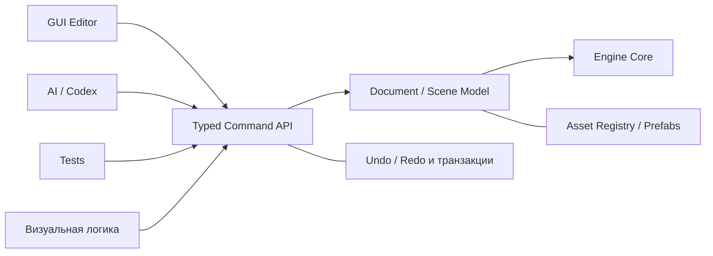

# Слои архитектуры и контракты

Цель AstroEngine — универсальный модульный 2D/3D-движок с графическим редактором, в котором AI-assisted authoring является ключевым рабочим процессом. GUI и AI используют один типизированный Command API и одну модель проекта; AI adapter остаётся необязательной зависимостью для запуска движка/игры, ограничивается разрешениями и не обходит команды. Puzzle сейчас служит проверочным вертикальным срезом, не ограничивает будущие жанры. Это архитектурный ориентир, не утверждение о текущем покрытии функций; текущий фактический статус перечислен ниже. Полная формулировка — [PRODUCT_REQUIREMENTS.md](PRODUCT_REQUIREMENTS.md), контракты AI — [AI_INTEGRATION.md](AI_INTEGRATION.md).

## Локальный AI Editor API (09.1)

Editor integrations могут получить in-process `astro::core::AIEditorApi` поверх существующего `CommandRegistry`. Направление зависимостей остаётся `AI adapter -> typed API -> CommandRegistry -> модель`; каталог схем строится из зарегистрированных команд и стабильно сортируется по ID. `validate` и `execute` используют те же C++ payload, validator, audit и transaction history, что и другие клиенты команд. API не вводит обходной доступ к модели.

Текущая реализация — trusted-library boundary: нет wire protocol, сериализации payload, разрешений, sandbox или подтверждений. Внешний adapter нельзя подключать как endpoint до реализации отдельной проверки разрешений и операций preview/approval по требованиям [AI_INTEGRATION.md](AI_INTEGRATION.md).

## Фактическая структура 00.1

Дополнение 00.2: main.cpp содержит минимальную диагностику уровней `[info]`/`[error]`, разбор --help и обработку ошибочных аргументов/сбоев вывода. Это не Logger/Result из этапа 01. Локальные scripts/verify.ps1 и ProcessRunner.psm1 выполняют проверку с логами, тайм-аутами и JSON-отчётом; .clang-format/.clang-tidy задают правила будущих инструментальных проверок. Запуск процессов и структура отчёта проверены PowerShell-тестами; C++ ещё не собран.

Корневой CMake подключает `engine/runtime` и, при BUILD_TESTING, `tests`. Цель `astro_headless` содержит только main.cpp с информацией о запуске. CTest запускает процесс и проверяет завершение и вывод. Внешних библиотек нет; окно не создаётся. Компиляция и выполнение пока не подтверждены из-за отсутствия toolchain. Это минимальная основа сборки, а не реализация перечисленных ниже контрактов ядра. См. [BUILD_GUIDE.md](BUILD_GUIDE.md).

Статус: документ фиксирует требования раздела 04. Фактическая реализация ядра отмечена в разделе Core; остальные контракты ниже являются планом, пока не подтверждены соответствующими отчётами подэтапов. [Предварительный стек](TECH_STACK.md) проверен только в пределах прототипа 00.3.

## Направление зависимостей

Целевое направление: GUI, визуальная логика и AI должны использовать единый механизм команд для одинаковых действий, согласно P01. Реализованный Inspector вызывает Scene Command API; Visual Logic 06.1 и UI Editor 06.2 пока изолированы и не отправляют команды. AI не изменяет внутреннее состояние сцен в обход команд. Optional Runtime Modules — Rendering, Physics, Audio, UI — подключаются при необходимости через границы подсистем. Core не зависит от GUI и необязательных реализаций.

## Core

Реализованы подэтапы 01.1 и 01.2 в `engine/core`: `EngineContext` владеет `Logger` и `ConfigurationService`; `Result<T>`/`Result<void>` переносят типизированный `Error`. Logger поддерживает severity threshold и внедряемый sink, по умолчанию пишет в `clog`/`cerr`. ConfigurationService загружает и сохраняет простой UTF-8 `key=value` файл с комментариями `#`/`;`, BOM и CRLF; при ошибке разбора прежнее состояние не меняет. Это внутренний ранний формат, не финальный формат проекта/сцен; JSON и миграции здесь не реализованы.

`IEngineModule` задаёт имя, список зависимостей и методы `initialize`/`shutdown`, принимающие общий `EngineContext`. `ModuleRegistry` владеет зарегистрированными модулями через `unique_ptr`, до запуска проверяет имена и граф зависимостей, детерминированно инициализирует зависимости раньше потребителей и завершает в обратном порядке. Пропущенные/дублирующиеся зависимости, самозависимость и цикл возвращают диагностику до запуска. При ошибке инициализации ранее успешно запущенные модули откатываются; при ошибках shutdown обход продолжается, ошибки агрегируются. Модуль обязан сам очистить частичные ресурсы, если его `initialize` завершился ошибкой. После успешного запуска реестр одноразовый; повторный запуск и изменение его состава отклоняются. Планирование `tick` относится к 01.3 и пока не реализовано.

Состав: EngineContext, IEngineModule, ModuleRegistry, EventBus, TimeService, Logger, ConfigurationService, Error/Result и диагностика. Ядро работает без окна.

Подэтап 01.3 добавляет typed EventBus: события различаются типом C++, публикация синхронная, подписки получают монотонные ID; изменение подписок при dispatch безопасно через snapshot, снятая подписка пропускается, добавленная начинает получать события со следующего publish. Исключения callback переводятся в `Result` после вызова остальных подписчиков. EventBus не потокобезопасен.

`TimeService::advance(realDelta)` ограничивает frame delta, считает фиксированные шаги, максимум catch-up шагов и alpha интерполяции; избыточные целые шаги отбрасываются и учитываются в diagnostics. Pause останавливает simulation time и очищает неполный остаток accumulator при включении паузы. Пример игрового цикла: вызвать `advance(frameDelta)`, затем `ModuleRegistry::tick(fixedDeltaSeconds)` ровно `fixedStepCount` раз; renderer может использовать `interpolationAlpha`. `tick` выполняет модули в порядке инициализации, передавая фиксированный delta; ошибка возвращается вызывающему коду, который отвечает за реакцию и shutdown.

Реализованный lifecycle: register → resolve dependencies → init → fixed tick → shutdown. Конфигурация времени и система событий независимы; optional runtime modules могут не использовать EventBus.

## Typed Command API

### Visual Logic prototype (06.1)

`engine/logic` provides an optional C++20 typed dataflow graph and deterministic single-threaded evaluator. The editor exposes a vertical-node-list UI with typed input menus and per-node debugging. It is deliberately isolated from `CommandRegistry` and `Scene`: this prototype cannot mutate a project or gameplay state. Graph persistence, undo, flow-control nodes, runtime bindings, and drag-wire authoring are not implemented. The graph target has no SDL/bgfx/ImGui dependency; the optional editor UI uses the existing editor stack. See [VISUAL_LOGIC.md](VISUAL_LOGIC.md).

### UI Editor prototype (06.2)

`engine/ui` contains an in-memory UI document model with stable element IDs, Panel/Text/Button kinds, Dark/Light preview themes, bounded responsive anchors/offsets, and two validated Scene bindings: `Entity.Name → Text` and `SpriteRenderer.Visible → Visible`. The Editor panel authors these elements and previews Desktop/Tablet/Phone viewports. Binding refresh is read-only with respect to Scene and applies values to the UI document only after all bindings validate. UI documents are not serialized, and the runtime Game UI renderer is not connected to this editor model. See [UI_EDITOR.md](UI_EDITOR.md).

### Timeline and camera editor prototype (06.3)

`astro_runtime_animation` separates scalar `AnimationTrack` and editable `AnimationTimeline` from puzzle rules. The Timeline panel can edit ordered scalar keys, scrub/play/pause and preview the sampled curve. Camera Presets exposes the existing `CameraRig` modes and custom pose controls. Both operate on in-memory preview state: no animated Scene property is changed and no camera image is rendered. Existing `ASTRO_BUILD_PUZZLE_RUNTIME=ON` continues to link the animation target for compatibility; `ASTRO_BUILD_ANIMATION_RUNTIME=ON` can build it without Puzzle. See [TIMELINE_EDITOR.md](TIMELINE_EDITOR.md) and [CAMERA_RIG.md](CAMERA_RIG.md).

Подэтап 01.4 реализует `CommandRegistry` в `engine/core`. `CommandSchema` задаёт ID и положительную версию; template-типы задают точный C++ payload и output; обязательный validator проверяет payload/предусловия, executor получает `EngineContext` и возвращает `Result<Output>`. `validate` выполняет validation-only/dry-run без вызова executor, `execute` повторяет validation непосредственно перед выполнением. Результат, типизированные ошибки и локальные audit entries доступны вызывающему коду. Подробный контракт и пример: [COMMAND_API.md](COMMAND_API.md).

Подэтап 01.5 добавляет `registerTransactionalCommand`: callback собирает apply/undo шаги, а registry применяет их атомарной транзакцией и включает в Undo/Redo history. Обычный `registerCommand` остаётся совместимым для необратимых операций, но после успешной валидации очищает прежнюю историю как undo-barrier до вызова executor. При ошибке применения транзакция откатывает выполненный префикс; ошибка rollback сообщается, а история очищается, чтобы не продолжать с потенциально неверным состоянием. Каждый отдельный apply/undo callback обязан быть атомарным или самокомпенсирующимся. API пока не является сериализуемой/удалённой схемой, не формирует preview diff и не реализует разрешения AI.

Подэтап 02.3 подключает `Scene::entityPropertySchema()` и `registerSceneCommands()`. Реализована команда `entity.set_property` v1 с типизированным payload `(entity ID, property ID, PropertyValue)`; validation проверяет ID сущности, существование/тип свойства, editable flag, requiredness, UTF-8 и ограничения длины/диапазона. Inspector вызывает тот же `CommandRegistry::execute`, что доступен другим потребителям. Сейчас схема сущности включает только редактируемое обязательное `Name` и read-only `ID`. Команда пока non-transactional и является undo barrier; Undo/Redo интеграция относится к 02.4.

Примеры будущих команд:

- scene.create, scene.save;
- entity.create, entity.delete, entity.set_property;
- component.add, component.remove;
- asset.replace, prefab.instantiate;
- checkpoint.create;
- save.configure, save.trigger, save.restore.

save.trigger и save.restore имеют runtime-контекст и ограничения. Не все runtime-действия обратимы: ограничения и возможность Undo должны документироваться отдельно для соответствующих команд. Перечень выше не означает готовность команд или утверждение их payload.

## Scene / ECS

`engine/scene` содержит Scene/Entity с именами и стабильными сериализуемыми ID, parent, обязательный Transform, необязательный SpriteRenderer и список ScriptBehavior references. Astro Scene v5 записывает компоненты и prefab instance map/overrides; загрузчик поддерживает v1–v4, а новые ScriptBehavior bindings проходят validation до публикации Scene.

В редакторе Hierarchy показывает дерево и позволяет создавать root/child entities и удалять выбранное поддерево. Inspector редактирует Name/SpriteRenderer и позволяет добавлять из зарегистрированных bindings, включать/выключать и удалять ScriptBehavior через команды с Undo/Redo; скрипт добавляется выключенным. Полноценное пространственное отображение компонентов и runtime rendering ещё отсутствуют.

Дальнейшая модель должна включать Scene ID, Entity ID, Component type/version, Property schema, hierarchy/parenting, transform, lifetime, validation и serialization.

Начальный перечень компонентов: Transform, Camera, SpriteRenderer, MeshRenderer, Light, Collider, RigidBody, AudioSource, ScriptBehavior, Health, UIBinding. Реализовывать их по мере потребности; не добавлять фиктивные «готовые» компоненты. Astro Scene v6 хранит `ScriptBehavior` и `MeshRenderer`; последний ссылается на стабильный model AssetId из Asset index v3. Scene команды поддерживают добавление, удаление и Undo/Redo компонента. Опциональный `astro_gltf` разрешает MeshRenderer через AssetRegistry и bounded importer, проверяя digest источников и диапазон primitive selection; standalone Windows BGFX smoke может визуализировать одну такую ссылку. Редакторские Scene/Game View и игровой runtime с этим 3D путём ещё не интегрированы; prefab capture отклоняет такую Scene, чтобы не потерять компонент. Headless core остаётся без glTF/BGFX зависимости.

### Пользовательские C# скрипты (требование P15)

Пользовательский код пишется в C# и подключается к runtime через явный `ScriptBehavior` и managed scripting adapter. Ручной Code Editor и C# runtime отделены от core: проекты без скриптов не получают необязательные compiler/host зависимости, а экспортируемая игра не должна содержать Editor. C# API не обходит Scene/Command/permission contracts там, где они применимы.

Выбор compiler, runtime host, binding-механизма и поддержки hot reload отложен до технической оценки кроссплатформенности, лицензий, безопасности, build size/time, отладки и сопровождения. До испытанного sandbox любой проектный скрипт рассматривается как обычный код с правами процесса; AI не запускает изменённый скрипт без preview/approval workflow. Это требования, а не текущая реализация.

В 04.5–04.6 проверен ограниченный Windows x64 prototype: необязательная `astro_runtime_csharp` через `nethost`/`hostfxr` загружает framework-dependent managed assembly и вызывает `UnmanagedCallersOnly` entry point. Versioned ABI v1 даёт callback-доступ к Transform одной сущности runtime Scene; `Scene::setTransform` валидирует запись. Bridge синхронный, действует на вызывающем fixed-step потоке и не раскрывает полную Scene/произвольные свойства. В 04.7 Scene v5 добавил сохраняемый ScriptBehavior binding. В 04.8 общий `.astro/assets.index` v2 использует единый счётчик ID для image/script records. В 04.9 PowerShell 7 CLI собирает source snapshot из `Scripts/` по `.astro/csharp-build.json`, использует пустой NuGet source list, публикует immutable generation и атомарно обновляет build state только при успехе. В 04.10 manifest дополнен явными source/type bindings; builder публикует хешированный `asset-bindings.state`, AssetRegistry проверяет его вместе с manifest, полным набором source files и outputs, а Project panel показывает Missing/Current/Stale/Invalid и позволяет явно синхронизировать bindings. В 04.13 все enabled bindings разрешаются до callbacks, Editor повторно проверяет approval перед каждой уникальной assembly load, затем выполняются `OnCreate`, fixed-step `FixedUpdate` и reverse-order `OnDestroy`. Это не sandbox. Host выключен по умолчанию. Code Editor, managed object state, hot reload, crash containment и платформенная поддержка остаются незавершёнными. .NET 10 остаётся кандидатом; packaging, лицензии, Android/iOS и AOT требуют отдельной проверки. Контракт и ограничения: [CSHARP_SCRIPTING_API.md](CSHARP_SCRIPTING_API.md), [FILE_FORMATS.md](FILE_FORMATS.md); отчёты [04.5](reports/04.5-csharp-runtime-prototype.md), [04.6](reports/04.6-versioned-csharp-runtime-api.md), [04.7](reports/04.7-persistent-script-behavior.md), [04.8](reports/04.8-project-script-asset-registry.md), [04.9](reports/04.9-csharp-project-build.md), [04.10](reports/04.10-csharp-build-registry-diagnostics.md) и [04.13](reports/04.13-csharp-runtime-lifecycle.md).

Подэтап 04.17 уточняет project diagnostics: manifest/build handoff bindings сверяются с AssetRegistry, а несовпадения managed type, source hash и output paths получают отдельные сообщения. Проверка остаётся metadata-only; CLR reflection не выполняется при открытии/обновлении Project panel. Загрузка CLR отложена до явно одобренного Play, поскольку может выполнить module initializer с правами процесса. См. [D082](DECISIONS.md#d082--c-binding-diagnostics-must-not-execute-project-code-0417) и [отчёт 04.17](reports/04.17-csharp-binding-diagnostics.md).

В 04.11 определена граница пользовательского согласия перед Play: подтверждение привязано к проекту/Scene, точному набору enabled ScriptBehavior и текущим build hashes, действует одну Play-сессию и не сохраняет доверие. В 04.12 Editor реализовал этот gate; в 04.13 перед каждой уникальной host-load выполняется повторная сверка, затем вызывается lifecycle. Низкоуровневый `CSharpScriptHost::loadScriptAsset` по-прежнему остаётся доверенным API без собственного consent gate. Editor Inspector теперь авторит ScriptBehavior через транзакционные команды и требует актуальную сборку для включения компонента. Ни consent gate, ни Inspector workflow не являются sandbox: код остаётся внутри процесса с правами пользователя. См. [CSHARP_SCRIPTING_API.md](CSHARP_SCRIPTING_API.md), [AI_INTEGRATION.md](AI_INTEGRATION.md), [04.12](reports/04.12-csharp-editor-approval.md), [04.13](reports/04.13-csharp-runtime-lifecycle.md) и [04.14](reports/04.14-scriptbehavior-editor-authoring.md).

В 04.15 отдельная C# Code workspace открывает и сохраняет UTF-8 source только под project `Scripts/`, хранит dirty state и блокирует переключение проекта с несохранённым текстом. Явная команда сборки запускает существующий локальный PowerShell build pipeline; compiler diagnostics разбираются по source location для перехода к строке. Workspace не реализует syntax highlighting, LSP, debugger, arbitrary shell или execution sandbox. Сборка может не быть доступна, если C# host/локальная SDK-конфигурация отключена. См. [отчёт 04.15](reports/04.15-csharp-code-workspace.md).

## Assets

Состав: AssetRegistry, AssetImporter, AssetReference, DependencyGraph, AssetProcessor; исходные файлы, метаданные и производный кэш. Требуются контроль хэшей, переимпорт, обработка отсутствующих ресурсов и упаковка только используемого.

Исходные ресурсы неизменны; производные данные помещаются в пересоздаваемый кэш. Изменение модели сохраняет ID объекта и ссылки; несовместимые привязки диагностируются. Предусмотреть темы интерфейса и пользовательские UI-шаблоны.

В 03.2 добавлен `astro_assets::AssetRegistry`: project-root `Assets/` — image source root, `.astro/assets.index` хранит общий AssetId и metadata, `Library/Assets` — игнорируемый image cache по SHA-256. В 04.8 index v2 добавляет script source/type и project-local assembly/runtimeconfig references с единым глобальным счётчиком ID; source hash обнаруживает несобранный после правки script. Registry не вызывает compiler. Удалённый/изменённый источник не переписывается автоматически. Панель редактора показывает missing image source; Windows WIC декодирует изображения для preview. PNG/JPEG importer checks остаются структурными и не гарантируют успешного WIC decode. Публичный API и лимиты: [ASSET_PIPELINE.md](ASSET_PIPELINE.md), формат: [FILE_FORMATS.md](FILE_FORMATS.md).

## Prefab

В 03.4 добавлен `astro_prefabs`: project-local `Prefabs/<id>.astro-prefab` хранит дерево с локальными стабильными ID, Transform, SpriteRenderer и вложенными prefab ссылками. `capturePrefab` копирует выбранное поддерево Scene. `instantiatePrefab` проверяет граф и создаёт развернутое дерево; source keys связывают asset nodes с EntityId экземпляра. Overrides Name/Transform/SpriteRenderer записываются в Scene v5, а `updatePrefabInstance` применяет новые базовые значения, сохраняя EntityId и локальные overrides. `ScriptBehavior` пока не является частью prefab asset; захват поддерева с такими компонентами должен быть отклонён, чтобы не потерять их молча. Устаревший source key с override отклоняет обновление, не теряя данные. `prefab.instantiate`, `prefab.set_override`, `prefab.update_instance` зарегистрированы как транзакционные команды с Undo/Redo по полному снимку Scene. Пока нет редакторского UI, variant prefabs, granular conflict merge и истории изменений между пользователями.

## Serialization

Требуются версии схем, миграции, резервные копии и понятные ошибки. Неизвестные данные не удаляются молча; неизвестные компоненты диагностируются. Данные редактора и игры разделяются.

## Runtime и Export

Runtime предусматривает фиксированный шаг симуляции, интерполяцию отображения, паузу и отдельное состояние Play Mode, не повреждающее редактируемую сцену.

Export создаёт самостоятельный runtime с минимальным набором используемых ресурсов. Готовая игра не включает редактор.

В 05.6 добавлен optional Windows x64/MSVC ZIP-пакет только для существующего `astro_game_ui_demo`: exe собирается со статическими SDL3/ImGui, а README и upstream license files попадают в архив рядом. Пакет smoke проверяет распаковку и запуск без cwd/source-tree зависимостей. Это техническая поставка Game UI prototype, не экспорт полной игры и не подтверждение полной приёмки этапа 05; текущие границы перечислены в [отчёте 05.6](reports/05.6.md).

## Границы текущего решения

Save System & Checkpoint Editor — обязательный модуль продукта с явным выбором сохраняемых объектов, компонентов и свойств. Требования к SaveProfile, checkpoint, respawn, хранению и проверкам описаны в [SAVE_SYSTEM.md](SAVE_SYSTEM.md). Автоматическое сохранение всего мира без выбора профиля/правил запрещено. Runtime save/checkpoint реализованы в 05.4–05.5; ограниченный editor authoring и restore preview добавлены в 06.4. Группы и профили пока не сериализуются, а набор доступных полей ограничен Save v1.

Адаптеры рендеринга, физики, звука и импорта должны позволять заменять библиотеки без переписывания ядра. Бинарный ABI, схемы payload, правила владения конкретными объектами и детали миграций пока не определены. Их нельзя считать готовыми контрактами реализации.

## Подэтап 02.1
Добавлен optional astro_editor: окно, docking, меню и project.astro. Подэтап 02.2 добавил минимальную in-memory Scene Model и панели Hierarchy/Scene View; точные границы перечислены выше и в [отчёте](reports/02.2.md).

## Файловая сцена и история (02.4)

В 02.4 `astro::scene::saveSceneFile`/`loadSceneFile` впервые сериализовали Scene/Entity в Astro Scene v1. Текущая версия формата — v3: v2 добавил Transform, v3 — SpriteRenderer/AssetId. Загрузчик читает v1 и v2, полная валидация выполняется до публикации модели; формат описан в [FILE_FORMATS.md](FILE_FORMATS.md). `entity.set_property` и `entity.set_sprite_renderer` транзакционны и используют историю CommandRegistry. Создание/удаление сущностей пока выполняются напрямую моделью и не отменяются; редактор очищает историю при смене/создании сцены.

## Компоненты и Transform (03.1)

Каждая `Entity` содержит обязательный `TransformComponent` версии 1 и может содержать один `SpriteRendererComponent` версии 1 с AssetId и видимостью. `ComponentId` уникален в пределах сцены и сохраняется вместе с сущностью; удалённые ID не переиспользуются в течение жизни сцены. Transform хранит локальные position, Euler rotation и scale; матрицы и пространственная композиция пока не реализованы. Неизвестные типы файла дают ошибку диагностики.

Astro Scene v5 сериализует ID, Transform, SpriteRenderer, prefab instance metadata и ScriptBehavior references. Загрузчик читает v1–v4, а старый файл создаёт v5 при явном сохранении. Формат и миграционное правило: [FILE_FORMATS.md](FILE_FORMATS.md).

## Derived resources и dependency graph (03.5)

`astro_assets` теперь включает явный `AssetDependencyGraph` и детерминированный сбор reachable AssetId в content-addressed `Library/Derived` package. Это слой между registry и будущим export; он не анализирует Scene/Prefab зависимости автоматически, не перекодирует картинки и не считается кроссплатформенным runtime/export.

## Подэтап 04.1 — Runtime Session

Добавлен `astro_runtime_session` и `astro::runtime::RuntimeSession`: Play копирует авторскую Scene, фиксированные callback-шаги изменяют только runtime-копию, Pause останавливает шаги, Step исполняет один шаг и остаётся на паузе, Stop освобождает сессию. Callback error переводит состояние в Faulted. Это headless API, не редакторский Play UI и не готовые игровые системы. Пример и ограничения: [RUNTIME.md](RUNTIME.md).

## Input Mapping (04.2)

`astro_runtime_input` предоставляет action map, independent от оконного backend; bindings принимают keyboard key/scancode, mouse buttons/delta/wheel, gamepad buttons/axes и ведут state/edge flags. `astro_runtime_sdl_input` — optional SDL3 adapter для editor-enabled сборки. Пример, frame ordering и ограничения: [INPUT_MAPPING.md](INPUT_MAPPING.md).

## Camera Rig (04.3)

`astro_runtime_camera` рассчитывает runtime camera pose по target Transform: есть программные presets, follow offset, exponential smoothing, AABB bounds и ограниченный zoom. Он не подключён к renderer и не сериализуется в Scene. API, пример и ограничения: [CAMERA_RIG.md](CAMERA_RIG.md).

## Runtime events and interaction (04.4)

`astro_runtime_interaction` registers programmatic runtime behavior for target entities and publishes sequenced `InteractionEvent` values through the existing typed `core::EventBus`. Request validation covers enabled state, entities, Transform and distance; callback executes against the supplied runtime Scene and reports Activated/Rejected events. Details and example: [INTERACTION_SYSTEM.md](INTERACTION_SYSTEM.md).

## Runtime 2D physics and collision events (05.1)

`astro_runtime_physics2d` binds runtime-only static/dynamic bodies and axis-aligned box colliders to one SceneId. Its caller supplies fixed steps and the runtime Scene; collision enter/stay/exit events use the core EventBus. Solid response is limited to axis positional correction; triggers report overlap without correction. It does not change the serialized Scene component model. Details: [PHYSICS_2D.md](PHYSICS_2D.md).

## Runtime Game UI (05.2)

`astro_runtime_game_ui` owns screen transitions, available menu actions, HUD fields and typed settings independently of rendering. Transitions to gameplay/pause coordinate with `RuntimeSession` and notify through the existing typed EventBus. Optional `astro_runtime_sdl_game_ui` presents the model using SDL3/ImGui and is built separately from Editor. Default headless builds do not link this adapter. Persistence, audio integration and general-purpose game rendering are not included. See [GAME_UI.md](GAME_UI.md).

## Runtime gameplay helpers (05.3)

`astro_runtime_puzzle` provides deterministic match-three rules and scalar keyframe sampling without platform dependencies; it is included when tests are enabled or explicitly requested with `ASTRO_BUILD_PUZZLE_RUNTIME`. When this target exists, Windows Editor links it optionally and Game View can run a built-in Puzzle preview with clickable adjacent-tile selection and fixed-step move resolution. This preview is not a Scene component or a T01 project template. The optional SDL3 audio adapter is built only with the Game UI demo profile and queues short synthesized cue tones. There is no scene-bound animation/audio component or asset playback/mixing; see [PUZZLE_AND_ANIMATION.md](PUZZLE_AND_ANIMATION.md) and [RENDERER_2D.md](RENDERER_2D.md).

## Minimal 2D rendering and Play foundation (06.5 prerequisite)

`astro_runtime_render2d` defines bounded backend-neutral rectangle and sprite commands, layer ordering, and world-to-viewport camera projection. `astro_scene_render2d` composes each visible Scene `SpriteRenderer`'s parent chain as a 2D affine transform (XY translation/scale and Z rotation) and emits transformed texture corners; SDL renders the quad so nested non-uniform scale/rotation shear is retained. The optional SDL3 renderer resolves AssetIds to textures through a caller callback. The Windows sample uses a WIC-backed `SDLImageTextureCache`; other platforms need their own decoder adapter. `astro_2d_playground` loads an Astro Scene and AssetRegistry from an existing project in read-only preview mode, auto-fits visible sprite bounds, and runs `RuntimeSession` on an isolated Scene copy. The Windows Editor also connects this renderer to Scene View and Game View; Game View controls a disposable RuntimeSession copy, but gameplay systems and level persistence remain absent. Details and checks: [RENDERER_2D.md](RENDERER_2D.md).
The Windows Editor's Scene View and Game View consume backend-neutral Canvas2D/SceneSprite commands through a direct bgfx presentation adapter. Each view renders sprite quads into its own sampleable framebuffer, then ImGui samples the attachment; SDL software rendering remains available as a separate runtime adapter. Ordinary Game View Play keeps an isolated RuntimeSession Scene copy and an empty fixed-step callback. Optional `Play Puzzle` instead draws the Puzzle board in Game View and queues selected swaps into the PuzzleGame fixed-step callback. When `astro_runtime_puzzle_save` is present, manual slot save/load persists explicitly selected `puzzle.snapshot` and additional custom values. Each project stores its Puzzle SaveProfile ID/version and a relative user-data subdirectory in `.astro/puzzle-save.settings`; slot payloads remain outside the project under SDL's per-user preference root. 06.18 adds independent `PuzzleLevelDefinition` documents under `Puzzle/Levels`; 06.19 binds authored-level snapshots to `puzzle.level.id` and separates their manual slots per level; 06.20 adds a filesystem catalog with explicit open/duplicate/rename operations and collision checks. These authored level files contain initial cells and rules, not Scene data. The smoke substitutes test-owned directories. Puzzle remains a built-in sample mode, not a general Scene gameplay binding.

## Optional 3D Editor Scene View (07.1f–07.1g)

When the glTF importer is enabled, Scene View adds a depth-tested BGFX pass for visible Scene `MeshRenderer` primitives. GPU geometry is cached per entity/reference and hierarchy transforms are composed before drawing. The editor-only `SceneViewCamera3D` holds orbit pose, clamps user input and exposes right-drag orbit, middle-drag pan, wheel zoom, and Frame All. Frame All derives a world AABB from all eight corners of each cached local mesh AABB after the composed world matrix; invalid or out-of-range mesh bounds are excluded with a diagnostic. The 07.1h Editor smoke renders two valid test meshes alongside one unresolved AssetId and verifies both valid draws continue while the missing reference is diagnosed. It captures the BGFX swapchain and crops the Scene View rectangle in normalized window coordinates to check a coarse bright-pixel minimum. This is a per-run smoke metric, not a committed pixel golden; BGFX only exposes screenshot capture for the OS window framebuffer in this path. The 07.1i benchmark adds per-frame CPU timings for mesh preparation/submission and full Editor frame timing using deterministic 1/100/500/1000-mesh projects. Its BGFX GPU timer spans the whole editor frame and includes the window's VSync behavior; it is not an isolated 3D-pass GPU measurement. The camera module has no GUI/backend dependency. This pass is not connected to Game View or runtime and does not yet render materials, normals, lighting or picking. Windows D3D11 is the only validated backend; see [3D rendering](3D_RENDERING.md#editor-scene-view-mesh-preview-071f), [profile guide](3D_RENDERING.md#editor-3d-frame-profile-071i), [testing](TESTING.md#071i-editor-3d-frame-profile), and [D132](DECISIONS.md#d132--editor-3d-frame-profile-scope-071i).

## Runtime save slots (05.4)

`astro_runtime_save` is an optional Scene-state persistence target. A versioned `SaveProfile` starts empty and explicitly selects individual properties by stable Entity ID; it can also select typed custom string/double/bool keys for caller-owned runtime values. `SaveStore` writes numbered slots using ASTRO_SAVE v1 for Scene-only profiles and v2 when custom values are explicitly supplied, with CRC32 integrity checks, bounded files, atomic replacement and `.bak` fallback. Loading validates before publishing the Scene/custom-state candidates. `astro_save_editor` is editor/test-only authoring: explicit groups flatten into SaveProfile fields; it does not serialize whole scenes or automatically persist anything. Supported fields and limits are in [SAVE_SYSTEM.md](SAVE_SYSTEM.md), [Save System Editor](SAVE_SYSTEM_EDITOR.md), and [FILE_FORMATS.md](FILE_FORMATS.md).

`astro_runtime_puzzle` remains independent of persistence. When both Puzzle and SaveStore are enabled, `astro_runtime_puzzle_save` adapts `PuzzleSnapshot` into one explicitly selected custom string field (`puzzle.snapshot` by default) with payload schema version 1. Its load operation validates on a Scene copy and publishes only after SaveStore and Puzzle snapshot restoration both succeed. The adapter is also built for tests; it does not add implicit save behavior to Play or Editor.

Campaign save transfer remains a separate same-ID operation. The Editor requires a read-only preview and per-operation confirmation. Runtime copies exclusively and records planned artifacts in a bounded recovery journal. Copy and resume hold an exclusive journal lease for their transaction lifetime. Acknowledgement compares the exact journal bytes and artifact inventory, then removes only the leased journal file object/entry; save slot artifacts are never removed or rewritten. Windows coordinates cooperating runtime operations with `LockFileEx` and deletes by handle. POSIX opens the directory/file without following links, takes `flock`, verifies the opened file still matches the directory entry by device/inode, then uses `unlinkat`. Malformed-journal archiving acquires the same source lease after preview classification and retains it while writing and verifying a unique same-directory staging file. Publication is atomic and no-replace: Windows renames the open staged file with `ReplaceIfExists=FALSE`; POSIX creates a hard link at the final name and then removes the staging name. The original malformed journal remains for manual review. A stale staging file from an interrupted process is not trusted or deleted; a later attempt uses a new unique name. A private integration-test seam terminates child processes after a partial write, after verification but before publish, and after publish but before staging cleanup; retries preserve stale bytes and publish/reuse the exact final copy. POSIX directory `fsync` is attempted around publication/cleanup, but platform/filesystem power-loss guarantees still vary; POSIX `flock` is advisory and coordinates only cooperating processes. After interruption, resume revalidates source and destination artifacts; partial/changed/unsafe targets stop without overwrite. Invalid journals are diagnosed without inferring target paths. These operations are not crash-atomic across multiple save files. See [SAVE_SYSTEM.md](SAVE_SYSTEM.md#interrupted-transfer-recovery-0640), [D103](DECISIONS.md#d103--explicit-resume-for-campaign-save-transfers-0641), [D104](DECISIONS.md#d104--preserve-partial-campaign-save-targets-0642), [D105](DECISIONS.md#d105--diagnose-invalid-campaign-transfer-journals-0643), [D106](DECISIONS.md#d106--archive-readable-malformed-campaign-journals-0644), [D107](DECISIONS.md#d107--preserve-malformed-journals-during-archive-0645), [D108](DECISIONS.md#d108--handle-based-valid-recovery-journal-acknowledgement-0646), [D110](DECISIONS.md#d110--cross-platform-campaign-journal-lifecycle-lock-0647), [D111](DECISIONS.md#d111--lock-malformed-journal-archive-0648), [D113](DECISIONS.md#d113--staged-atomic-no-replace-journal-archive-publication-0650), and [D114](DECISIONS.md#d114--subprocess-interruption-tests-for-staged-journal-archive-0651).

06.52 reviewed legacy archive conflicts without changing runtime behavior. The deterministic path and its non-cryptographic fingerprint do not prove that a differing occupant was created by AstroEngine; even a matching byte prefix may be user data. In 06.53, a read-only runtime inspection API reports the deterministic path, no-follow object kind, bounded byte size and comparison category. Windows opens the object with `FILE_FLAG_OPEN_REPARSE_POINT`; POSIX uses `fstatat(..., AT_SYMLINK_NOFOLLOW)` and `openat(..., O_NOFOLLOW)`. The Editor presents these details after an archive conflict and states that inspection changes no files. This is not ownership/provenance verification; no delete, move, truncate, overwrite or archive repair is performed. See [D115](DECISIONS.md#d115--manual-review-of-legacy-conflicting-archive-files-0652), [D116](DECISIONS.md#d116--read-only-diagnostics-for-archive-conflicts-0653), and [06.53 report](reports/06.53-archive-conflict-diagnostics.md).

06.55 implements this workflow after explicit user confirmation. Runtime preview captures the bounded bytes and source identity; confirmation reacquires/holds no-follow handles, revalidates source, recovery journal and destination, then stages and publishes a generated adjacent copy without replacement. The Editor labels the copy as unverified. The original archive occupant, malformed journal and candidate slots remain unchanged, so the conflict still needs manual review. Cancel and preview are read-only. Links/reparse points, directories, other types, unavailable and oversized files remain ineligible. This protects against ordinary races and accidental replacement; it is not a guarantee against arbitrary hostile local writers or power loss. See [D118](DECISIONS.md#d118--explicit-bounded-copy-aside-for-archive-conflicts-0655) and [06.55 report](reports/06.55-conflict-copy.md).

06.56 adds a Unicode parent-path integration fixture and a manual Editor review of the confirmation prompt using only the smoke project's temporary data. The reviewer cancelled the operation; no copy was created, and the smoke exited successfully after checking source/journal/slot preservation. This validates Unicode path handling on the tested Windows and WSL filesystems, not every supported filesystem or platform. The optional `--smoke-inspect-copy-dialog` switch is a test harness path, not part of the editor product workflow. See [06.56 report](reports/06.56-unicode-copy-and-dialog-review.md).

## Runtime checkpoints and respawn (05.5)

`astro_runtime_checkpoint` detects actor XY entry into code-registered 2D AABBs, applies optional runtime conditions, tracks one-shot/repeatable use, and emits typed events. A definition explicitly chooses position-only or a named SaveProfile/slot. Respawn is called by the host game; selected-profile restore is opt-in and the checkpoint spawn position is applied after save-state load. Definitions/runtime state are runtime-only; 06.4 provides an in-memory editor configuration, Transform-based XY preview, and isolated restore test, but no Scene component, physics trigger, rendered trigger, or project persistence. See [SAVE_SYSTEM.md](SAVE_SYSTEM.md).
### Authored Puzzle progress identity (06.19)

The optional Puzzle Save adapter exposes `savePuzzleLevelSnapshot` and `loadPuzzleLevelSnapshot`. The selected custom string field `puzzle.level.id` binds an authored-level snapshot to its safe level ID. Load decodes into a candidate Scene and checks the identity before publishing Scene or Puzzle state. Editor storage further separates level slots under `PuzzleLevels/<ID>` within the project-specific SDL user-data directory. The built-in sample continues using its previous profile and location. This remains a manual SaveStore integration, not a general campaign/progression service.

### Puzzle campaign format (06.22 parser and project-file API)

`astro_runtime_puzzle` exposes a strict v1 campaign parser/serializer, structural validator, project-scoped `PuzzleCampaignFile`, bounded `PuzzleCampaignFile::list` catalog with per-level link diagnostics, pure `resolvePuzzleCampaignTransition`, and `PuzzleCampaignSession`. The Windows Editor exposes **View → Puzzle Campaign Browser** with campaign diagnostics and draft authoring for ID/name, level order, START, score thresholds and DEFAULT/END rules. Saves are confirmed and use the strict project-file writer. `PuzzleLevelFile::rename` refuses to rename a referenced level or proceed when campaign links cannot be verified; update campaign links and save them before renaming. Game View routes input through its fixed-step `RuntimeSession` callback; reaching the authored target presents Continue, and END retains the final board and score. Since 06.31, Game View also offers manual slots 0–9 for the explicitly selected campaign/level/END/snapshot fields. Editor resolves their directory as SDL user-data root + project settings subdirectory + `PuzzleCampaigns/<campaign-id>` through `resolvePuzzleCampaignSaveDirectory`; campaign ID changes select a new namespace, while moved/copied projects carrying the same sidecar retain/share the namespace. No files are migrated or rewritten implicitly. Load validates into a candidate before replacing the session. Autosave and migrations are absent. The system does not load engine Scenes. See [PUZZLE_CAMPAIGNS.md](PUZZLE_CAMPAIGNS.md), [SAVE_SYSTEM.md](SAVE_SYSTEM.md), [06.26 report](reports/06.26-puzzle-campaign-browser.md), [06.27 report](reports/06.27-puzzle-campaign-authoring-rename.md), [06.31 report](reports/06.31-editor-campaign-progress.md), and [06.33 report](reports/06.33-campaign-save-identity.md).

The grammar and policy were initially designed in 06.21; parser and file integration were added in 06.22. No v1 migration is defined.

The project campaign document is separate from level definitions and player saves. It contains an explicit display order, a start level ID, score-threshold branches, and one fallback destination or `END` per level. The full schema and bounds are in [PUZZLE_CAMPAIGNS.md](PUZZLE_CAMPAIGNS.md). This code parses and validates campaign data but does not advance a campaign. Because campaign edges reference stable level IDs, level rename is not safe for referenced IDs until a future operation checks or updates those references.
# Локализация Editor и Game UI

Windows Editor использует внутренний каталог переводов `editor/Localization.*`; SDL Game UI demo использует независимый backend-neutral каталог `GameUiLocalization.*`. Демо хранит `ui.language` как стандартный выбор `en|ru` в GameUiModel и немедленно локализует ImGui-адаптер; значение не персистентно. Системный шрифт Segoe UI/Arial активируется только в русской локали, английский font atlas остаётся прежним. Выбор языка Editor по-прежнему персистентен в пользовательском SDL preference-файле. Неизвестные runtime сообщения сохраняют исходный текст с русской меткой ошибки; сообщения SDL/драйвера внутри исходного текста могут быть английскими. Подробнее: [LOCALIZATION.md](LOCALIZATION.md), [06.28](reports/06.28-editor-russian-localization.md) и [06.29](reports/06.29-runtime-and-diagnostics-localization.md).

## C# Play consent and runtime lifecycle (04.12–04.13)

The Editor captures the enabled ScriptBehavior set against the current Scene, registered AssetRegistry bindings, and a fresh build report. Its confirmation dialog displays project/Scene identity, each entity/component/AssetId/source/type/source hash, build fingerprint, and assembly/runtimeconfig paths and hashes. Approval is ephemeral and compared with a new snapshot on Allow; before every unique host load the runtime invokes the Editor's fresh snapshot gate again. Stop, new Play, project/Scene replacement, and fault revoke consent. After approval, `CSharpScriptRuntime` loads the complete set before invoking callbacks and connects it to `RuntimeSession`: `OnCreate` follows Scene/component insertion order, fixed updates follow the session timestep, and `OnDestroy` runs in reverse order. Startup callback failure rolls back created components and leaves the session stopped. This is an accidental-execution policy only: C# remains trusted in-process code with current process rights, not a sandbox. See [04.12 report](reports/04.12-csharp-editor-approval.md), [04.13 report](reports/04.13-csharp-runtime-lifecycle.md), and [C# API](CSHARP_SCRIPTING_API.md).

# C# metadata inspection and process boundary (04.19 prototype)

The Windows-only metadata-validator CLI runs `System.Reflection.Metadata` outside the Editor CLR. Its bounded request selects managed types from a single staged PE (maximum 64 MiB); the worker validates the three existing ABI v1 entry-point signatures and `UnmanagedCallersOnlyAttribute` without loading the inspected assembly. It runs in a temporary no-capability AppContainer with access only to its copied worker/runtime, selected input, and bounded response folder. A Job Object applies a 512 MiB process-memory limit and kills the worker at the request timeout. Request/response caps remain 16/32 KiB. One worker batch is bounded to 64 types and 8 KiB of UTF-8 type-name bytes; Editor permits up to 256 types in 128 KiB aggregate output. Runtime and worker files are copied for each batch; measured batching reduces process/staging overhead without adding persistent cache state or broader ACL access. See [D086](DECISIONS.md#d086--c-metadata-validation-batch-limits-0421) and [04.21 report](reports/04.21-csharp-metadata-batch-performance.md).

The integration test verifies file and loopback denial on this Windows machine, and a fixture whose module initializer throws proves the assembly is not initialized during metadata inspection. In 04.20 the Project panel invokes the worker only after an explicit user action and only against a fresh build plus registered bindings. The Editor runner accepts canonical outputs beneath `Library/Scripts`, rejects traversal and reparse points, and waits asynchronously; the C# build is disabled during validation. This does not certify all AppContainer/runtime attack surfaces; Microsoft explicitly says the low-level metadata reader is not designed for untrusted input. The existing in-process C# host ABI v1 remains unchanged and trusted-code-only. See [D085](DECISIONS.md#d085--project-panel-c-metadata-diagnostics-0420), [04.20 report](reports/04.20-csharp-project-metadata-diagnostics.md), [D084](DECISIONS.md#d084--windows-c-metadata-validator-worker-prototype-0419), and the [04.18 assessment](reports/04.18-csharp-metadata-isolation-assessment.md).

In 04.21 the Project panel's aggregated text output cap was raised to 128 KiB; truncation remains explicit. The 04.22 smoke checks only that a full-size synthetic report can scroll and that ImGui wrapped-text drawing stays below its broad 250 ms guard. This is not a claim about real-project diagnostic readability or full worker latency; see [D087](DECISIONS.md#d087--04-22-c-metadata-profile-and-large-report-ux).

## POSIX campaign-copy file operations (06.57 assessment)

The current non-Windows campaign archive path uses descriptor-relative operations (`openat`, `fstatat`, `linkat`, `unlinkat`), no-follow flags, inode identity checks, `flock`, and file/directory `fsync`. Apple documents `O_NOFOLLOW` and `O_DIRECTORY`; same-directory hard-link publication atomically creates a new directory entry and requires one filesystem. `flock` is advisory and coordinates cooperating processes only. This establishes API-level plausibility, not macOS build or filesystem validation. Ordinary `fsync` does not promise power-loss durability; stronger `F_FULLFSYNC` is Apple-specific and itself filesystem/device dependent. Before claiming macOS support, run the POSIX integration suite on a supported macOS version and APFS, and record outcomes for directory `fsync`, hard-link publication, Unicode paths, lock contention, and process interruption. Do not strengthen the durability claim from a successful process-interruption test. See [06.57 assessment](reports/06.57-posix-macos-portability-assessment.md) and [D120](DECISIONS.md#d120--macos-posix-copy-aside-portability-assessment-0657).

## 3D subsystem boundaries (07.1 assessment)

The Scene/Transform model remains 2D-oriented and has no 3D mesh component or 3D physics adapter. 07.1a provides backend-neutral camera/projection and indexed mesh data plus an opt-in Windows bgfx/D3D11 cube smoke. 07.1b adds the separate opt-in `astro_gltf` adapter for bounded static glTF/GLB geometry import and a derived cache; it does not modify Scene serialization, AssetRegistry, Editor Scene/Game View, or the default headless build. fastgltf and its helper sources are pinned and validated from an ignored local dependency cache, with upstream CMake downloads disabled. Importer path checks prevent ordinary traversal and link escapes but are not race-safe against a hostile concurrent local writer. See [07.1 assessment](reports/07.1-3d-foundation-assessment.md), [07.1a report](reports/07.1a-3d-camera-mesh-prototype.md), [07.1b report](reports/07.1b-bounded-gltf-importer.md), and [D125](DECISIONS.md#d125--optional-bounded-gltf-static-mesh-importer-071b).
