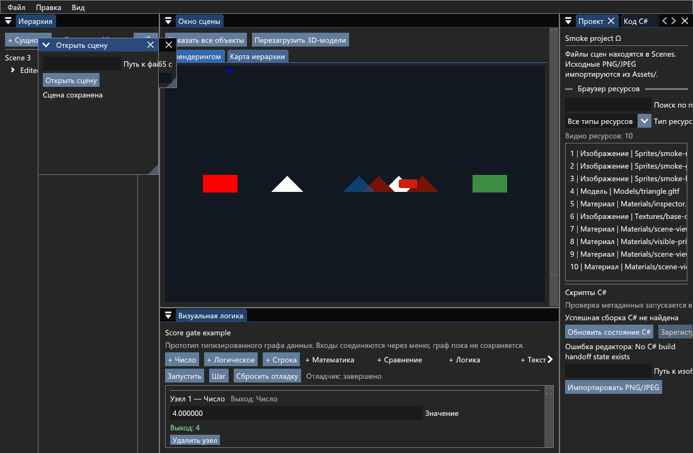

# 07.2bh — видимый project material на встроенном примитиве

## Результат

Добавлен `editor.primitive_material.smoke`. Тест запускает Windows Editor с зарегистрированным project material (base color 0.8/0.12/0.04), назначает его видимому Cube и выводит сцену через текущий BGFX Scene View renderer. Screenshot readback выявил **1 942 красных пикселя** в прямоугольнике Scene View. Последний кадр подтвердил 7 mesh submissions, из которых 5 прошли material/textured draw path; отладочная сцена проверяет 0 mesh diagnostics.



PNG сохранён как визуальное свидетельство. Автоматический тест сохраняет исходный TGA в `build/<preset>/tests/editor-primitive-material/scene-view-materialized-primitive.tga` и проверяет submissions, порог пикселей и файл снимка. Исходные пользовательские материалы и игровые ресурсы не затрагиваются: fixture создаётся внутри временного smoke-проекта.

## Проверка

- Windows x64, MSVC 2022 Release, BGFX D3D11.
- `astro_editor` собран успешно.
- `editor.primitive_material.smoke`: **1/1 passed за 3,23 с**.
- Полный Release CTest: **97 passed, 1 skipped из 98 за 122,55 с**; skipped — `editor.window_mixed_dpi.sdl.smoke`, требующий двух мониторов с разным масштабированием.

```powershell
& $env:ComSpec /s /c '"C:\Program Files (x86)\Microsoft Visual Studio\2022\BuildTools\Common7\Tools\VsDevCmd.bat" -arch=x64 && cmake --build build/07.2d-release-clean --config Release --target astro_editor --parallel 8'
ctest --test-dir build/07.2d-release-clean -C Release --output-on-failure -R "^editor\.primitive_material\.smoke$"
```

## Ограничения

Это был пороговый тест на одном Windows D3D11 backend, а не exact pixel golden. Последующий аудит показал, что красный matcher мог также считать красный 2D fixture marker полного кадра; поэтому исходные 1 942 красных пикселя сами по себе не изолировали вклад Cube. В 07.2bi тест заменён на уникальный жёлтый matcher и проверку material submissions в обоих viewport. Актуальные результаты: [отчёт 07.2bi](07.2bi-primitive-material-game-view.md).
