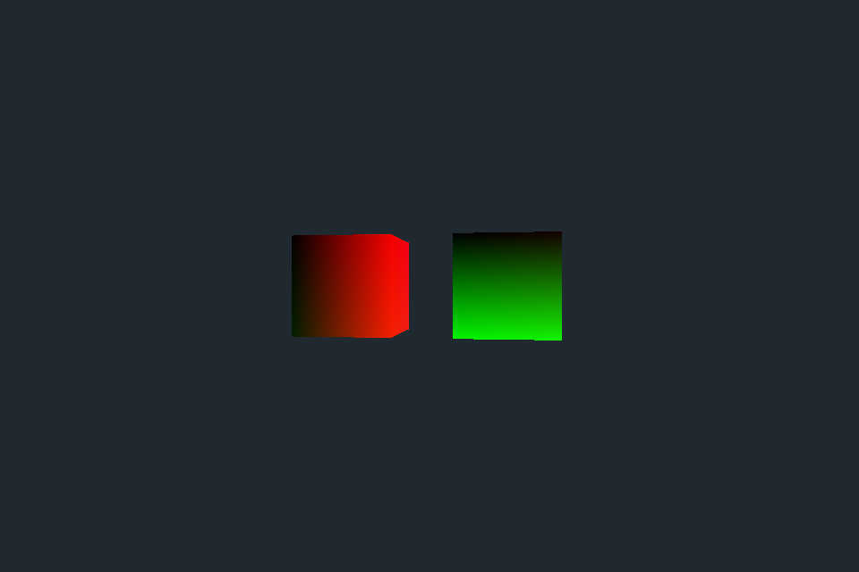

# 07.2bl — Runtime BGFX consumer for Scene render packet

## Результат

Добавлен opt-in `astro_runtime_bgfx_scene3d` adapter в `engine/runtime/adapters/bgfx`.
Он принимает `SceneRenderPacket`, вычисляет view/projection из его Camera3D и
для каждого render item отправляет отдельный BGFX draw с world transform из
Scene. Геометрия переводится в BGFX vertex/index buffers и кэшируется по
content hash и `baseColorFactor`, чтобы одинаковая форма могла повторно
использовать GPU geometry, а разные authored цвета — свои vertex colors.

`MeshData` теперь хранит детерминированный 64-bit content key, покрытый unit
проверкой. Он нужен как локальный ключ кэша и не является криптографическим
хэшем. Cache ограничен 4096 вариантами; renderer должен быть очищен/уничтожен
до `bgfx::shutdown`. BGFX context и program handle принадлежат host.

## Визуальный smoke

Новый `runtime.render3d.scene_packet.bgfx.smoke` строит packet для сцены с двумя
MeshRenderer children под преобразованным parent и активной камерой. Оба items
используют одну геометрию и разные opaque base-color factors. Windows x64
Release/D3D11 результат:

```text
renderer=Direct3D 11 frames=32 draw_calls=3 frame_ms_p50=16.642 frame_ms_p95=17.157
pixel_capture=1 foreground_pixels=29512 color_buckets=15 bounds=326,259-627,380
runtime_packet_items=2 runtime_packet_diagnostics=0 runtime_items_submitted=2
runtime_gpu_mesh_cache=2 runtime_packet_valid=1 runtime_screenshot_saved=1
```

Screenshot показывает сцену из двух цветных объектов. Pixel smoke проверяет
видимую foreground область и границы, но не exact golden pixels. Итоговый PNG
в этом отчёте получен из TGA capture без редактирования изображения.



## Точные команды

PowerShell Developer x64, MSVC 2022:

```powershell
cmake -S . -B build/07.2d-release-clean -DASTRO_BUILD_STACK_SPIKE=ON -DASTRO_BUILD_RENDER3D_BGFX_SMOKE=ON -DASTRO_BUILD_RUNTIME_BGFX_3D=ON -DASTRO_BUILD_GLTF_IMPORTER=ON -DASTRO_BUILD_EDITOR=ON -DBUILD_TESTING=ON
cmake --build build/07.2d-release-clean --config Release --parallel 8
ctest --test-dir build/07.2d-release-clean -C Release --parallel 1 --output-on-failure -R "^runtime\.render3d\.scene_packet\.bgfx\.smoke$"
ctest --test-dir build/07.2d-release-clean -C Release --parallel 1 --output-on-failure
```

Фактически выполненная полная сборка прошла. Новый focused CTest прошёл, а
полный Release CTest: **100 passed, 1 skipped из 101 за 126,36 с**. Штатный
пропуск — `editor.window_mixed_dpi.sdl.smoke`, поскольку в среде нет пары
мониторов с нужным различием масштаба. Ранее выведенные предупреждения MSVC
C4530/C4189/C4244 остаются; сборка завершилась с кодом 0.

## Ограничения и следующий этап

Поддерживаются vertex colors и opaque `baseColorFactor`. Texture maps,
alpha blend/mask, освещение, нормали в shader, metallic/roughness, batching,
динамическая синхронизация изменяемой геометрии и другие BGFX backends не
поддерживаются. Adapter не создаёт SDL window, не управляет runtime session,
не переключает Editor в Play и не интегрирован в общий Game View.

Следующий рекомендуемый подэтап — связать adapter с runtime Play session/window
и добавить end-to-end старт проекта в Play с render packet. Не начинать до
ручного подтверждения пользователя.

## Изменённые области

`CMakeLists.txt`, `engine/render3d/MeshData.*`,
`engine/runtime/adapters/bgfx/*`, `samples/3d_prototype/*`,
`tests/unit/runtime/CameraMesh3DTests.cpp` и документация проекта. Исходные
пользовательские игровые ресурсы не менялись. Предыдущие dirty/untracked файлы
оставлены без очистки; коммит и push не выполнялись.
